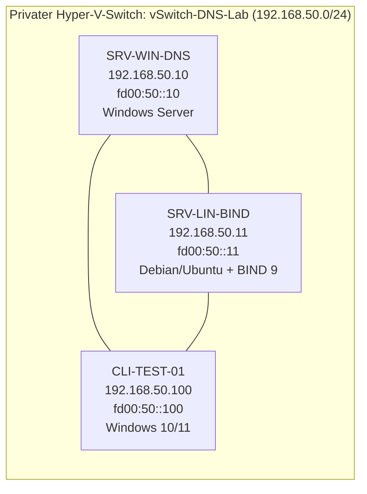
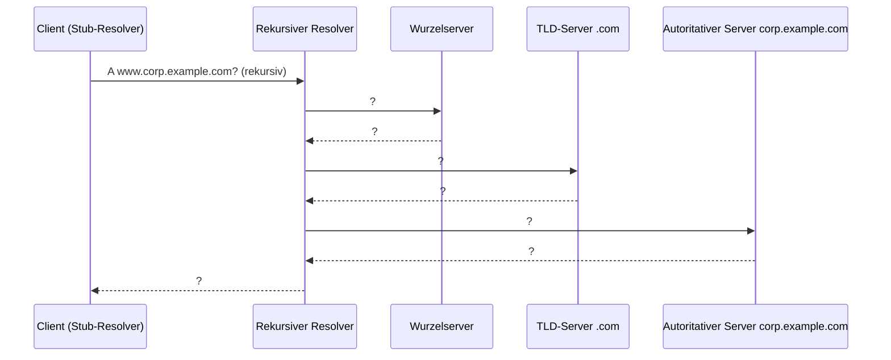

# 01.1 Namensauflösung und DNS-Architektur

| | |
|---|---|
| **Modul** | 01 Grundlagen der Namensauflösung und DNS-Architektur |
| **Stufe** | Grundlagen |
| **Geschätzte Zeit** | 6 bis 8 Stunden (Schätzung; der Lehrplan nennt 8 UE zu 45 Minuten, also 6 Stunden) |
| **Werkzeuge** | Hyper-V, Windows Server 2022/2025, Debian 12 oder Ubuntu Server 24.04, Windows 10/11 Enterprise, PowerShell 5.1, `dig` |
| **Vorwissen** | IP-Adressen, Subnetze, OSI-Modell, Grundbedienung von Windows- und Linux-Kommandozeile |

> [!WARNING]
> **Stand der Prüfung: Entwurf.** Die Linux-Befehle und die Beispielausgaben unter `beispiele/` wurden auf Ubuntu 24.04 mit BIND 9.18.39 real ausgeführt, **nicht** in einer Hyper-V-VM mit Debian 12 und nicht mit `systemd`. Die beiden PowerShell-Skripte wurden mit PowerShell 7.4.6 auf Linux auf Syntaxfehler geprüft, ihre Dateilogik (Eintragen, Doppelt-Eintragen, Entfernen) mit einer Testdatei ausgeführt. **Auf Windows wurde nichts ausgeführt.** Alle Windows-Ausgaben in dieser Übung sind sinngemäß und als *nicht bestätigt* gekennzeichnet.

## Lernziele

Nach dieser Übung kannst du

- erklären, wie sich die Namensauflösung von der `hosts`-Datei zum hierarchischen DNS (RFC 1034, RFC 1035) entwickelt hat,
- die Reihenfolge der Namensauflösung unter Windows (Cache, `hosts`, DNS-Server) und Linux (`nsswitch.conf`) nachvollziehen und mit Werkzeugen belegen,
- den DNS-Namensraum (Wurzel, TLD, Zone, FQDN, Längengrenzen) beschreiben und reservierte Namen für Übungen sicher wählen,
- Stub-Resolver, rekursiven Resolver und autoritativen Server unterscheiden und eine rekursive Auflösung Schritt für Schritt zeichnen,
- eine DNS-Antwort lesen: Header-Flags (`QR`, `AA`, `TC`, `RD`, `RA`), Antwortcodes (`NOERROR`, `NXDOMAIN`, `SERVFAIL`, `REFUSED`), UDP und TCP, EDNS(0),
- ein isoliertes Labor aus drei VMs aufbauen, das alle folgenden Module nutzen.

## Voraussetzungen

- Ein Hyper-V-Host mit etwa 12 GB freiem Arbeitsspeicher für die drei VMs (4 + 2 + 4 GB laut Lehrplan, im Zweifel weniger zuteilen) und etwa 130 GB Plattenplatz (dynamische VHDX).
- ISO-Dateien: Windows Server 2022 oder 2025 (Evaluationsversion), Debian 12 oder Ubuntu Server 24.04, Windows 10/11 Enterprise (Evaluationsversion).
- Grundkenntnisse in PowerShell und in der Linux-Kommandozeile (`ip`, `nano`, `systemctl`).
- **Wichtig:** Das Labor läuft auf einem **privaten Hyper-V-Switch ohne Verbindung zum Heimnetz oder Host**. Es berührt keinen produktiven DNS-Server. Die Linux-Pakete (`bind9`, `bind9utils`, `bind9-dnsutils`, `tcpdump`) installierst du **vor** dem Trennen vom Internet (siehe Teil 0, Schritt 5) oder von einem DVD-ISO.

## Grundbegriffe

| Begriff | Bedeutung |
|---|---|
| **hosts-Datei** | Lokale Tabelle „Name → Adresse“ (Windows: `C:\Windows\System32\drivers\etc\hosts`, Linux: `/etc/hosts`). Vorläufer des DNS (`HOSTS.TXT`). |
| **Stub-Resolver** | Der einfache Resolver im Betriebssystem eines Clients. Er stellt die Frage an einen konfigurierten DNS-Server und wartet auf die fertige Antwort. |
| **Rekursiver Resolver** | Server, der die Auflösung stellvertretend durchführt (Wurzel → TLD → Zone) und das Ergebnis zwischenspeichert (Cache). |
| **Autoritativer Server** | Server, der die Daten einer Zone selbst besitzt und mit dem Flag `AA` antwortet. |
| **Zone** | Verwaltungseinheit im Namensraum: ein Teilbaum, der von einem Server (oder einer Servergruppe) verwaltet wird. |
| **FQDN** | Vollständig qualifizierter Name mit Punkt am Ende (`www.corp.example.com.`). Der letzte Punkt steht für die Wurzel. |
| **Label** | Ein Namensteil zwischen zwei Punkten, höchstens 63 Zeichen. |
| **Delegation** | Verweis (NS-Einträge) von einer Zone auf die Server der Unterzone. |
| **Rekursive / iterative Abfrage** | Rekursiv: „Löse das für mich komplett auf.“ Iterativ: „Sag mir, wen ich als Nächsten fragen soll.“ |
| **EDNS(0)** | Erweiterung (RFC 6891), unter anderem für UDP-Antworten über 512 Byte. |
| **NXDOMAIN / NODATA** | Der Name existiert nicht / der Name existiert, aber nicht mit dem gefragten Typ. NODATA ist keine eigene Statusmeldung, sondern `NOERROR` ohne Antworteinträge. |

## Testumgebung und Adressplan

Drei VMs an einem privaten Switch. Alle Namen und Domänen sind für Beispiele reserviert (RFC 2606) oder privat.

<!-- tikz:topologie -->


| Gerät | Rolle (ab Modul) | IPv4 | IPv6 | DNS-Server in Modul 1 |
|---|---|---|---|---|
| SRV-WIN-DNS | Windows-DNS-Server (ab Modul 2) | 192.168.50.10/24 | fd00:50::10/64 | keiner |
| SRV-LIN-BIND | BIND-Server (ab Modul 3) | 192.168.50.11/24 | fd00:50::11/64 | keiner |
| CLI-TEST-01 | Testclient | 192.168.50.100/24 | fd00:50::100/64 | keiner |

Kein Standardgateway, kein DHCP: Die Adressen sind fest vergeben. Die Servernamen sind absichtlich ohne Erweiterung gewählt; die Übungszonen heißen `corp.example.com`, `branch.example.org` und `lab.internal`.

## Aufgabe

Jeder Schritt steht, wo es zwei Wege gibt, grafisch (GUI) und per Kommandozeile. PowerShell-Befehle laufen in einer PowerShell **als Administrator**, Linux-Befehle als `root` oder mit `sudo`.

### Teil 0: Testumgebung aufbauen

**1. Privaten Switch anlegen und die VMs anschließen**

- **GUI:** Hyper-V-Manager → *Manager für virtuelle Switches* → *Neuer virtueller Netzwerkswitch* → Typ *Privat* → Name `vSwitch-DNS-Lab`. In den Einstellungen jeder VM unter *Netzwerkadapter* diesen Switch wählen.
- **PowerShell** (auf dem Hyper-V-Host):

```powershell
New-VMSwitch -Name 'vSwitch-DNS-Lab' -SwitchType Private
Connect-VMNetworkAdapter -VMName 'SRV-WIN-DNS','SRV-LIN-BIND','CLI-TEST-01' -SwitchName 'vSwitch-DNS-Lab'
```

**2. Windows-VMs benennen und Adressen setzen (SRV-WIN-DNS und CLI-TEST-01)**

- **GUI:** *Einstellungen* → *System* → *Info* → *Diesen PC umbenennen*. Danach *Netzwerkverbindungen* → Adapter → *Eigenschaften* → *Internetprotokoll Version 4* und *Version 6*: feste Adresse, Präfixlänge, **kein** Gateway, **kein** DNS-Server eintragen.
- **PowerShell** (Beispiel SRV-WIN-DNS; der Adaptername kann abweichen, `Get-NetAdapter` zeigt ihn):

```powershell
Rename-Computer -NewName 'SRV-WIN-DNS' -Restart
```

Nach dem Neustart:

```powershell
New-NetIPAddress -InterfaceAlias 'Ethernet' -IPAddress 192.168.50.10 -PrefixLength 24
New-NetIPAddress -InterfaceAlias 'Ethernet' -IPAddress fd00:50::10 -PrefixLength 64
```

Auf CLI-TEST-01 entsprechend mit `CLI-TEST-01`, `192.168.50.100` und `fd00:50::100`.

**3. Ping zulassen (beide Windows-VMs)**

Windows blockiert eingehende Echoanfragen standardmäßig. Ohne Regel schlägt `ping` zu Windows fehl, obwohl das Netz in Ordnung ist. Eine sprachunabhängige Regel für das Labor:

```powershell
New-NetFirewallRule -DisplayName 'Labor ICMPv4 Echo' -Direction Inbound -Protocol ICMPv4 -IcmpType 8 -Action Allow
New-NetFirewallRule -DisplayName 'Labor ICMPv6 Echo' -Direction Inbound -Protocol ICMPv6 -IcmpType 128 -Action Allow
```

Die Regeln gehören nur ins Labor. Sie werden im Abschlussmodul wieder entfernt (siehe „Aufräumen“).

**4. Linux-VM benennen und Adressen setzen (SRV-LIN-BIND)**

```bash
sudo hostnamectl set-hostname srv-lin-bind
ip -br link                   # Namen der Netzwerkkarte ablesen, auf Hyper-V meist eth0
```

- **Ubuntu Server 24.04 (netplan):** Datei `/etc/netplan/60-dns-lab.yaml` anlegen. Falls es schon eine Datei mit DHCP für dieselbe Karte gibt (z. B. von der Installation), diese Karte dort entfernen oder die Datei ersetzen.

```yaml
network:
  version: 2
  ethernets:
    eth0:
      dhcp4: false
      dhcp6: false
      addresses:
        - 192.168.50.11/24
        - fd00:50::11/64
```

```bash
sudo chmod 600 /etc/netplan/60-dns-lab.yaml
sudo netplan try              # 120 Sekunden Zeit zum Bestätigen, setzt bei Fehler zurück
```

- **Debian 12 (ifupdown):** Datei `/etc/network/interfaces.d/dns-lab` anlegen und die Karte in `/etc/network/interfaces` nicht doppelt auf `dhcp` stehen lassen.

```text
auto eth0
iface eth0 inet static
    address 192.168.50.11/24
iface eth0 inet6 static
    address fd00:50::11/64
```

```bash
sudo systemctl restart networking
```

**5. Pakete installieren, solange noch Netz da ist**

Mit einem kurzzeitigen Zugang (zweiter Adapter an einem externen Switch, den du danach entfernst) oder vom DVD-ISO:

```bash
sudo apt update
sudo apt install -y bind9 bind9utils bind9-dnsutils bind9-doc tcpdump
sudo systemctl disable --now bind9 || sudo systemctl disable --now named     # BIND erst in Modul 3 benutzen (je nach Version heißt die Einheit bind9 oder named)
```

Danach den Zusatzadapter entfernen, die VM herunterfahren und einen **Snapshot** `m01-start` machen (Hyper-V: *Prüfpunkt*). Dasselbe auf den Windows-VMs.

> [!NOTE]
> Unter Debian/Ubuntu heißt der Dienst `named`, auf manchen Versionen `bind9`; `named` ist ein Alias. Die Pakete `bind9-dnsutils` (bei Ubuntu 24.04 nötig für `dig`) und `dnsutils` sind verwandt, der Paketname hängt von der Version ab.

**6. Verbindung prüfen**

- **Windows (CLI-TEST-01):**

```powershell
ping 192.168.50.10
ping 192.168.50.11
ping -6 fd00:50::10
```

- **Linux:** Das Prüfskript `01.1-labor-pruefen.sh` zeigt Adressen, Namen und Erreichbarkeit der beiden anderen VMs. Es ändert nichts.

```bash
bash 01.1-labor-pruefen.sh
```

Alle Zeilen sollen mit `OK` beginnen. Der Eintrag zu `/etc/hosts` am Ende soll noch leer sein.

### Teil 1: Reihenfolge der Namensauflösung und die hosts-Datei

*(Lerneinheit 1.1, Praxisaufgaben 2 und 3 des Lehrplans)*

**1. Zwei Einträge in die hosts-Datei von CLI-TEST-01 schreiben**

Ziel: `winserver.corp.example.com` → `192.168.50.10` und `linserver.corp.example.com` → `192.168.50.11`.

- **GUI:** Notepad **als Administrator** öffnen → Datei `C:\Windows\System32\drivers\etc\hosts` (Dateityp *Alle Dateien*) → zwei Zeilen anfügen → speichern.
- **PowerShell** mit dem Skript (setzt eine Markierung `# dns-uebung-01.1`, damit das Aufräumen exakt nur diese Zeilen findet):

```powershell
Set-ExecutionPolicy -Scope Process -ExecutionPolicy RemoteSigned
.\01.1-hosts-eintragen.ps1 -WhatIf     # zeigt nur, was passieren würde
.\01.1-hosts-eintragen.ps1
```

**2. Auflösung mit vier Werkzeugen vergleichen (CLI-TEST-01)**

```powershell
ping winserver.corp.example.com
Resolve-DnsName winserver.corp.example.com
nslookup winserver.corp.example.com
ipconfig /displaydns
```

Notiere für jedes Werkzeug: Wurde der Name aufgelöst? Mit welchem Ergebnis? Wurde ein DNS-Server befragt?

Erwartet (*sinngemäß, nicht bestätigt*): `ping` meldet `winserver.corp.example.com [192.168.50.10]` und antwortet, wenn die Regel aus Teil 0 gesetzt ist. `Resolve-DnsName` liefert einen A-Eintrag mit `192.168.50.10` aus der `hosts`-Datei (die Quelle steht nicht in der Ausgabe). `nslookup` findet **nichts**: Es umgeht die `hosts`-Datei, fragt direkt einen DNS-Server ab, und in Modul 1 ist noch keiner konfiguriert. Daher meldet es, dass kein Standardserver verfügbar ist oder die Anfrage in eine Zeitüberschreitung läuft. `ipconfig /displaydns` zeigt Einträge, die aus der `hosts`-Datei in den Cache geladen wurden.

Dann derselbe Test mit zwei Schaltern von `Resolve-DnsName`:

```powershell
Resolve-DnsName winserver.corp.example.com -NoHostsFile
Resolve-DnsName winserver.corp.example.com -DnsOnly
```

Erwartet (*nicht bestätigt*): Beide Aufrufe liefern keinen Treffer bzw. einen Fehler, weil sie die `hosts`-Datei überspringen bzw. nur DNS (kein LLMNR, kein NetBIOS) benutzen. Damit ist belegt, dass der Treffer zuvor aus der `hosts`-Datei kam.

**3. Dasselbe unter Linux (SRV-LIN-BIND)**

Reihenfolge der Quellen nachsehen und einen Eintrag testen:

```bash
grep '^hosts:' /etc/nsswitch.conf
echo '192.168.50.11 hosttest.corp.example.com   # dns-uebung-01.1' | sudo tee -a /etc/hosts
getent hosts hosttest.corp.example.com
dig hosttest.corp.example.com +short
```

Erwartet (so auf Ubuntu 24.04 gemessen): `hosts:  files dns` (auf Servern mit `mdns4_minimal` kann die Zeile länger sein). `getent hosts` gibt `192.168.50.11   hosttest.corp.example.com` aus, weil es `nsswitch.conf` befolgt. `dig` gibt **nichts** aus, weil es die `hosts`-Datei nie liest: Es fragt immer einen DNS-Server. (Ohne konfigurierten Server fragt `dig` den Eintrag aus `/etc/resolv.conf`.)

**4. Aufräumen, damit Modul 2 nicht verfälscht wird**

Die Einträge dürfen nicht stehen bleiben: Sonst wird ab Modul 2 jede Namensauflösung durch die lokale Datei überdeckt und die Tests belegen nichts mehr.

- **Windows:** `.\01.1-hosts-aufraeumen.ps1 -WhatIf`, dann ohne `-WhatIf`. Es sichert die Datei als `hosts.bak-uebung`, entfernt nur Zeilen mit der Markierung und leert den Cache (`Clear-DnsClientCache`, entspricht `ipconfig /flushdns`).
- **Linux:**

```bash
sudo sed -i '/dns-uebung-01.1/d' /etc/hosts
grep -n 'dns-uebung-01.1' /etc/hosts || echo "sauber"
```

Prüfung auf CLI-TEST-01: `Get-Content C:\Windows\System32\drivers\etc\hosts | Select-String 'dns-uebung'` darf nichts ausgeben.

### Teil 2: Der DNS-Namensraum und seine Grenzen

*(Lerneinheit 1.2)*

**1. Namen zerlegen**

Zerlege jeden Namen in Labels, benenne die Wurzel, die TLD und den Zonenbereich, und schreibe den FQDN mit abschließendem Punkt:

| Name | Labels | TLD | FQDN |
|---|---|---|---|
| `www.corp.example.com` | | | |
| `linserver.branch.example.org` | | | |
| `srv01.lab.internal` | | | |

**2. Längen berechnen**

Ein Label hat höchstens 63 Zeichen, ein ganzer Name höchstens 255 Byte in der Übertragungsform (Längenbyte vor jedem Label, plus ein Null-Byte für die Wurzel). Berechne die Übertragungslänge von `www.corp.example.com.` und begründe, warum die längste Textform 253 Zeichen hat.

**3. Die Grenze testen (Linux)**

```bash
L=$(printf 'a%.0s' $(seq 1 64))
dig "$L.example.org" A
```

Erwartet (so gemessen): `dig` bricht ab, bevor es eine Anfrage sendet: `'aaaa…aaa.example.org' is not a legal name (label too long)`.

**4. Reservierte Namen für das Labor**

Prüfe, warum die Labornamen sicher sind:

- `example.com`, `example.net`, `example.org` sowie die TLDs `.example`, `.test`, `.invalid`, `.localhost` sind in RFC 2606 für Beispiele und Tests reserviert. Sie tauchen nie im öffentlichen DNS auf.
- `lab.internal`: `.internal` steht **nicht** in RFC 2606. Nach meinem Kenntnisstand hat ICANN die TLD `.internal` 2024 für die private Verwendung reserviert (Beschluss des ICANN-Vorstands). *Bitte gegen die ICANN-Quelle prüfen, bevor du das zitierst; der Lehrplan nennt nur „reservierte Namensräume“.*
- Warum ist `.local` für ein Unternehmensnetz ungeeignet? (Hinweis: mDNS, RFC 6762.)

**5. Wurzelserver ansehen**

Auf SRV-LIN-BIND liegt die Liste der Wurzelserver als Datei:

```bash
ls -l /usr/share/dns/root.hints
grep -c ' A ' /usr/share/dns/root.hints
```

Zähle die Wurzelserver (A bis M) und schreibe auf, was ein DNS-Server mit dieser Datei macht. Die Datei kommt aus dem Paket `dns-root-data`; der Pfad kann je nach Version abweichen.

### Teil 3: Rollen im DNS und die rekursive Auflösung

*(Lerneinheit 1.3)*

**1. Rollen zuordnen**

Trage ein, welche Rolle jedes Gerät einnimmt, sobald in den Modulen 2 und 3 die Server laufen:

| Gerät | Stub-Resolver | Rekursiver Resolver | Autoritativ für |
|---|---|---|---|
| CLI-TEST-01 | | | |
| SRV-WIN-DNS | | | |
| SRV-LIN-BIND | | | |

**2. Ablauf zeichnen**

Zeichne (Papier oder Mermaid) die rekursive Auflösung von `www.corp.example.com` durch einen rekursiven Server mit leerem Cache. Vorlage zum Ausfüllen:



Ersetze jedes `?` durch die Frage bzw. die Antwort („Verweis auf …“, „Adresse …“). Markiere, welche Abfragen iterativ und welche rekursiv sind.

**3. Delegation erklären**

Erkläre in zwei Sätzen: Warum fragt der Wurzelserver nicht selbst nach `www.corp.example.com`, sondern verweist nur weiter? Welcher Eintragstyp trägt den Verweis?

### Teil 4: Antworten lesen: Flags, Antwortcodes, UDP und TCP

*(Lerneinheit 1.4)*

Im Ordner `beispiele/` liegen sieben Mitschnitte von `dig`. Sie stammen aus einer **Testumgebung**, nicht aus deinem Labor, damit du den Aufbau der Antworten kennst, bevor du eigene Server hast. Ab Modul 3 erzeugst du dieselben Antworten selbst und vergleichst.

| Datei | Frage |
|---|---|
| `01-noerror-autoritativ.md` | `branch.example.org` SOA an den Server |
| `02-nxdomain.md` | Name, den es nicht gibt |
| `03-nodata.md` | Name, den es gibt, aber Typ AAAA gibt es nicht |
| `04-servfail-extern.md` | externer Name, der Server hat keinen Weg ins Internet |
| `05-tc-ohne-edns.md` | große Antwort über UDP ohne EDNS (512 Byte) |
| `06-per-tcp.md` | dieselbe Frage über TCP |
| `07-refused-acl.md` | Anfrage von einer Adresse, die der Server nicht bedienen darf |

**1. Tabelle ausfüllen**

Lies aus jeder Datei die Zeilen `status:` und `flags:` und das Transportprotokoll (`SERVER: … (UDP)` bzw. `(TCP)`) ab:

| Datei | status | flags | ANSWER | UDP/TCP | Bedeutung in einem Satz |
|---|---|---|---|---|---|
| 01 | | | | | |
| 02 | | | | | |
| 03 | | | | | |
| 04 | | | | | |
| 05 | | | | | |
| 06 | | | | | |
| 07 | | | | | |

**2. Fragen**

1. In welchen Dateien steht `aa`, und warum nicht in allen?
2. Was unterscheidet Datei 02 (NXDOMAIN) von Datei 03 (NODATA)? Welche Zeile im Abschnitt `AUTHORITY` hilft zu erkennen, wie lange ein Resolver das Ergebnis behalten darf (Hinweis: Minimum-TTL im SOA, RFC 2308)?
3. In Datei 05 steht `tc`. Wie viele Antworteinträge sind enthalten, und wie viele hätte die vollständige Antwort? Wie verhält sich ein Client daraufhin?
4. In Datei 06 steht in der Zeile `EDNS` eine Zahl. Welche, und was bedeutet sie?
5. Datei 07 zeigt im Abschnitt `OPT` eine Zeile `EDE`. Was meldet sie?

**3. Eigene Abfragen (ab Modul 2 möglich)**

Sobald die Server laufen, wiederholst du von CLI-TEST-01:

```powershell
Resolve-DnsName -Name branch.example.org -Type SOA -Server 192.168.50.11
Resolve-DnsName -Name branch.example.org -Type SOA -Server 192.168.50.11 -TcpOnly
```

## Hintergrund: Was passiert beim Auflösen?

### Von HOSTS.TXT zum DNS

In den Anfangsjahren des Netzes lag eine einzige Datei (`HOSTS.TXT`) bei einer zentralen Stelle, und jeder Rechner holte sie ab. Das skaliert nicht: Änderungen kommen zu spät, Namen kollidieren, die Last steigt. RFC 1034 und RFC 1035 ersetzen die Datei durch einen verteilten, hierarchischen Dienst mit Delegation und Zwischenspeicherung. Die `hosts`-Datei gibt es weiter, für Ausnahmen und als Rückfall.

### Reihenfolge am Client

Unter Windows prüft der DNS-Client nacheinander seinen Cache, die `hosts`-Datei und erst dann die konfigurierten DNS-Server (so beschreibt es Microsoft in der Fehlersuche zur Namensauflösung). Unter Linux bestimmt `/etc/nsswitch.conf` in der Zeile `hosts:` die Quellen; `files dns` heißt: erst `/etc/hosts`, dann DNS. Programme, die die Systemfunktionen benutzen (`ping`, Browser, `getent`), folgen dieser Reihenfolge. Reine DNS-Werkzeuge (`dig`, `nslookup`) fragen dagegen direkt einen DNS-Server und ignorieren die `hosts`-Datei.

### Rollen und Delegation

Der Stub-Resolver im Client fragt einen rekursiven Server. Dieser kennt die Wurzelserver (Root Hints), fragt dort nach und folgt den Verweisen (NS-Einträge) über die TLD bis zum autoritativen Server der Zone. Alle Zwischenergebnisse landen für die Dauer der TTL im Cache.

### Transport und Antwort

DNS benutzt normalerweise UDP auf Port 53. Wird die Antwort zu groß, setzt der Server das Flag `TC` (truncated), und der Client wiederholt die Anfrage über TCP auf Port 53. Mit EDNS(0) (RFC 6891) kündigt der Client an, wie große UDP-Antworten er annimmt; die Testumgebung zeigt `udp: 1232`. TCP wird außerdem für Zonenübertragungen (Modul 6) benutzt.

## Hinweise

- Nach jedem Snapshot-Zurücksetzen prüfen, ob die Uhrzeit der VMs stimmt (bei späteren Modulen wichtig für TSIG und Kerberos).
- Kopiere keine Befehle mit typografischen Anführungszeichen aus dem Text; das gilt für Skripte und für `hosts`.
- Wenn `ping` zu Windows trotz Regel nicht antwortet: Netzwerkprofil der Karte mit `Get-NetConnectionProfile` ansehen; die Regel gilt für alle Profile, solange sie nicht eingeschränkt wurde.
- Antivirenprogramme warnen manchmal bei Änderungen an der `hosts`-Datei (*nicht bestätigt*). Das Skript ändert nur die Zeilen mit der Markierung.

## Prüfbefehle

Zustand am Ende von Modul 1:

```powershell
# CLI-TEST-01
ping 192.168.50.10; ping 192.168.50.11
Get-Content C:\Windows\System32\drivers\etc\hosts | Select-String 'dns-uebung'    # keine Ausgabe
Get-DnsClientServerAddress -InterfaceAlias 'Ethernet'                           # keine Server eingetragen
```

```bash
# SRV-LIN-BIND
bash 01.1-labor-pruefen.sh
systemctl is-enabled named || true       # disabled
```

**Kontrollfragen**

1. Warum verwendet das DNS-Protokoll im Regelfall UDP auf Port 53 für Standardabfragen, und in welchen Fällen weicht ein Client oder Server zwingend auf TCP Port 53 aus?
2. Welche Bedeutung haben die Header-Flags `RD`, `RA` und `AA` in einer DNS-Nachricht?
3. Worin unterscheidet sich das Verhalten von `nslookup` gegenüber `ping` oder `Resolve-DnsName`, wenn ein Hostname ausschließlich in der lokalen `hosts`-Datei steht?
4. Was besagt der Antwortcode `NXDOMAIN` im Vergleich zu `NODATA` (Antwort mit `NOERROR`, aber 0 Einträgen im Answer-Abschnitt)?
5. Warum müssen die `hosts`-Einträge am Ende von Teil 1 wieder entfernt werden?

## Erweiterungen

- Mit `tcpdump -i eth0 -n port 53` auf SRV-LIN-BIND mitlesen und ab Modul 3 eine Abfrage von CLI-TEST-01 beobachten (UDP, dann TCP bei `+tcp`).
- Mit Wireshark (Windows) einen Mitschnitt von `Resolve-DnsName` machen und `TC` und EDNS(0) im Paket finden.
- Die Root Hints in `/usr/share/dns/root.hints` lesen und erklären, warum dort IPv4- und IPv6-Adressen stehen.
- Das Verhalten mit `dig +trace` (nur mit Internet, **nicht im Labor**) auf einem getrennten Rechner nachvollziehen.

## Musterlösung

<details>
<summary>Musterlösung anzeigen</summary>

### Teil 2

| Name | Labels | TLD | FQDN |
|---|---|---|---|
| `www.corp.example.com` | `www`, `corp`, `example`, `com` | `com` | `www.corp.example.com.` |
| `linserver.branch.example.org` | `linserver`, `branch`, `example`, `org` | `org` | `linserver.branch.example.org.` |
| `srv01.lab.internal` | `srv01`, `lab`, `internal` | `internal` | `srv01.lab.internal.` |

Übertragungslänge `www.corp.example.com.`: Längenbyte + Zeichen je Label (1+3, 1+4, 1+7, 1+3) = 21, dazu das Null-Byte der Wurzel = **22 Byte**. Die Textform (ohne Punkt am Ende) hat höchstens 253 Zeichen, weil die Übertragungsform immer 2 Byte mehr braucht als die Textform: das Längenbyte des ersten Labels und das Null-Byte der Wurzel (die Punkte zwischen den Labels werden zu Längenbytes). `www.corp.example.com` hat 20 Zeichen und 22 Byte. 255 − 2 = 253.

### Teil 3

| Gerät | Stub-Resolver | Rekursiver Resolver | Autoritativ für |
|---|---|---|---|
| CLI-TEST-01 | ja | nein | nichts |
| SRV-WIN-DNS | (selbst auch, für eigene Anfragen) | ja, wenn Rekursion an | `corp.example.com` (ab Modul 4) |
| SRV-LIN-BIND | (selbst auch) | ja, wenn Rekursion an | `branch.example.org` (ab Modul 4) |

Ablauf: Client → Resolver (rekursiv, `RD`). Resolver → Wurzel: „A www.corp.example.com?“ → Antwort: Verweis auf die `.com`-Server. Resolver → TLD: dieselbe Frage → Verweis auf die Server von `example.com`/`corp`. Resolver → autoritativer Server → Antwort mit Adresse und `AA`. Resolver → Client: Antwort mit `RA`. Die Abfragen an Wurzel, TLD und autoritativen Server sind iterativ, die erste ist rekursiv. Der Wurzelserver kennt die Daten nicht, er kennt nur die Delegation; der Verweis steht in **NS-Einträgen** (mit Adressen als Glue, wenn nötig).

### Teil 4

| Datei | status | flags | ANSWER | UDP/TCP | Bedeutung |
|---|---|---|---|---|---|
| 01 | NOERROR | qr aa ra | 1 | UDP | Autoritative Antwort mit SOA |
| 02 | NXDOMAIN | qr aa ra | 0 | UDP | Name existiert nicht; SOA im AUTHORITY-Teil (für das Negativ-Caching) |
| 03 | NOERROR | qr aa ra | 0 | UDP | Name existiert, aber kein AAAA (NODATA) |
| 04 | SERVFAIL | qr rd ra | 0 | UDP | Auflösung gescheitert: Server erreicht die Wurzelserver nicht |
| 05 | NOERROR | qr aa tc ra ad | 5 | UDP | Antwort abgeschnitten, 5 von 12 Einträgen |
| 06 | NOERROR | qr aa ra | 12 | TCP | Vollständige Antwort |
| 07 | REFUSED | qr | 0 | UDP | Server verweigert die Antwort (ACL), `EDE: 18 (Prohibited)` |

1. `aa` steht in 01, 02, 03, 05, 06: Dort antwortet der Server für eine Zone, die er selbst besitzt. In 04 ist der Server nicht zuständig (`example.net`), und in 07 hat er die Anfrage gar nicht bearbeitet.
2. 02: der **Name** fehlt. 03: der Name existiert, nur der **Typ** fehlt. Beide Antworten enthalten im AUTHORITY-Teil den SOA-Eintrag; der kleinere Wert aus dessen TTL und dem Minimum-Feld bestimmt, wie lange Resolver die Verneinung merken dürfen (RFC 2308).
3. Datei 05: 5 Einträge und ein Gesamtumfang von 453 Byte statt der vollständigen 12 Einträge von Datei 06. Der Client sieht `tc` und wiederholt die Frage über TCP (oder wiederholt mit EDNS).
4. `udp: 1232`: die UDP-Größe, die der Absender akzeptiert (EDNS(0), RFC 6891). Meines Wissens ist 1232 die seit dem DNS Flag Day 2020 empfohlene Größe, die BIND 9.18 hier anbietet; die genaue Zahl hängt von der Software ab.
5. `EDE: 18 (Prohibited)`: erweiterte Fehlermeldung (Extended DNS Error, RFC 8914): Die Anfrage war verboten.

### Antworten auf die Kontrollfragen

1. UDP ist schnell, braucht keinen Verbindungsaufbau, und die meisten Antworten sind klein. TCP zwingend bei abgeschnittener Antwort (`TC`), bei Zonenübertragungen (AXFR/IXFR) und bei Antworten, die EDNS-Grenzen überschreiten.
2. `RD`: Client wünscht Rekursion. `RA`: Server bietet Rekursion an. `AA`: Antwort stammt von einem für die Zone autoritativen Server.
3. `nslookup` überspringt die `hosts`-Datei und fragt direkt einen DNS-Server, `ping` und `Resolve-DnsName` folgen der Reihenfolge des Systems und finden den Eintrag.
4. `NXDOMAIN`: Name existiert nicht. `NODATA`: Name existiert, aber nicht mit dem gefragten Typ.
5. Sonst überdecken lokale Einträge alle späteren Tests, und Fehler im DNS-Server fallen nicht auf.

</details>

## Aufräumen und Rückkehr zum Ausgangszustand

- hosts-Einträge: Teil 1, Schritt 4.
- Für die Folgemodule soll gelten: keine `hosts`-Einträge, `named` auf SRV-LIN-BIND **nicht** aktiv, kein DNS-Server in den IP-Einstellungen der Clients, Snapshot `m01-ende` auf allen drei VMs.
- Die Firewall-Regeln `Labor ICMPv4 Echo` und `Labor ICMPv6 Echo` bleiben bis zum Ende der Reihe bestehen.

## Quellen

- RFC 1034 und RFC 1035 (Domain Names): <https://datatracker.ietf.org/doc/html/rfc1034>, <https://datatracker.ietf.org/doc/html/rfc1035>
- RFC 2308 (Negative Caching): <https://datatracker.ietf.org/doc/html/rfc2308>
- RFC 2606 (Reserved Top Level DNS Names): <https://datatracker.ietf.org/doc/html/rfc2606>
- RFC 6762 (Multicast DNS, Bezug zu `.local`): <https://datatracker.ietf.org/doc/html/rfc6762>
- RFC 6891 (EDNS(0)): <https://datatracker.ietf.org/doc/html/rfc6891>
- RFC 8914 (Extended DNS Errors): <https://datatracker.ietf.org/doc/html/rfc8914>
- RFC 8499 (DNS Terminology): <https://datatracker.ietf.org/doc/html/rfc8499>
- Microsoft Learn: *Troubleshoot DNS client name resolution issues* (Reihenfolge Cache, `hosts`, DNS): <https://learn.microsoft.com/troubleshoot/windows-client/networking/troubleshoot-dns-client-resolution-issues>
- Microsoft Learn: *Resolve-DnsName* (`-NoHostsFile`, `-DnsOnly`): <https://learn.microsoft.com/powershell/module/dnsclient/resolve-dnsname>
- Eigene Messungen mit BIND 9.18.39 auf Ubuntu 24.04 (siehe `beispiele/`).
