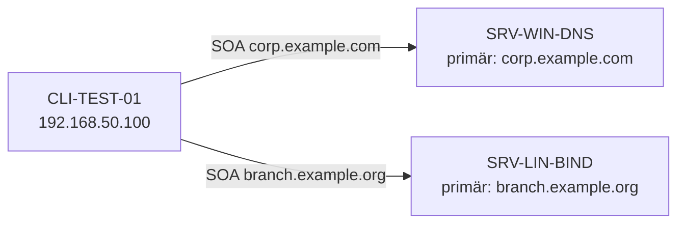

# 04.1 Zonentypen, SOA-Eintrag und primäre Zonen

| | |
|---|---|
| **Modul** | 04 Zonentypen im Detail: Primäre, Sekundäre und Stub-Zonen |
| **Stufe** | Aufbau |
| **Geschätzte Zeit** | 7 bis 9 Stunden (Schätzung; Lehrplan: 10 UE zu 45 Minuten = 7,5 Stunden) |
| **Werkzeuge** | Windows Server mit DNS-Rolle, Debian/Ubuntu mit BIND 9.18, `named-checkzone`, `rndc`, `dig`, PowerShell 5.1, `Resolve-DnsName` |
| **Vorwissen** | Module 01 bis 03 abgeschlossen (Labor, Windows-DNS läuft, BIND läuft mit den Optionen aus Modul 03) |

> [!WARNING]
> **Stand der Prüfung: Entwurf, Linux-Teil mit Testlauf.** Zonendatei, Prüfskript und alle Ausgaben von `named-checkzone`, `rndc zonestatus` und `dig` stammen aus einem **echten Lauf von BIND 9.18.39 auf Ubuntu 24.04** (Testumgebung, nicht das Hyper-V-Labor). **Der Windows-Teil wurde nicht ausgeführt:** Das Skript `04.1-corp-zone-anlegen.ps1` wurde nur auf Syntaxfehler geprüft (PowerShell 7.4.6), `Add-DnsServerPrimaryZone` und seine Parameter gegen Microsoft Learn. Die Eigenschaftsnamen des SOA-Objekts (`RefreshInterval`, `RetryDelay`) stammen aus meinem Wissen und sind **nicht bestätigt**. Windows-Ausgaben sind sinngemäß.

## Lernziele

Nach dieser Übung kannst du

- Domain und Zone unterscheiden und entscheiden, wann eine Subdomain eine eigene Zone braucht,
- eine Delegation mit NS- und Glue-Einträgen aufbauen und lesen, was ein Server bei einer Delegation antwortet,
- primäre, sekundäre und Stub-Zonen nach Zweck, Datenhaltung und Ausfallsicherheit vergleichen,
- alle Felder des SOA-Eintrags erklären (MNAME, RNAME, Serial, Refresh, Retry, Expire, Minimum) und die Seriennummer im Format `JJJJMMTTnn` führen,
- eine primäre Forward-Zone unter Windows Server (PowerShell und GUI) und unter BIND 9 anlegen,
- Zonendateien mit `named-checkzone` prüfen und typische Fehlermeldungen deuten.

## Voraussetzungen

- Labor mit allen drei VMs, Zustand: Snapshot `m03-ende`. Auf SRV-LIN-BIND läuft `named` mit der Konfiguration aus Modul 03 (`allow-query { lab-nets; }`).
- Auf SRV-WIN-DNS läuft die DNS-Rolle (Modul 02), Rekursion ist eingeschaltet.
- CLI-TEST-01 nutzt als DNS-Server `192.168.50.10` (Modul 02), kann aber mit `-Server 192.168.50.11` den Linux-Server direkt fragen.
- Die Dateien dieses Ordners liegen auf den Servern bereit: `04.1-corp-zone-anlegen.ps1` auf SRV-WIN-DNS, `04.1-db.branch.example.org` und `04.1-zone-pruefen.sh` auf SRV-LIN-BIND.

## Grundbegriffe

| Begriff | Bedeutung |
|---|---|
| **Domain** | Ein Teilbaum im Namensraum (`example.org` samt allem darunter). |
| **Zone** | Der Teil davon, den ein Server verwaltet. Eine Zone endet dort, wo eine Delegation beginnt. |
| **Delegation** | NS-Einträge in der Elternzone, die auf die Server der Unterzone zeigen. |
| **Glue-Record** | A- oder AAAA-Eintrag für einen Namensserver, dessen Name **in** der delegierten Zone liegt. Ohne ihn wäre die Auflösung ein Kreisverweis. |
| **Primäre Zone** | Die schreibbare Originalzone. |
| **Sekundäre Zone** | Schreibgeschützte Kopie, per Zonenübertragung von einem Primärserver geholt (Modul 06). |
| **Stub-Zone** | Enthält nur SOA, NS und die Glue-Adressen der Zone eines anderen Servers. |
| **SOA** | Start of Authority: Verwaltungsdaten der Zone. |
| **Serial** | Versionsnummer der Zone, Format `JJJJMMTTnn`. |
| **Negative Caching** | Zwischenspeichern der Antwort „gibt es nicht“ (RFC 2308). |

## Testumgebung

Wie in den Modulen 01 bis 03. Neu: Jeder Server wird für **eine** Zone zum Primärserver.

| Server | Zone | Zonendatei |
|---|---|---|
| SRV-WIN-DNS (192.168.50.10) | `corp.example.com` | `C:\Windows\System32\dns\corp.example.com.dns` |
| SRV-LIN-BIND (192.168.50.11) | `branch.example.org` | `/etc/bind/db.branch.example.org` |



## Aufgabe

Jeder Schritt steht, wo es zwei Wege gibt, auf zwei Wegen: grafisch (GUI) und per Kommandozeile. Unter Linux gibt es nur den Weg über die Kommandozeile.

### Teil 1: Zone oder Domain? Delegation und Glue

*(Lerneinheit 4.1)*

**1. Entscheiden**

Das Unternehmen betreibt `example.org`. Sieh dir die folgenden Fälle an und entscheide für jeden: eigene Zone (delegiert) oder Teil der Elternzone? Begründe in einem Satz.

| Fall | Zone oder Teil der Elternzone? | Begründung |
|---|---|---|
| `www.example.org` und `mail.example.org`, gepflegt vom selben Team | | |
| `branch.example.org`, gepflegt von einer anderen Niederlassung mit eigenen Administratoren | | |
| `test.example.org` mit 3 Einträgen | | |
| `cloud.example.org`, gehostet bei einem Dienstleister, der seine Einträge selbst pflegt | | |

**2. Eine Delegation bauen (SRV-LIN-BIND)**

Delegiere `sub.branch.example.org` an einen Server mit dem Namen `ns.sub.branch.example.org` und der Adresse `192.168.50.99`. Der Name des Servers liegt **in** der delegierten Zone; daher brauchst du den Glue-Eintrag. Hänge an die Zonendatei an (die Datei legst du in Teil 4 an; hier probierst du an einer Kopie):

```bash
cp /etc/bind/db.branch.example.org /tmp/db.delegation.test
cat >> /tmp/db.delegation.test <<'EOT'
; Delegation der Unterzone sub.branch.example.org
sub       IN  NS  ns.sub.branch.example.org.
ns.sub    IN  A   192.168.50.99
EOT
named-checkzone branch.example.org /tmp/db.delegation.test
```

Erwartet (so gemessen): Es erscheint eine Warnung der Form `… 'ns.sub.branch.example.org' (out of zone) has no addresses records (A or AAAA)`, danach `loaded serial …` und `OK`. Die Warnung erscheint auch **mit** Glue; lass dich nicht davon verwirren. Das entscheidende Stichwort ist `REQUIRED GLUE` (siehe Schritt 3).

**3. Glue weglassen**

Entferne die Zeile `ns.sub IN A …` und prüfe erneut.

Erwartet (so gemessen): eine zusätzliche Meldung

```text
zone branch.example.org/IN: sub.branch.example.org/NS 'ns.sub.branch.example.org' has no REQUIRED GLUE address records (A or AAAA)
```

Beachte: `named-checkzone` endet trotzdem mit `OK` und Rückgabewert 0. Der Fehler ist eine **Warnung**, die Zone lässt sich laden. Das Problem tritt erst im Betrieb auf: Ein Resolver bekommt einen Verweis ohne Adresse des Namensservers und kann nicht weiterkommen.

**4. Die Delegation im laufenden Server beobachten**

Lade die Datei mit Glue als Zonendatei (Teil 4 zeigt, wie) und frage einen Namen unterhalb der Delegation:

```bash
dig @192.168.50.11 host.sub.branch.example.org A +norecurse
```

Erwartet (so gemessen): `status: NOERROR`, `flags: qr ra` (**kein** `aa`), `ANSWER: 0`, im Abschnitt `AUTHORITY` der NS-Eintrag `sub.branch.example.org. 3600 IN NS ns.sub.branch.example.org.` und im Abschnitt `ADDITIONAL` der Glue-Eintrag `ns.sub.branch.example.org. … A 192.168.50.99`. Der Server antwortet nicht, er **verweist** (Referral).

Entferne die Delegation danach wieder (Aufräumen, siehe unten).

### Teil 2: Die drei Zonentypen im Vergleich

*(Lerneinheit 4.2)*

**1. Tabelle ausfüllen**

| Merkmal | Primär | Sekundär | Stub |
|---|---|---|---|
| Schreibzugriff auf die Daten | | | |
| Woher kommen die Daten? | | | |
| Welche Einträge sind enthalten? | | | |
| Antwortet autoritativ (`aa`)? | | | |
| Fällt der Primärserver aus: Was passiert? | | | |
| Typischer Einsatz | | | |

**2. Den Typ am Server ablesen**

Windows:

```powershell
Get-DnsServerZone | Select-Object ZoneName, ZoneType, IsDsIntegrated, IsReverseLookupZone
```

Linux (nach Teil 4):

```bash
sudo rndc zonestatus branch.example.org
```

Erwartet (Linux, so gemessen): u. a. `type: primary`, `files: /etc/bind/db.branch.example.org`, `serial: 2026110801`, `dynamic: no`.

**3. Szenario**

Eine Niederlassung betreibt eine eigene Zone. Euer Server soll deren aktuelle Namensserver kennen, darf die Zone aber nicht komplett übertragen. Welcher Zonentyp? Begründe in zwei Sätzen und nenne einen Nachteil gegenüber einer sekundären Zone.

### Teil 3: Der SOA-Eintrag

*(Lerneinheit 4.3)*

**1. Einen echten SOA lesen**

Nach Teil 4 fragst du den SOA ab:

```bash
dig @192.168.50.11 branch.example.org SOA +short
```

Erwartet (so gemessen):

```text
linserver.branch.example.org. hostmaster.branch.example.org. 2026110801 900 300 604800 3600
```

Ordne die sieben Felder zu:

| Wert | Feldname | Bedeutung |
|---|---|---|
| `linserver.branch.example.org.` | | |
| `hostmaster.branch.example.org.` | | |
| `2026110801` | | |
| `900` | | |
| `300` | | |
| `604800` | | |
| `3600` | | |

**2. Rechnen**

- Wie viele Minuten sind 900 Sekunden? Wie viele Tage sind 604800 Sekunden?
- Die Seriennummer `2026110801` bedeutet: 8. November 2026, erste Änderung des Tages. Wie lautet die Seriennummer für die dritte Änderung am 9. November 2026?
- Warum ist das Format `JJJJMMTTnn` bequem, aber auf 99 Änderungen pro Tag begrenzt?
- In `hostmaster.branch.example.org.` steht der Punkt für das `@` einer Mailadresse. Wie lautet die Mailadresse? Was wäre bei `max.huber.branch.example.org.` zu beachten (Punkt im lokalen Teil)?

**3. Negatives Caching**

Eine Abfrage nach `gibtsnicht.branch.example.org` ergibt `NXDOMAIN` mit dem SOA im Abschnitt `AUTHORITY`. Wie lange darf ein Resolver das Ergebnis „existiert nicht“ merken, wenn die TTL des SOA-Eintrags 3600 und das Minimum-Feld 3600 sind? Was ändert sich, wenn das Minimum-Feld auf 300 steht? (RFC 2308)

**4. SOA unter Windows**

- **GUI:** DNS-Manager → Zone `corp.example.com` → Rechtsklick → *Eigenschaften* → Reiter *Start of Authority (SOA)* (deutsch auch *Ursprung (SOA)*; Bezeichnung *nicht bestätigt*). Dort stehen Seriennummer, Primärserver, Verantwortliche Person, Aktualisierungsintervall (Refresh), Wiederholungsintervall (Retry), Ablauf (Expire) und Minimum-TTL.
- **PowerShell:**

```powershell
Get-DnsServerResourceRecord -ZoneName corp.example.com -RRType SOA | Format-List *
```

### Teil 4: Primäre Zonen anlegen und prüfen

*(Lerneinheit 4.4, Praxisaufgaben 1 bis 3)*

**1. Primäre Zone auf SRV-WIN-DNS**

Ziel: dateibasierte Forward-Zone `corp.example.com` mit Zonendatei `corp.example.com.dns`, Refresh 15 Minuten, Retry 5 Minuten.

- **GUI:** DNS-Manager → *Forward-Lookupzonen* → Rechtsklick → *Neue Zone* → Assistent: *Primäre Zone*; Haken bei *Zone in Active Directory speichern* **nicht** setzen (es gibt kein AD); Zonenname `corp.example.com`; *Neue Datei mit diesem Namen erstellen* (`corp.example.com.dns`); dynamische Updates: *Keine dynamischen Updates zulassen*. Danach Rechtsklick auf die Zone → *Eigenschaften* → Reiter SOA: Refresh `15 Minuten`, Retry `5 Minuten`.
- **PowerShell:** Nur die Zone:

```powershell
Add-DnsServerPrimaryZone -Name 'corp.example.com' -ZoneFile 'corp.example.com.dns'
```

  Zone, SOA-Werte und einen A-Eintrag in einem Zug, mit Vorabprüfung:

```powershell
.\04.1-corp-zone-anlegen.ps1 -WhatIf
.\04.1-corp-zone-anlegen.ps1
```

Prüfen:

```powershell
Get-DnsServerZone -Name corp.example.com
Get-Content C:\Windows\System32\dns\corp.example.com.dns
```

Öffne die Datei im Texteditor: Du siehst Kopfkommentare, `$ORIGIN`-Bezug, den SOA mit `@`, die NS-Zeile und die A-Zeile. Notiere, welche NS-Zeile Windows automatisch angelegt hat (auf einem Server, der nicht in einer Domäne steht, kann sie auf einen Namen ohne Domänenanhang zeigen, *nicht bestätigt*). Prüfe, ob dieser NS-Name einen Adresseintrag hat; falls nicht, ergänze ihn in Modul 05.

**2. Primäre Zone auf SRV-LIN-BIND**

Ziel: Zone `branch.example.org`, Datei `/etc/bind/db.branch.example.org`.

a) Zonendatei aus der Vorlage `db.empty` erzeugen und bearbeiten (oder die fertige Datei `04.1-db.branch.example.org` dieser Übung verwenden):

```bash
sudo cp /etc/bind/db.empty /etc/bind/db.branch.example.org
sudoedit /etc/bind/db.branch.example.org
```

Inhalt (Datei `04.1-db.branch.example.org`):

```text
; Zonendatei fuer branch.example.org (Uebung 04.1)
$TTL 3600
@         IN  SOA linserver.branch.example.org. hostmaster.branch.example.org. (
              2026110801  ; Serial (YYYYMMDDnn)
              900         ; Refresh (15 Minuten)
              300         ; Retry (5 Minuten)
              604800      ; Expire (7 Tage)
              3600 )      ; Negative Cache TTL (RFC 2308)
@         IN  NS  linserver.branch.example.org.
linserver IN  A   192.168.50.11
```

Achte auf die **Punkte am Ende** der Namen im SOA und im NS-Eintrag (siehe Fehlerübung unten).

b) Zone in `/etc/bind/named.conf.local` deklarieren:

```text
zone "branch.example.org" {
    type primary;
    file "/etc/bind/db.branch.example.org";
};
```

(`type primary;` ist die moderne Schreibweise für `type master;`; BIND 9.18 akzeptiert beides.)

**3. Prüfen und laden**

```bash
sudo named-checkzone branch.example.org /etc/bind/db.branch.example.org
sudo named-checkconf
sudo rndc reload
```

Erwartet (so gemessen):

```text
zone branch.example.org/IN: loaded serial 2026110801
OK
```

`named-checkconf` bleibt stumm, `rndc reload` meldet `server reload successful`. Dann `sudo rndc zonestatus branch.example.org` (siehe Teil 2) und das Prüfskript:

```bash
bash 04.1-zone-pruefen.sh
```

Alle Zeilen sollen mit `OK` beginnen.

**4. Gegenprobe von CLI-TEST-01**

```powershell
Resolve-DnsName -Name corp.example.com -Type SOA -Server 192.168.50.10
Resolve-DnsName -Name branch.example.org -Type SOA -Server 192.168.50.11
Resolve-DnsName -Name linserver.branch.example.org -Type A -Server 192.168.50.11
```

Erwartet (*Windows-Ausgabe sinngemäß, nicht bestätigt*): je eine SOA-Zeile mit PrimaryServer, NameAdministrator, SerialNumber, TimeToZoneRefresh, TimeToZoneFailureRetry, TimeToExpiration und TimeToLive. Die Werte für Refresh und Retry entsprechen deinen Einstellungen (in Sekunden; 900 und 300).

**5. Fehler einbauen und deuten**

Lege Kopien der Zonendatei in `/tmp` an und prüfe jede mit `named-checkzone`:

a) **Punkt am Ende vergessen** im NS-Eintrag (`@ IN NS linserver.branch.example.org`):

```text
zone branch.example.org/IN: NS 'linserver.branch.example.org.branch.example.org' has no address records (A or AAAA)
zone branch.example.org/IN: not loaded due to errors.
```

(so gemessen). Erkläre: Ein Name ohne Punkt am Ende wird relativ zum Ursprung der Zone gelesen und bekommt `branch.example.org.` angehängt.

b) **CNAME neben anderen Daten:** `www IN CNAME linserver` und `www IN A 192.168.50.12`:

```text
dns_master_load: /tmp/zf3:12: www.branch.example.org: CNAME and other data
zone branch.example.org/IN: loading from master file /tmp/zf3 failed: CNAME and other data
zone branch.example.org/IN: not loaded due to errors.
```

(so gemessen, die Zeilennummer hängt von deiner Datei ab). Ein Name mit CNAME darf keine anderen Einträge haben.

c) **Kein A-Eintrag für den Namensserver** (Zeile `linserver IN A …` entfernt):

```text
zone branch.example.org/IN: NS 'linserver.branch.example.org' has no address records (A or AAAA)
zone branch.example.org/IN: not loaded due to errors.
```

(so gemessen). Ein Namensserver innerhalb der eigenen Zone braucht einen Adresseintrag in dieser Zone.

**6. Die Seriennummer: ein Experiment**

Hänge an die Zonendatei `neu IN A 192.168.50.99` an, **ohne** die Seriennummer zu ändern, und lade neu:

```bash
echo 'neu IN A 192.168.50.99' | sudo tee -a /etc/bind/db.branch.example.org
sudo rndc reload
dig @192.168.50.11 neu.branch.example.org A +short
```

Erwartet (so gemessen): `192.168.50.99`. Der **Primärserver** liest die geänderte Datei trotz unveränderter Seriennummer ein. Der Haken liegt bei den Sekundärservern: Sie holen Daten nur, wenn die Seriennummer im SOA **höher** ist als ihre eigene (Modul 06). Entferne die Testzeile wieder und erhöhe danach die Seriennummer auf `2026110802`, damit nichts durcheinandergerät.

## Hintergrund

### Domain und Zone

Ein Name wie `www.branch.example.org` gehört zur Domain `example.org`, aber die **Zone** `branch.example.org` kann von einem anderen Server verwaltet werden als die Zone `example.org`. Wo die Verwaltung wechselt, steht in der Elternzone ein Satz NS-Einträge (die Delegation). Der Server der Elternzone beantwortet Fragen unterhalb davon nicht, sondern verweist auf die Server der Unterzone (Referral, ohne `aa`).

### Glue

Liegt der Name des Namensservers selbst unterhalb der Delegation (`ns.sub.branch.example.org` für `sub.branch.example.org`), wäre die Auflösung zirkulär: Um den Server zu finden, müsste man die Zone auflösen, die er bedient. Deshalb steht in der Elternzone zusätzlich ein A- oder AAAA-Eintrag für diesen Namen (Glue), und der Server liefert ihn im Abschnitt `ADDITIONAL` mit aus. Bei einem Namensserver außerhalb der Zone (z. B. `ns1.example.net`) braucht man keinen Glue.

### Zonentypen

Die **primäre Zone** ist die Quelle. **Sekundäre** Zonen sind Kopien für Ausfallsicherheit und Lastverteilung. **Stub-Zonen** enthalten nur SOA, NS und Glue und halten so die Namensserver einer fremden Zone aktuell, ohne alle Daten zu kopieren. Unter Windows kommt zusätzlich die **Active-Directory-integrierte Zone** hinzu (Modul 08), bei der das Verzeichnis die Replikation übernimmt.

### Der SOA-Eintrag

| Feld | Bedeutung |
|---|---|
| MNAME | Primärer Namensserver der Zone |
| RNAME | Verantwortliche Mailadresse, erster Punkt = `@` |
| Serial | Version der Zone; Sekundärserver vergleichen sie |
| Refresh | Wie oft ein Sekundärserver nach einer neuen Version fragt |
| Retry | Wartezeit zwischen Wiederholungen, wenn der Refresh fehlschlug |
| Expire | Nach dieser Zeit ohne Verbindung hört ein Sekundärserver auf, die Zone zu beantworten |
| Minimum | Seit RFC 2308 die TTL für negative Antworten (Negative Caching) |

### Zonendateien

Das `@` steht für den Ursprung (`$ORIGIN`), also den Zonennamen. Namen **ohne** abschließenden Punkt werden an den Ursprung angehängt, Namen **mit** Punkt sind vollständig. `$TTL` legt die Standard-TTL fest. Kommentare beginnen mit `;`.

## Hinweise

- Die Zonendatei liegt unter `/etc/bind` und ist für `named` **nur lesbar** (AppArmor-Profil im Testsystem). Für statische Zonen genügt das. Für dynamische Updates (Modul 08) und Sekundärzonen (Modul 06) braucht `named` Schreibrechte; Dateien dafür gehören nach `/var/lib/bind` bzw. `/var/cache/bind`.
- Zonendateien: Dateirechte `root:bind`, Modus `644`. Das ist nicht kritisch, solange `bind` die Datei lesen kann.
- Windows: Ändere die Zonendatei nie von Hand, während der Dienst läuft; dafür gibt es die Konsole und die Cmdlets.
- Die Zonen bleiben für die folgenden Module bestehen.

## Prüfbefehle

```bash
sudo named-checkzone branch.example.org /etc/bind/db.branch.example.org
sudo rndc zonestatus branch.example.org
dig @192.168.50.11 branch.example.org SOA +short
bash 04.1-zone-pruefen.sh
```

```powershell
Get-DnsServerZone -Name corp.example.com
Resolve-DnsName -Name corp.example.com -Type SOA -Server 192.168.50.10
Resolve-DnsName -Name branch.example.org -Type SOA -Server 192.168.50.11
```

**Kontrollfragen**

1. Worin besteht der zentrale technische Unterschied zwischen einer sekundären Zone und einer Stub-Zone, und wann ist eine Stub-Zone vorzuziehen?
2. Welche Funktion hat das letzte numerische Feld des SOA-Eintrags (Minimum) seit RFC 2308?
3. Was sind Glue-Records, und wann sind sie zwingend nötig?
4. Was passiert im Betrieb, wenn du in einer BIND-Zonendatei Einträge änderst, die Datei speicherst und `rndc reload` ausführst, aber die Seriennummer nicht erhöhst?
5. Warum meldet `named-checkzone` beim fehlenden Glue-Eintrag `OK`, obwohl die Delegation nicht funktioniert?
6. Was bewirkt ein fehlender Punkt am Ende eines Namens in einer Zonendatei?
7. Warum darf ein Name mit CNAME keine weiteren Einträge haben?

## Erweiterungen

- Eine zweite Zone `lab.internal` auf einem der Server anlegen (mit Reverse-Zone folgt in Modul 05).
- Windows: eine Zone mit `Export-DnsServerZone` in eine Datei exportieren und mit der BIND-Datei vergleichen.
- BIND: `$ORIGIN` und `$TTL` verändern und die Auswirkungen mit `dig` beobachten.
- Ein Skript zur automatischen Seriennummer-Erhöhung (`JJJJMMTTnn`) schreiben und die Randfälle (mehr als 99 Änderungen am Tag, Wechsel des Tages) bedenken.
- Die Stub-Zone vorab planen: Welche Angaben benötigt der Assistent (Masterserver)? Umsetzung in Modul 06.

## Musterlösung

<details>
<summary>Musterlösung anzeigen</summary>

### Teil 1

| Fall | Entscheidung | Begründung |
|---|---|---|
| `www`, `mail` desselben Teams | Teil der Elternzone | Gleiche Verwalter, kein Grund für eine Delegation. |
| `branch.example.org` mit eigenen Administratoren | eigene Zone | Verwaltungsgrenze: Die Niederlassung pflegt ihre Daten selbst. |
| `test.example.org` mit 3 Einträgen | Teil der Elternzone | Aufwand einer Zone lohnt nicht. |
| `cloud.example.org` beim Dienstleister | eigene Zone (delegiert) | Fremder Betreiber pflegt die Daten; die Elternzone zeigt per NS dorthin. |

Delegationsdateien siehe Aufgabe. Referral: `status NOERROR`, kein `aa`, `AUTHORITY` mit NS, `ADDITIONAL` mit Glue.

### Teil 2

| Merkmal | Primär | Sekundär | Stub |
|---|---|---|---|
| Schreibzugriff | ja | nein | nein |
| Herkunft der Daten | Administrator | Zonenübertragung (AXFR/IXFR) | Abfrage bzw. Übertragung nur von SOA, NS, Glue |
| Inhalt | alle Einträge | alle Einträge (Kopie) | nur SOA, NS, Glue |
| autoritativ (`aa`) | ja | ja | nein (nur Verweis) |
| Primärserver fällt aus | Zone nicht änderbar, beantwortet weiter | beantwortet weiter bis Expire | bleibt mit den zuletzt bekannten NS bis Expire |
| Einsatz | Quelle der Zone | Ausfallsicherheit, Lastverteilung | Namensserver einer fremden Zone kennen, ohne Daten zu spiegeln |

*Zum Stub:* Die Angabe „nicht autoritativ, nur Verweis“ beruht auf der allgemeinen Beschreibung von Stub-Zonen und ist in diesem Entwurf **nicht getestet** (Fachlektorat: bitte gegenprüfen; Umsetzung in Modul 06).

Szenario: Stub-Zone. Sie hält die NS-Einträge der Niederlassungszone aktuell, ohne die Zone zu übertragen. Nachteil: Der eigene Server kann nicht autoritativ aus den Daten antworten und braucht Erreichbarkeit der Zielserver zur Laufzeit.

### Teil 3

| Wert | Feld | Bedeutung |
|---|---|---|
| `linserver.branch.example.org.` | MNAME | primärer Namensserver |
| `hostmaster.branch.example.org.` | RNAME | Kontakt `hostmaster@branch.example.org` |
| `2026110801` | Serial | Version |
| `900` | Refresh | 15 Minuten |
| `300` | Retry | 5 Minuten |
| `604800` | Expire | 7 Tage |
| `3600` | Minimum | negative TTL, 1 Stunde |

Rechnen: 900 s = 15 min; 604800 s = 7 Tage. Dritte Änderung am 9. 11. 2026: `2026110903`. Zwei Ziffern erlauben nur 00 bis 99. Mailadresse: `hostmaster@branch.example.org`. Bei `max.huber.branch.example.org.` würde ein Punkt im lokalen Teil als `\.` geschrieben (`max\.huber.branch.example.org.`).

Negative Caching: Der Resolver nimmt den kleineren der beiden Werte (SOA-TTL, Minimum): 3600 s. Bei Minimum 300 sind es 300 s.

### Teil 4, Zusammenfassung

```powershell
Add-DnsServerPrimaryZone -Name 'corp.example.com' -ZoneFile 'corp.example.com.dns'
```

```bash
sudo named-checkzone branch.example.org /etc/bind/db.branch.example.org
sudo rndc reload
```

### Antworten auf die Kontrollfragen

1. Sekundär: vollständige Kopie, per Zonenübertragung, antwortet autoritativ. Stub: nur SOA, NS, Glue; Hinweisgeber. Vorzuziehen, wenn nur die aktuellen Namensserver einer fremden Zone bekannt sein müssen und eine vollständige Übertragung unerwünscht oder nicht erlaubt ist.
2. Negative Caching TTL: Wie lange ein Resolver „existiert nicht“ merken darf (zusammen mit der SOA-TTL, der kleinere Wert).
3. A/AAAA-Einträge für Namensserver, deren Name unterhalb der Delegation liegt. Zwingend, weil sonst kein Resolver den Server finden kann.
4. Der Primärserver liefert nach dem Neuladen die neuen Daten (so gemessen). Sekundärserver erkennen die Änderung nicht, weil die Seriennummer gleich bleibt, und liefern weiter alte Daten. Die Server antworten unterschiedlich.
5. Weil die Syntax der Datei gültig ist. Die fehlende Glue-Adresse ist ein Betriebsproblem (Warnung), kein Syntaxfehler.
6. Der Name wird als relativ gelesen und bekommt den Ursprung angehängt (`linserver.branch.example.org` → `linserver.branch.example.org.branch.example.org.`).
7. Ein CNAME sagt „dieser Name ist ein Alias für einen anderen“; andere Daten am selben Namen würden dem widersprechen (RFC 1034).

</details>

## Aufräumen und Rückkehr zum Ausgangszustand

- Testdateien in `/tmp` löschen: `rm -f /tmp/db.delegation.test /tmp/zf*`.
- Falls du die Delegation `sub` in die Zone übernommen hast: Zeilen entfernen, Seriennummer erhöhen, `rndc reload`.
- Die Zeile `neu IN A 192.168.50.99` entfernen, Seriennummer auf `2026110802` erhöhen, `rndc reload`.
- Die Zonen `corp.example.com` und `branch.example.org` **bleiben** für die Module 05 bis 12 bestehen. Entfernen nur bei Bedarf: `Remove-DnsServerZone -Name corp.example.com -Force` (Windows) bzw. Zone aus `named.conf.local` nehmen und `rndc reload` (Linux).
- Snapshot `m04-ende` auf allen drei VMs.

## Quellen

- RFC 1034, RFC 1035 (Zonen, SOA, Delegation, Glue): <https://datatracker.ietf.org/doc/html/rfc1034>, <https://datatracker.ietf.org/doc/html/rfc1035>
- RFC 2308 (Negative Caching): <https://datatracker.ietf.org/doc/html/rfc2308>
- RFC 2181 (Clarifications, u. a. zu NS und TTL): <https://datatracker.ietf.org/doc/html/rfc2181>
- ISC: *BIND 9 Administrator Reference Manual*, Zonendateien: <https://bind9.readthedocs.io/>
- Microsoft Learn: *Add-DnsServerPrimaryZone*: <https://learn.microsoft.com/powershell/module/dnsserver/add-dnsserverprimaryzone> (Parameter `-Name`, `-ZoneFile`, `-ResponsiblePerson`, `-DynamicUpdate`, `-LoadExisting`)
- Microsoft Learn: *Set-DnsServerResourceRecord* (`-OldInputObject`, `-NewInputObject`): <https://learn.microsoft.com/powershell/module/dnsserver/set-dnsserverresourcerecord>
- Eigene Messungen mit BIND 9.18.39 auf Ubuntu 24.04
