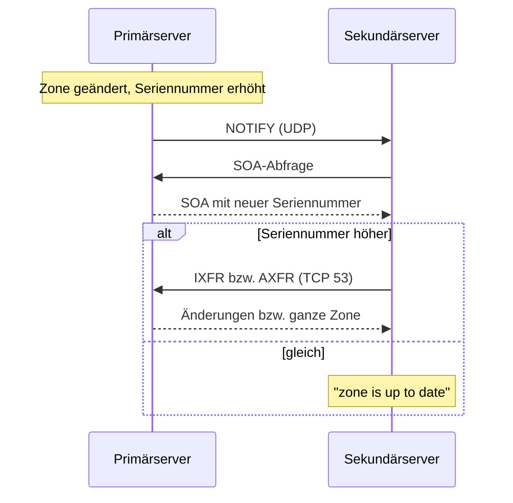

# 06.1 Zonenübertragung (AXFR/IXFR), NOTIFY und TSIG

| | |
|---|---|
| **Modul** | 06 Zonenübertragung (AXFR/IXFR) und plattformübergreifende Replikation |
| **Stufe** | Aufbau |
| **Geschätzte Zeit** | 7 bis 9 Stunden (Schätzung; Lehrplan: 10 UE zu 45 Minuten = 7,5 Stunden) |
| **Werkzeuge** | Windows Server mit DNS-Rolle, Debian/Ubuntu mit BIND 9.18, `rndc`, `dig`, `nslookup`, `tsig-keygen`, `named-compilezone`, PowerShell 5.1 |
| **Vorwissen** | Module 01 bis 05 abgeschlossen (Zonen `corp.example.com`, `50.168.192.in-addr.arpa`, `branch.example.org` bestehen als primäre Zonen) |

> [!WARNING]
> **Stand der Prüfung: Entwurf, Linux-Teil mit Testlauf.** Alle BIND-Befehle, Konfigurationen und Logzeilen stammen aus einem **echten Lauf von BIND 9.18.39 auf Ubuntu 24.04**. Weil es dort keinen Windows-Server gab, hat ein **zweites BIND auf 192.168.50.10 den Windows-Server vertreten**. Das beweist die Linux-Seite (Sekundärzone, `allow-transfer`, NOTIFY, TSIG, `rndc`), aber **nicht** das Verhalten von Windows. **Der Windows-Teil wurde nicht ausgeführt:** Die Skripte `06.1-windows-primaer-freigeben.ps1` und `06.1-windows-sekundaer-anlegen.ps1` sind auf Syntax geprüft (PowerShell 7.4.6) und mit Attrappen gegen die Parameternamen aus Microsoft Learn probegelaufen. Windows-Ausgaben und Bezeichnungen der deutschen Oberfläche sind sinngemäß bzw. *nicht bestätigt*. Das Testlabor lief ohne systemd und ohne AppArmor-Durchsetzung; deshalb gibt es keine echte `journalctl`-Ausgabe, und eine Sperre durch AppArmor wurde nicht geprüft.

## Lernziele

Nach dieser Übung kannst du

- den Ablauf von AXFR (RFC 5936), IXFR (RFC 1995) und NOTIFY (RFC 1996) erklären und die Rolle der SOA-Seriennummer beschreiben,
- eine sekundäre Zone zwischen Windows Server und BIND 9 in beide Richtungen einrichten,
- Zonenübertragungen auf bestimmte Adressen beschränken (`allow-transfer`, Windows-Zoneneigenschaften) und prüfen, dass unbefugte Abzüge abgelehnt werden,
- eine Zonenübertragung mit TSIG (RFC 8945) in BIND absichern und begründen, warum das zwischen Windows-DNS und BIND nicht geht,
- Übertragungen manuell auslösen (`rndc refresh`, `rndc retransfer`, `Start-DnsServerZoneTransfer`) und in den Logs nachvollziehen.

## Voraussetzungen

- Labor mit allen drei VMs, Zustand: Snapshot `m05-ende`.
- Auf SRV-WIN-DNS gibt es `corp.example.com` und die beiden Reverse-Zonen (Modul 05), auf SRV-LIN-BIND `branch.example.org` mit den Einträgen aus Modul 05.
- Die Dateien dieses Ordners liegen auf den Servern bereit: die `.ps1`-Skripte auf SRV-WIN-DNS, `06.1-db.branch.example.org`, `06.1-named.conf.local`, `06.1-db.tsig-test.example.org` und `06.1-transfer-pruefen.sh` auf SRV-LIN-BIND.

## Grundbegriffe

| Begriff | Bedeutung |
|---|---|
| **AXFR** | Vollständige Zonenübertragung (RFC 5936), über TCP Port 53. |
| **IXFR** | Inkrementelle Übertragung: nur die Änderungen seit einer bestimmten Seriennummer (RFC 1995). |
| **NOTIFY** | Der Primärserver meldet dem Sekundärserver sofort „die Zone hat sich geändert“ (RFC 1996). |
| **Refresh / Retry / Expire** | SOA-Zeiten (Modul 04), mit denen der Sekundärserver nachfragt, wiederholt und aufgibt. |
| **Primärserver / Sekundärserver** | Quelle der Zone / Kopie. In BIND `primaries` (älter: `masters`). |
| **TSIG** | Transaktionssignatur mit gemeinsamem geheimem Schlüssel (RFC 8945). |
| **Journal** | Datei mit der Änderungshistorie einer Zone; Grundlage für IXFR. |

## Testumgebung

Wie in den Modulen 01 bis 05. Neu: Jeder der beiden Server ist für je eine Zone Primär- und für die andere Sekundärserver.

| Zone | Primär | Sekundär | Beschränkung |
|---|---|---|---|
| `corp.example.com` | SRV-WIN-DNS | SRV-LIN-BIND | Transfer nur an `192.168.50.11` |
| `50.168.192.in-addr.arpa` | SRV-WIN-DNS | SRV-LIN-BIND | Transfer nur an `192.168.50.11` |
| `branch.example.org` | SRV-LIN-BIND | SRV-WIN-DNS | `allow-transfer { 192.168.50.10; };` |
| `tsig-test.example.org` (nur Teil 5) | SRV-LIN-BIND | – | `allow-transfer { key "xfer-key"; };` |



## Aufgabe

Wo es zwei Wege gibt, stehen beide: grafisch (GUI) und per Kommandozeile. Unter Linux gibt es nur den Weg über die Kommandozeile.

### Teil 1: Der Ablauf einer Zonenübertragung

*(Lerneinheit 6.1)*

**1. Ausgangslage prüfen: Wer darf die Zone abziehen?**

Bevor du etwas beschränkst, sieh dir die Standardeinstellung von BIND an. Auf SRV-LIN-BIND ist für `branch.example.org` bisher kein `allow-transfer` gesetzt. Ein Rechner, der nicht Teil der Zonenverwaltung ist (hier simuliert mit der Absenderadresse `192.168.50.100`), fragt die ganze Zone ab:

```bash
dig -b 192.168.50.100 @192.168.50.11 branch.example.org AXFR
```

In der Übung kommt der Abzug von CLI-TEST-01 (`nslookup`, siehe Teil 4); `-b` setzt nur die Absenderadresse, wenn du alles von einem einzigen Rechner aus testest.

Erwartet (so gemessen): Die ganze Zone wird ausgegeben, am Ende steht `XFR size: 11 records`. Im Log des Servers erscheint (so gemessen):

```text
192.168.50.100#46675 (branch.example.org): transfer of 'branch.example.org/IN': AXFR started (serial 2026111101)
192.168.50.100#46675 (branch.example.org): transfer of 'branch.example.org/IN': AXFR ended: 1 messages, 11 records, 412 bytes, 0.001 secs (412000 bytes/sec) (serial 2026111101)
```

Beantworte: Was erfährt ein Angreifer aus einem solchen Abzug, das er mit Einzelabfragen nur mühsam fände?

**2. Den Ablauf beschreiben**

Beschreibe mit dem Diagramm oben in vier bis fünf Sätzen, was passiert, wenn du auf dem Primärserver einen A-Eintrag anlegst und die Seriennummer erhöhst. Beantworte dabei: Welche Nachricht geht zuerst? Was entscheidet der Sekundärserver anhand der SOA? Welches Protokoll und welcher Port wird für die Übertragung selbst benutzt?

### Teil 2: Windows als Primärserver, BIND als Sekundärserver

*(Lerneinheit 6.2, Praxisaufgabe 1)*

**1. Windows: Übertragung freigeben (SRV-WIN-DNS)**

Ziel: Für `corp.example.com` und die beiden Reverse-Zonen gilt: NS-Eintrag für `linserver.branch.example.org`, Zonenübertragung **ausschließlich** an `192.168.50.11`, NOTIFY an dieselbe Adresse.

- **GUI:** DNS-Manager → Zone → Rechtsklick → *Eigenschaften*. Reiter *Namenserver* → *Hinzufügen* → `linserver.branch.example.org` mit der IP `192.168.50.11`. Reiter *Zonenübertragungen* → *Zonenübertragungen zulassen* → *Nur an die folgenden Server* → `192.168.50.11` → Schaltfläche *Benachrichtigen…* → *Die folgenden Server automatisch benachrichtigen* → `192.168.50.11`. Die Bezeichnungen der deutschen Oberfläche sind *nicht bestätigt*.
- **PowerShell:** Für eine Zone:

```powershell
Add-DnsServerResourceRecord -ZoneName corp.example.com -NS -Name '@' -NameServer linserver.branch.example.org
Set-DnsServerPrimaryZone -Name corp.example.com -SecureSecondaries TransferToSecureServers -SecondaryServers 192.168.50.11 -Notify NotifyServers -NotifyServers 192.168.50.11
```

  Für alle drei Zonen, mit Vorabprüfung:

```powershell
.\06.1-windows-primaer-freigeben.ps1 -WhatIf
.\06.1-windows-primaer-freigeben.ps1
```

  Der Name `@` für den NS-Eintrag am Zonenursprung ist *nicht bestätigt* (Microsoft Learn zeigt für MX den Namen `.`). Meldet Windows einen Fehler, rufe das Skript mit `-ApexName .` auf. Die Kombination `TransferToSecureServers` mit `-SecondaryServers` stammt aus einem Beispiel in Microsoft Learn; die Bedeutung („nur an die aufgelisteten Server“) entnehme ich der Oberfläche und habe sie nicht geprüft.

**2. BIND: sekundäre Zonen einrichten (SRV-LIN-BIND)**

Ergänze in `/etc/bind/named.conf.local` (Vorlage: `06.1-named.conf.local`):

```text
zone "corp.example.com" {
    type secondary;
    primaries { 192.168.50.10; };
    file "/var/cache/bind/db.corp.example.com";
};

zone "50.168.192.in-addr.arpa" {
    type secondary;
    primaries { 192.168.50.10; };
    file "/var/cache/bind/db.50.168.192.in-addr.arpa";
};
```

`primaries` ist die neuere Schreibweise für `masters`; BIND 9.18 nahm im Test beide ohne Meldung an. Dann:

```bash
sudo named-checkconf
sudo rndc reconfig
```

`rndc reconfig` lädt nur neue Zonen und lässt die übrigen unberührt; `rndc reload` leistet das auch (und liest zusätzlich alle Zonendateien neu).

**3. Log lesen**

```bash
sudo journalctl -u named -n 40 --no-pager
```

(In der Testumgebung gab es kein `journalctl`; die Zeilen stammen aus der Ausgabe von `named`, der Vorspann von journald weicht ab.) Erwartet (so gemessen):

```text
zone corp.example.com/IN: Transfer started.
transfer of 'corp.example.com/IN' from 192.168.50.10#53: connected using 192.168.50.10#53
zone corp.example.com/IN: transferred serial 2026111102
transfer of 'corp.example.com/IN' from 192.168.50.10#53: Transfer status: success
transfer of 'corp.example.com/IN' from 192.168.50.10#53: Transfer completed: 1 messages, 14 records, 447 bytes, 0.001 secs (447000 bytes/sec) (serial 2026111102)
```

Die Zahlen für Seriennummer und Datenmenge hängen von deinem Stand ab. Weitere Beispiele: `beispiele/01-log-sekundaer-bind.txt`.

**4. Zustand und Datei ansehen**

```bash
sudo rndc zonestatus corp.example.com
dig @192.168.50.11 corp.example.com SOA
ls -l /var/cache/bind/
```

Erwartet (so gemessen): `type: secondary`, `files: /var/cache/bind/db.corp.example.com`, `serial: …`, `next refresh: …`; die Antwort von `dig` trägt das Flag `aa`, denn der Sekundärserver antwortet autoritativ. Die Datei in `/var/cache/bind` ist im Test **nicht lesbar** (binäres „raw“-Format). Lesbar machst du sie mit:

```bash
named-compilezone -f raw -F text -o - corp.example.com /var/cache/bind/db.corp.example.com
```

Das Ergebnis (so gemessen, Leerraum zusammengefasst):

```text
zone corp.example.com/IN: loaded serial 2026111102
corp.example.com. 3600 IN SOA winserver.corp.example.com. hostmaster.corp.example.com. 2026111102 900 300 604800 3600
corp.example.com. 3600 IN NS linserver.branch.example.org.
corp.example.com. 3600 IN NS winserver.corp.example.com.
…
```

**5. Warum `/var/cache/bind` und nicht `/etc/bind`?**

Prüfe, ob der Benutzer `bind` dort schreiben darf:

```bash
sudo -u bind touch /etc/bind/test.tmp
sudo -u bind touch /var/cache/bind/test.tmp && echo "schreibbar" && sudo -u bind rm /var/cache/bind/test.tmp
```

Erwartet (so gemessen): im ersten Fall `touch: cannot touch '/etc/bind/test.tmp': Permission denied`, im zweiten `schreibbar`. Ein Sekundärserver muss seine Zonendatei bei jeder Übertragung neu schreiben können. Unter Ubuntu kommt nach meiner Kenntnis ein AppArmor-Profil hinzu, das `named` nur an bestimmten Orten Schreiben erlaubt; das wurde im Test nicht geprüft.

### Teil 3: BIND als Primärserver, Windows als Sekundärserver

*(Lerneinheit 6.2, Praxisaufgabe 2)*

**1. BIND: Übertragung freigeben**

Ergänze in der Zonendatei von `branch.example.org` den NS-Eintrag für `winserver.corp.example.com.` (Vorlage: `06.1-db.branch.example.org`) und **erhöhe die Seriennummer** (zum Beispiel auf `2026111102`):

```text
@         IN  NS    linserver.branch.example.org.
@         IN  NS    winserver.corp.example.com.
```

In `named.conf.local` innerhalb der Zonendefinition:

```text
zone "branch.example.org" {
    type primary;
    file "/etc/bind/db.branch.example.org";
    allow-transfer { 192.168.50.10; };
    also-notify    { 192.168.50.10; };
};
```

```bash
sudo named-checkzone branch.example.org /etc/bind/db.branch.example.org
sudo named-checkconf
sudo rndc reload
```

**2. Windows: sekundäre Zone anlegen (SRV-WIN-DNS)**

- **GUI:** DNS-Manager → *Forward-Lookupzonen* → Rechtsklick → *Neue Zone…* → *Sekundäre Zone* → Zonenname `branch.example.org` → Masterserver `192.168.50.11` → *Neue Datei mit diesem Namen erstellen*. Bezeichnungen *nicht bestätigt*.
- **PowerShell:**

```powershell
Add-DnsServerSecondaryZone -Name branch.example.org -ZoneFile branch.example.org.dns -MasterServers 192.168.50.11
Start-DnsServerZoneTransfer -Name branch.example.org
```

  Oder mit Vorabprüfung:

```powershell
.\06.1-windows-sekundaer-anlegen.ps1 -WhatIf
.\06.1-windows-sekundaer-anlegen.ps1
```

**3. Prüfen**

```powershell
Get-DnsServerZone -Name branch.example.org
Resolve-DnsName -Name branch.example.org -Type SOA -Server 192.168.50.10 -DnsOnly
```

Die Seriennummer muss mit der auf SRV-LIN-BIND übereinstimmen. Auf SRV-LIN-BIND erscheint im Log (so gemessen, Gegenstelle war ein BIND als Stellvertreter für Windows):

```text
192.168.50.10#38133 (branch.example.org): transfer of 'branch.example.org/IN': AXFR started (serial 2026111102)
192.168.50.10#38133 (branch.example.org): transfer of 'branch.example.org/IN': AXFR ended: 1 messages, 12 records, 413 bytes, 0.001 secs (413000 bytes/sec) (serial 2026111102)
```

Das Prüfskript fasst beides zusammen:

```bash
bash 06.1-transfer-pruefen.sh
```

Es vergleicht die Seriennummern der drei Zonen auf beiden Servern und prüft, dass ein Abzug von einer nicht freigegebenen Adresse abgelehnt wird.

### Teil 4: NOTIFY, IXFR und unbefugte Abzüge

*(Lerneinheit 6.3 und 6.4, Praxisaufgabe 3)*

**1. Änderung auf Windows, Übernahme auf BIND**

Lege auf SRV-WIN-DNS in `corp.example.com` den Eintrag `test-notify` mit `192.168.50.99` an:

```powershell
Add-DnsServerResourceRecord -ZoneName corp.example.com -A -Name test-notify -IPv4Address 192.168.50.99
```

Windows erhöht die Seriennummer bei Änderungen selbst und schickt NOTIFY an die eingetragenen Server (nach meiner Kenntnis; *nicht bestätigt*). Prüfe auf SRV-LIN-BIND:

```bash
dig @192.168.50.11 test-notify.corp.example.com A +short
sudo journalctl -u named -n 20 --no-pager
```

Erwartet (so gemessen; das Beispiel wurde mit einem BIND als Primärserver erzeugt und die Seriennummer von Hand erhöht):

```text
192.168.50.99
```

und im Log

```text
192.168.50.10#39024: received notify for zone 'corp.example.com'
zone corp.example.com/IN: notify from 192.168.50.10#39024: serial 2026111103
zone corp.example.com/IN: Transfer started.
transfer of 'corp.example.com/IN' from 192.168.50.10#53: Transfer completed: 1 messages, 5 records, 227 bytes, 0.001 secs (227000 bytes/sec) (serial 2026111103)
```

Die Gegenstelle meldet dazu `IXFR started (serial 2026111102 -> 2026111103)`: Es wurde inkrementell übertragen (5 statt 14 Einträge). Auf Windows-Seite gilt das nach meiner Kenntnis ebenfalls; das ist *nicht bestätigt*.

**2. Unterschied zwischen AXFR und IXFR bei BIND als Primärserver**

Bearbeite auf SRV-LIN-BIND die Zonendatei **von Hand**: Eintrag `neu IN A 192.168.50.98` anfügen, Seriennummer erhöhen, `sudo rndc reload`. Beobachte das Log:

```text
192.168.50.10#32879 (branch.example.org): transfer of 'branch.example.org/IN': IXFR version not in journal, falling back to AXFR
192.168.50.10#32879 (branch.example.org): transfer of 'branch.example.org/IN': AXFR-style IXFR started (serial 2026111103)
```

(so gemessen). Der Sekundärserver bat um IXFR, doch BIND hat von einer von Hand bearbeiteten Datei keine Änderungshistorie und überträgt die ganze Zone. Erkläre den Grund und schlage eine Einstellung vor, mit der BIND die Unterschiede zwischen alter und neuer Datei selbst als Journal führt (Stichwort `ixfr-from-differences`; Wirkung im Test nur bei der Windows-Stellvertreterinstanz beobachtet, auf SRV-LIN-BIND nicht ausprobiert).

Entferne die Zeile `neu` danach wieder und erhöhe die Seriennummer.

**3. Seriennummer nicht erhöht**

Wiederhole das Experiment, ohne die Seriennummer zu erhöhen. Erwartet (so gemessen): Die Gegenstelle erhält das NOTIFY und meldet

```text
zone branch.example.org/IN: notify from 192.168.50.11#36569: zone is up to date
```

Erkläre den Zusammenhang mit Kontrollfrage 4 aus Modul 04.

**4. Unbefugter Abzug von CLI-TEST-01**

- **Windows-Client:** `nslookup` im Dialogmodus:

```text
nslookup
> server 192.168.50.10
> ls -d corp.example.com
> server 192.168.50.11
> ls -d branch.example.org
```

  Erwartet: Beide Server lehnen den Abzug ab. Die genaue Fehlermeldung von `nslookup` (zum Beispiel „Query refused“) ist *nicht bestätigt*.
- **Linux (Absender nicht freigegeben):**

```bash
dig @192.168.50.11 branch.example.org AXFR
```

  Erwartet (so gemessen, Absender `192.168.50.100`): `; Transfer failed.` Im Log des Servers steht:

```text
192.168.50.100#35917 (branch.example.org): zone transfer 'branch.example.org/AXFR/IN' denied
```

  Der Windows-Stellvertreter (BIND) lehnte den Abzug von `corp.example.com` ebenso mit `; Transfer failed.` ab. Ob und wo ein echter Windows-Server die Ablehnung protokolliert, habe ich nicht geprüft (Ereignisanzeige, *nicht bestätigt*).

Notiere, warum die Ablehnung gerade bei der Absenderadresse hängt, und welche Folgen es hat, wenn ein Angreifer die Adresse eines freigegebenen Servers fälscht (nur ein Gedankenspiel; im Labor nicht ausprobieren).

### Teil 5: TSIG-gesicherte Übertragung (nur BIND)

*(Lerneinheit 6.3, Praxisaufgabe 4)*

Windows-DNS unterstützt nach bisherigem Kenntnisstand TSIG für Zonenübertragungen nicht (*nicht bestätigt*; Windows kennt GSS-TSIG für dynamische Updates, siehe Modul 08). Deshalb arbeitest du an einer separaten Testzone nur auf SRV-LIN-BIND.

**1. Testzone anlegen**

Zonendatei `/etc/bind/db.tsig-test.example.org` (Vorlage: `06.1-db.tsig-test.example.org`):

```text
$TTL 3600
@         IN  SOA linserver.branch.example.org. hostmaster.branch.example.org. (
              2026111101 900 300 604800 3600 )
@         IN  NS    linserver.branch.example.org.
host1     IN  A     192.168.50.55
```

**2. Schlüssel erzeugen**

```bash
sudo sh -c 'tsig-keygen -a hmac-sha256 xfer-key > /etc/bind/xfer.key'
sudo chmod 640 /etc/bind/xfer.key
sudo chgrp bind /etc/bind/xfer.key
ls -l /etc/bind/xfer.key
```

Erwartet (so gemessen): `-rw-r----- 1 root bind 100 … /etc/bind/xfer.key`. Der Inhalt hat die Form (das Geheimnis hier ersetzt):

```text
key "xfer-key" {
	algorithm hmac-sha256;
	secret "<GEHEIM>";
};
```

Der Schlüssel ist ein gemeinsames Geheimnis. Gib ihn nie in einem Chat, einer E-Mail oder einem Repository weiter; die Datei in diesem Ordner enthält ihn bewusst nicht.

**3. In die Konfiguration einbinden**

An `/etc/bind/named.conf.local` anfügen:

```text
include "/etc/bind/xfer.key";

zone "tsig-test.example.org" {
    type primary;
    file "/etc/bind/db.tsig-test.example.org";
    allow-transfer { key "xfer-key"; };
};
```

```bash
sudo named-checkconf
sudo rndc reconfig
```

**4. Prüfen**

```bash
dig @192.168.50.11 tsig-test.example.org AXFR
dig @192.168.50.11 tsig-test.example.org AXFR -k /etc/bind/xfer.key
```

Erwartet (so gemessen): Ohne Schlüssel `; Transfer failed.` (Log: `zone transfer 'tsig-test.example.org/AXFR/IN' denied`), mit Schlüssel die Zone mit vier Einträgen und am Ende eine TSIG-Zeile (`xfer-key. 0 ANY TSIG hmac-sha256. …NOERROR 0`) sowie `XFR size: 4 records`. Das Log zeigt `…/key xfer-key (tsig-test.example.org): transfer of 'tsig-test.example.org/IN': AXFR started: TSIG xfer-key`. Vollständige Ausgabe: `beispiele/04-tsig-transfer.txt`.

Notiere den Unterschied zu einer IP-Freigabe: Was beweist die Signatur zusätzlich zur Absenderadresse? Was muss ein Angreifer besitzen, um sie zu fälschen?

**5. Bereinigung (wichtig für die folgenden Module)**

Entferne die Zone `tsig-test.example.org` und die `include`-Zeile aus `named.conf.local`, lösche die Dateien und lade neu:

```bash
sudo rm /etc/bind/xfer.key /etc/bind/db.tsig-test.example.org
sudoedit /etc/bind/named.conf.local
sudo named-checkconf
sudo rndc reload
```

Prüfe, dass die Zonen `corp.example.com` und `branch.example.org` unverändert ihre IP-basierte Beschränkung haben (`bash 06.1-transfer-pruefen.sh`). Danach antwortet der Server auf `tsig-test.example.org` nicht mehr aus einer Zone; im Testlabor (ohne Internet) kam `SERVFAIL`, im Labor ist je nach Rekursion ein anderes Ergebnis möglich.

### Teil 6: Übertragungen manuell auslösen und Fehler lesen

*(Lerneinheit 6.4)*

**1. BIND**

```bash
sudo rndc refresh corp.example.com
sudo rndc retransfer corp.example.com
sudo rndc zonestatus corp.example.com
```

Erwartet (so gemessen): `rndc refresh` antwortet `zone refresh queued`; im Test erschien im Log nur der Befehl selbst, es folgte keine Übertragung (Seriennummer gleich). Laut Dokumentation fragt BIND dabei die SOA ab und überträgt nur bei höherer Seriennummer. `rndc retransfer` überträgt die ganze Zone **unabhängig** von der Seriennummer (Log: `Transfer started … Transfer status: success`).

**2. Windows**

```powershell
Start-DnsServerZoneTransfer -Name branch.example.org
Start-DnsServerZoneTransfer -Name branch.example.org -FullTransfer
```

Laut Microsoft Learn prüft der erste Befehl die Seriennummer und überträgt nur bei höherer Nummer (inkrementell, wenn möglich); mit `-FullTransfer` wird die ganze Zone geholt.

> **Hinweis für das Fachlektorat:** Der Lehrplan nennt für das manuelle Auslösen auch `Sync-DnsServerZone`. Laut Microsoft Learn schreibt dieses Cmdlet Änderungen aus dem Speicher des DNS-Servers in den dauerhaften Speicher (Datei oder Active Directory). Es löst **keine** Zonenübertragung aus; dafür ist `Start-DnsServerZoneTransfer` das passende Cmdlet.

**3. Wenn der Primärserver ablehnt**

Ändere auf dem Primärserver testweise die erlaubte Adresse (`allow-transfer`) so, dass sie nicht mehr zum Absender passt, und löse `rndc retransfer corp.example.com` aus. Erwartet (so gemessen):

```text
transfer of 'corp.example.com/IN' from 192.168.50.10#53: failed while receiving responses: REFUSED
transfer of 'corp.example.com/IN' from 192.168.50.10#53: Transfer status: REFUSED
```

Stelle die Einstellung wieder her. Die erlaubte Adresse muss die Absenderadresse sein, die der Sekundärserver beim Verbindungsaufbau verwendet; bei mehreren Netzwerkkarten ist das nicht immer die Adresse, die man erwartet. In BIND lässt sie sich mit `transfer-source` festlegen.

## Hintergrund

### Warum Seriennummern

Der Sekundärserver überträgt nur, wenn die Seriennummer des Primärservers (RFC 1982-Arithmetik, siehe SOA in Modul 04) höher ist als seine eigene. Gleiche Seriennummer bei geänderten Daten führt deshalb zu unterschiedlichen Antworten der beiden Server, ohne dass ein Fehler gemeldet wird.

### AXFR, IXFR, NOTIFY

AXFR überträgt alles, IXFR nur die Änderungen seit einer bestimmten Seriennummer. Ohne Journal oder bei zu großem Abstand fällt der Primärserver auf AXFR zurück. NOTIFY ist eine Zusatzfunktion: Ohne sie holt sich der Sekundärserver Änderungen erst nach Ablauf des Refresh-Intervalls.

### Warum offene Übertragungen ein Risiko sind

Ein vollständiger Zonenabzug liefert alle Namen und Adressen einer Zone, auch solche, die nie auf einer Webseite stehen (interne Hosts, Testsysteme, Dienste). Das ist Aufklärung ohne jeden Aufwand (Information Disclosure). BIND erlaubt Übertragungen standardmäßig an jeden (siehe Teil 1).

### TSIG

TSIG signiert die Nachrichten mit einem gemeinsamen Schlüssel (HMAC). Der Empfänger prüft, ob die Nachricht vom Besitzer des Schlüssels stammt und unterwegs nicht verändert wurde. Eine reine IP-Freigabe prüft nur die Absenderadresse, die sich fälschen oder mitbenutzen lässt (zum Beispiel von einem anderen Rechner hinter derselben Adresse).

## Hinweise

- Reihenfolge einhalten: Erst NS-Eintrag und Freigabe auf dem Primärserver, dann Sekundärzone anlegen. Sonst kommt `REFUSED`.
- Erhöhe nach jeder Änderung an einer BIND-Zonendatei die Seriennummer, sonst überträgt kein Sekundärserver.
- Schlüsseldateien: Modus `640`, Gruppe `bind`, nie in Repositories oder Chats.
- Die Beschränkungen auf `192.168.50.10` und `192.168.50.11` gelten für die weiteren Module unverändert. Snapshot `m06-ende`.

## Prüfbefehle

```bash
sudo rndc zonestatus corp.example.com
dig @192.168.50.11 corp.example.com SOA +short
dig @192.168.50.10 branch.example.org SOA +short
bash 06.1-transfer-pruefen.sh
```

```powershell
Get-DnsServerZone
Resolve-DnsName -Name branch.example.org -Type SOA -Server 192.168.50.10 -DnsOnly
```

**Kontrollfragen**

1. Wie erkennt ein sekundärer DNS-Server beim regulären Refresh-Ablauf oder nach dem Empfang eines DNS-NOTIFY-Pakets, ob er überhaupt eine Zonenübertragung vom primären Server anfordern muss?
2. Warum sollten sekundäre Zonendateien unter Debian/Ubuntu im Verzeichnis `/var/cache/bind/` und nicht in `/etc/bind/` gespeichert werden?
3. Welche Sicherheitsrisiken entstehen, wenn ein öffentlich erreichbarer autoritativer DNS-Server Zonenübertragungen (`AXFR`) für beliebige IP-Adressen zulässt?
4. Welchen zusätzlichen Schutz bietet TSIG (RFC 8945) gegenüber einer reinen IP-Adress-Freigabe in `allow-transfer`?
5. Was passiert, wenn du auf dem Primärserver Einträge änderst, aber die Seriennummer nicht erhöhst? Was zeigt das Log des Sekundärservers?
6. Warum überträgt BIND nach einer von Hand bearbeiteten Zonendatei mit `rndc reload` die ganze Zone, obwohl der Sekundärserver IXFR verlangt?

## Erweiterungen

- Eine Kombination aus IP-Freigabe **und** Schlüssel in `allow-transfer` ausprobieren (`allow-transfer { 192.168.50.10; key "xfer-key"; };` gilt als Oder, nicht als Und; mit `dig` prüfen).
- In BIND ein zweites Sekundärziel angeben (`also-notify`) und beobachten, was passiert, wenn es nicht antwortet.
- `ixfr-from-differences yes;` im `options`-Block von SRV-LIN-BIND setzen und das Log nach einer Handänderung mit dem aus Teil 4 vergleichen.
- Die Sekundärdatei mit `masterfile-format text;` (Zonenoption) im Klartext speichern und vergleichen.
- Die Ablehnung auf dem Windows-Server in der Ereignisanzeige suchen (*Anwendungs- und Dienstprotokolle → DNS-Server*).

## Musterlösung

<details>
<summary>Musterlösung anzeigen</summary>

### Teil 1

1. Alle Namen und Adressen der Zone, auch interne Hosts und Dienste (SRV, MX, TXT). Ein Angreifer spart sich das Erraten der Namen.
2. Der Primärserver sendet NOTIFY (UDP) an die Sekundärserver. Der Sekundärserver fragt die SOA ab und vergleicht die Seriennummer mit seiner eigenen. Ist sie höher, holt er die Änderungen (IXFR) oder die ganze Zone (AXFR) über TCP Port 53; ist sie gleich, tut er nichts (`zone is up to date`).

### Teil 2

Siehe Aufgabentext; Kontrollwerte: Zonenstatus `type: secondary`, `serial` gleich dem Primärserver. `/etc/bind` ist für `bind` nicht beschreibbar (`Permission denied`), `/var/cache/bind` schon.

### Teil 3

Die Seriennummern von `branch.example.org` auf beiden Servern müssen gleich sein; das Prüfskript meldet `alles in Ordnung`.

### Teil 4

2. BIND führt ein Journal nur für Änderungen, die es selbst vornimmt (dynamische Updates, IXFR als Sekundärserver). Eine von Hand bearbeitete Datei hat keine Historie; deshalb `IXFR version not in journal, falling back to AXFR`. Mit `ixfr-from-differences yes;` vergleicht BIND beim Laden alte und neue Zone und legt die Differenz im Journal ab.
3. Bei gleicher Seriennummer sieht der Sekundärserver keine neuere Version: `zone is up to date`. Er hält die alten Daten, bis die Seriennummer steigt (siehe Modul 04, Kontrollfrage 4).
4. Die Ablehnung hängt an der Absenderadresse, weil `allow-transfer` auf Adressen prüft. Ein Angreifer, der eine freigegebene Adresse fälschen oder mitbenutzen kann, würde durchkommen; bei TCP ist Fälschen wegen des Verbindungsaufbaus schwer, aber ein Angreifer im selben Netz oder auf dem freigegebenen Rechner nicht ausgeschlossen.

### Teil 5

Ohne Schlüssel: `Transfer failed`; mit Schlüssel: Zone und TSIG-Zeile. Die Signatur beweist, dass der Absender das Geheimnis kennt und die Nachricht unverändert ist; ein Angreifer müsste den Schlüssel besitzen.

### Teil 6

Siehe Aufgabentext.

### Antworten auf die Kontrollfragen

1. Er fragt die SOA des Primärservers ab (nach Ablauf des Refresh-Intervalls oder nach NOTIFY) und vergleicht die Seriennummer mit der eigenen. Nur bei einer höheren Nummer fordert er eine Übertragung an.
2. Der Sekundärserver schreibt die Datei bei jeder Übertragung neu. `/etc/bind` gehört `root:bind` und ist für `bind` nicht beschreibbar (so gemessen); `/var/cache/bind` ist beschreibbar. Zusätzlich beschränkt unter Ubuntu nach meiner Kenntnis ein AppArmor-Profil, wohin `named` schreiben darf (im Test nicht geprüft). Konfiguration und veränderliche Daten bleiben außerdem sauber getrennt.
3. Alle Namen und Adressen werden preisgegeben (Information Disclosure, Aufklärung), und jeder Abzug belastet den Server. Bei sensiblen Namen in internen Zonen kann das zu gezielten Angriffen führen.
4. TSIG weist nach, dass der Absender das gemeinsame Geheimnis kennt, und schützt die Nachricht vor Veränderung; eine IP-Freigabe prüft nur die Absenderadresse. Zusätzlich enthält die Signatur einen Zeitstempel, der Wiedereinspielen erschwert.
5. Der Sekundärserver erhält NOTIFY, vergleicht die Seriennummern und meldet `zone is up to date`. Er überträgt nichts und liefert weiter die alten Daten.
6. Weil BIND ohne Journal keine Änderungshistorie für diese Seriennummern hat (`IXFR version not in journal`).

</details>

## Aufräumen und Rückkehr zum Ausgangszustand

- `tsig-test.example.org`, `xfer.key` und `db.tsig-test.example.org` wurden in Teil 5 entfernt.
- Testeinträge `test-notify` (Windows) und `neu` (BIND) entfernen und Seriennummern erhöhen.
- Die Sekundärzonen und Freigaben **bleiben** für die Module 07 bis 12 bestehen.
- Snapshot `m06-ende` auf allen drei VMs.

## Quellen

- RFC 1982 (Arithmetik für Seriennummern): <https://datatracker.ietf.org/doc/html/rfc1982>
- RFC 1995 (IXFR), RFC 1996 (NOTIFY), RFC 5936 (AXFR), RFC 8945 (TSIG): <https://datatracker.ietf.org/doc/html/rfc1995>, <https://datatracker.ietf.org/doc/html/rfc1996>, <https://datatracker.ietf.org/doc/html/rfc5936>, <https://datatracker.ietf.org/doc/html/rfc8945>
- Microsoft Learn: *Set-DnsServerPrimaryZone* (`-SecureSecondaries`, `-SecondaryServers`, `-Notify`, `-NotifyServers`): <https://learn.microsoft.com/powershell/module/dnsserver/set-dnsserverprimaryzone>
- Microsoft Learn: *Add-DnsServerSecondaryZone* (`-MasterServers`, `-ZoneFile`): <https://learn.microsoft.com/powershell/module/dnsserver/add-dnsserversecondaryzone>
- Microsoft Learn: *Start-DnsServerZoneTransfer*: <https://learn.microsoft.com/powershell/module/dnsserver/start-dnsserverzonetransfer>
- Microsoft Learn: *Sync-DnsServerZone*: <https://learn.microsoft.com/powershell/module/dnsserver/sync-dnsserverzone>
- Microsoft Learn: *Add-DnsServerResourceRecord* (NS): <https://learn.microsoft.com/powershell/module/dnsserver/add-dnsserverresourcerecord>
- ISC: *BIND 9 Administrator Reference Manual*, `allow-transfer`, `also-notify`, `primaries`, `ixfr-from-differences`, `rndc`: <https://bind9.readthedocs.io/>
- Eigene Messungen mit BIND 9.18.39 auf Ubuntu 24.04
