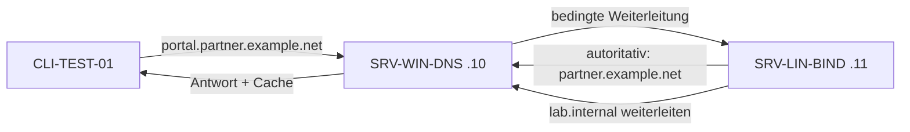

# 07.1 Weiterleitungen, bedingte Weiterleitungen, Caching und TTL

| | |
|---|---|
| **Modul** | 07 Weiterleitungen, bedingte Weiterleitungen, Caching und TTL-Steuerung |
| **Stufe** | Aufbau |
| **Geschätzte Zeit** | 5 bis 7 Stunden (Schätzung; Lehrplan: 8 UE zu 45 Minuten = 6 Stunden) |
| **Werkzeuge** | Windows Server mit DNS-Rolle, Debian/Ubuntu mit BIND 9.18, `rndc`, `dig`, `Resolve-DnsName`, `nslookup`, PowerShell 5.1 |
| **Vorwissen** | Module 01 bis 06 abgeschlossen (Snapshot `m06-ende`) |

> [!WARNING]
> **Stand der Prüfung: Entwurf, Linux-Teil mit Testlauf.** Alle BIND-Befehle und alle Ausgaben im Ordner `beispiele/` stammen aus einem **echten Lauf von BIND 9.18.39 auf Ubuntu 24.04**. Weil es dort keinen Windows-Server gab, hat ein **zweites BIND auf 192.168.50.10 den Windows-Server vertreten** (bedingte Weiterleitung, Cache, TTL-Countdown). Das zeigt das Verhalten eines weiterleitenden, cachenden Servers, aber **nicht** das von Windows. **Der Windows-Teil wurde nicht ausgeführt:** Die Skripte `07.1-windows-weiterleitungen-einrichten.ps1` und `07.1-windows-cache-pruefen.ps1` sind auf Syntax geprüft (PowerShell 7.4.6), das erste ist mit Attrappen gegen die Parameternamen aus Microsoft Learn probegelaufen. Windows-Ausgaben, die Ausgabespalten von `Show-DnsServerCache` und die Bezeichnungen der deutschen Oberfläche sind sinngemäß bzw. *nicht bestätigt*. **Nicht gemessen:** das Zeitverhalten bei einem nicht erreichbaren Weiterleitungsserver (`forward first` gegenüber `forward only`) und das Verhalten von Stub-Zonen; beides ist als Theorie nach der BIND-Dokumentation beschrieben.

## Lernziele

Nach dieser Übung kannst du

- globale Weiterleitungen (Forwarders), Root Hints und bedingte Weiterleitungen unterscheiden und in Windows-DNS und BIND 9 einrichten,
- `forward first;` und `forward only;` erklären und eine bedingte Weiterleitung gegen eine Stub-Zone abwägen,
- positives und negatives Caching (RFC 2308) an gemessenen TTL-Werten nachvollziehen,
- eine IP-Umstellung mit rechtzeitig abgesenkter TTL planen und zeigen, was ein veralteter Cache anrichtet,
- Caches von Server und Client anzeigen und gezielt leeren.

## Voraussetzungen

- Labor mit allen drei VMs, Zustand: Snapshot `m06-ende`.
- Auf SRV-LIN-BIND ist BIND mit den Zonen aus den Modulen 04 bis 06 in Betrieb, auf SRV-WIN-DNS die DNS-Rolle mit `corp.example.com`.
- Die Dateien dieses Ordners liegen bereit: `07.1-db.partner.example.net` und `07.1-weiterleitung-pruefen.sh` auf SRV-LIN-BIND, die `.ps1`-Skripte auf SRV-WIN-DNS.

## Grundbegriffe

| Begriff | Bedeutung |
|---|---|
| **Forwarder (globale Weiterleitung)** | Ein anderer DNS-Server, an den ein rekursiver Server alle Anfragen schickt, die er nicht aus eigenen Zonen oder dem Cache beantworten kann. |
| **Root Hints** | Liste der Root-Server. Ohne Weiterleitung beginnt der Server die Auflösung bei der Wurzel. |
| **Bedingte Weiterleitung** | Weiterleitung nur für eine bestimmte Domäne (Windows: *Conditional Forwarder*; BIND: Zone mit `type forward;`). |
| **Stub-Zone** | Zone, die nur SOA, NS und zugehörige Adressen einer fremden Zone hält (BIND: `type stub;`). |
| **Positives Caching** | Gemerkte Antwort, solange die TTL des Eintrags läuft. |
| **Negatives Caching** | Gemerkte Antwort „Name oder Typ existiert nicht“ (RFC 2308), solange die negative TTL läuft. |
| **TTL** | Time to Live in Sekunden: Wie lange ein Cache eine Antwort behalten darf. |

## Testumgebung

Wie in den Modulen 01 bis 06. Neu: die fiktive Partnerfirma `partner.example.net`, deren Zone auf SRV-LIN-BIND liegt, aber von SRV-WIN-DNS nicht kopiert, sondern **weitergeleitet** wird.

| Zone | Wo definiert | Wer fragt wen |
|---|---|---|
| `partner.example.net` | primär auf SRV-LIN-BIND | SRV-WIN-DNS leitet bedingt an `192.168.50.11` weiter |
| `lab.internal` | primär auf SRV-WIN-DNS | SRV-LIN-BIND leitet bedingt an `192.168.50.10` weiter |



## Aufgabe

### Teil 1: Weiterleitungsarchitektur

*(Lerneinheit 7.1, Theorie mit kurzer Konfigurationsübung)*

Ein rekursiver Server beantwortet eine Anfrage aus eigenen Zonen oder dem Cache. Sonst gibt es zwei Wege: selbst bei der Wurzel beginnen (**Root Hints**) oder die Arbeit an einen **Forwarder** abgeben. Im isolierten Labor ist keiner der beiden Wege zum Internet erfolgreich; deshalb bleiben die globalen Weiterleitungen im Labor leer, und wir arbeiten ausschließlich mit **bedingten** Weiterleitungen.

**1. Aufgabe: Bestandsaufnahme**

- **Windows GUI:** DNS-Manager → Server → Rechtsklick → *Eigenschaften* → Reiter *Weiterleitungen* und Reiter *Stammhinweise*. Die Bezeichnungen der deutschen Oberfläche sind *nicht bestätigt*.
- **Windows PowerShell:**

```powershell
Get-DnsServerForwarder
```

- **BIND:** Weiterleitungen stehen im `options`-Block (`forwarders { … };` und `forward first|only;`). Prüfe, ob in deiner `/etc/bind/named.conf.options` schon etwas steht:

```bash
sudo named-checkconf -p | grep -n -A3 "forward"
```

**2. Was passiert, wenn der Forwarder nicht antwortet?**

Nach der BIND-Dokumentation (ARM):

| Option | Verhalten, wenn der Weiterleitungsserver nicht antwortet |
|---|---|
| `forward first;` | BIND versucht anschließend die normale Auflösung ab der Wurzel. Das ist die Voreinstellung, sobald `forwarders` gesetzt ist. |
| `forward only;` | BIND fragt ausschließlich die Weiterleitungsserver. Antwortet keiner, endet die Anfrage mit einem Fehler (`SERVFAIL`). |

Unter Windows entspricht das dem Kontrollkästchen „Stammhinweise verwenden, wenn keine Weiterleitungen verfügbar sind“ (`-UseRootHint`); laut Microsoft Learn wartet der Server standardmäßig fünf Sekunden auf einen Forwarder, bevor er den nächsten versucht (`-Timeout`). Die Zuordnung der deutschen Oberflächentexte ist *nicht bestätigt*.

```powershell
# Beispiel, nur lesen bzw. im Labor NICHT ausfuehren: es gibt keinen Forwarder
Set-DnsServerForwarder -IPAddress 192.168.50.99 -UseRootHint $false -Timeout 3
```

> **Nicht gemessen:** Im Testlabor wurde ein toter Weiterleitungsserver sofort abgewiesen (die Adresse lag im lokalen Netz des Testrechners) und nicht erst nach einer Zeitüberschreitung. Das Zeitverhalten bei `forward first` gegenüber `forward only` ist deshalb nur aus der Dokumentation beschrieben. Im Hyper-V-Labor kannst du es prüfen, indem du eine Weiterleitung auf eine nicht vergebene Adresse einträgst und die Antwortzeit mit `Measure-Command { Resolve-DnsName … }` bzw. `time dig …` misst.

### Teil 2: Bedingte Weiterleitung statt sekundärer Zone

*(Lerneinheit 7.2, Praxisaufgabe 1)*

**1. BIND: Zone der Partnerfirma anlegen (SRV-LIN-BIND)**

Kopiere die Zonendatei `07.1-db.partner.example.net` nach `/etc/bind/db.partner.example.net` und ergänze in `/etc/bind/named.conf.local`:

```text
zone "partner.example.net" {
    type primary;
    file "/etc/bind/db.partner.example.net";
};
```

```bash
sudo cp 07.1-db.partner.example.net /etc/bind/db.partner.example.net
sudo named-checkzone partner.example.net /etc/bind/db.partner.example.net
sudo named-checkconf
sudo rndc reconfig
dig @192.168.50.11 portal.partner.example.net A +short
```

Erwartet: `192.168.50.88`. Die Zone enthält zusätzlich `migrate.partner.example.net` für Teil 6.

**2. Windows: bedingte Weiterleitung einrichten (SRV-WIN-DNS)**

- **GUI:** DNS-Manager → *Bedingte Weiterleitungen* → Rechtsklick → *Neue bedingte Weiterleitung…* → DNS-Domäne `partner.example.net`, IP-Adresse des Masterservers `192.168.50.11`. Die Bezeichnungen sind *nicht bestätigt*.
- **PowerShell:**

```powershell
Add-DnsServerConditionalForwarderZone -Name "partner.example.net" -MasterServers 192.168.50.11
```

  Mit Vorabprüfung, über das Skript (legt in Teil 3 auf Wunsch auch `lab.internal` an):

```powershell
.\07.1-windows-weiterleitungen-einrichten.ps1 -WhatIf
.\07.1-windows-weiterleitungen-einrichten.ps1
```

**3. Prüfen (CLI-TEST-01)**

```powershell
Resolve-DnsName portal.partner.example.net -Server 192.168.50.10 -Type A
nslookup portal.partner.example.net 192.168.50.10
```

Erwartet: `192.168.50.88`. `nslookup` meldet dabei „Nicht autorisierende Antwort“ (englisch *Non-authoritative answer*): Der Windows-Server hat die Antwort nur weitergegeben. Im Testlauf stand dieselbe Abfrage am Stellvertreter ohne `aa`-Flag (siehe `beispiele/01-bedingte-weiterleitung-und-ttl.txt`).

**4. Bedingte Weiterleitung oder Stub-Zone?**

| | Bedingte Weiterleitung | Stub-Zone |
|---|---|---|
| Was wird gespeichert? | Nur die Adresse(n) des Weiterleitungsziels | SOA, NS und Adressen der Namenserver der fremden Zone |
| Wer wird gefragt? | Immer der eingetragene Weiterleitungsserver | Die in der Stub-Zone bekannten Namenserver der Partnerzone, direkt |
| Pflege | Ändert der Partner seinen Server, muss die Adresse von Hand angepasst werden | Der Server holt die NS-Daten von der Partnerzone selbst und aktualisiert sie |
| Voraussetzung | Das Ziel ist erreichbar | Die Namenserver der Partnerzone müssen für den Abruf erreichbar sein (Zonenübertragung der Stub-Daten) |
| Typischer Einsatz | Kleine, stabile Partneranbindung über einen bekannten Resolver | Partnerzone mit mehreren, wechselnden Namenservern |

> **Nicht getestet:** Das Verhalten von Stub-Zonen wurde im Testlabor nicht geprüft; die Tabelle gibt die Dokumentation und gängige Praxis wieder.

### Teil 3: Bedingte Weiterleitung in der Gegenrichtung (BIND)

*(Lerneinheit 7.2)*

**1. Windows: Zone `lab.internal` anlegen**

```powershell
.\07.1-windows-weiterleitungen-einrichten.ps1 -MitLabInternal
```

Das Skript legt die dateibasierte Zone `lab.internal` mit `testhost` (`192.168.50.120`) an. Manuell:

```powershell
Add-DnsServerPrimaryZone -Name lab.internal -ZoneFile lab.internal.dns -DynamicUpdate None
Add-DnsServerResourceRecordA -ZoneName lab.internal -Name testhost -IPv4Address 192.168.50.120 -TimeToLive 01:00:00
```

**2. BIND: Zone vom Typ `forward`**

Ergänze in `/etc/bind/named.conf.local`:

```text
zone "lab.internal" {
    type forward;
    forward only;
    forwarders { 192.168.50.10; };
};
```

```bash
sudo named-checkconf
sudo rndc reconfig
dig @192.168.50.11 testhost.lab.internal A +short
```

Erwartet: `192.168.50.120`.

**3. Stolperstein: `SERVFAIL` durch DNSSEC-Validierung**

Mit der Einstellung `dnssec-validation auto;` aus Modul 03 prüft BIND auch die weitergeleiteten Antworten. Die Wurzelsignatur lässt sich im isolierten Labor nicht prüfen, und für `lab.internal` gibt es keinen Vertrauensanker. Im Testlauf endete die Abfrage mit `SERVFAIL`, im Log stand `broken trust chain` (siehe `beispiele/05-dnssec-validate-except.txt`). Abhilfe im `options`-Block:

```text
    validate-except { "lab.internal"; };
```

```bash
sudo named-checkconf
sudo rndc reconfig
sudo rndc flush
dig @192.168.50.11 testhost.lab.internal A
```

Danach antwortete der Server mit `NOERROR` und der Adresse. `validate-except` nimmt nur diese Domäne von der Prüfung aus; für alle anderen Namen bleibt die Validierung aktiv.

### Teil 4: Positives Caching und herabzählende TTL

*(Lerneinheit 7.3, Praxisaufgabe 2)*

Leere zuerst den Cache von SRV-WIN-DNS, damit die erste Abfrage sicher weitergeleitet wird:

```powershell
Clear-DnsServerCache -Force
```

Dann von CLI-TEST-01:

```powershell
Resolve-DnsName portal.partner.example.net -Server 192.168.50.10 -Type A -DnsOnly
Start-Sleep -Seconds 15
Resolve-DnsName portal.partner.example.net -Server 192.168.50.10 -Type A -DnsOnly
```

Oder mit `dig` (Linux, auch von SRV-LIN-BIND aus möglich):

```bash
dig @192.168.50.10 portal.partner.example.net A +noall +comments +answer
sleep 15
dig @192.168.50.10 portal.partner.example.net A +noall +comments +answer
```

Erwartet (so im Testlauf, Stellvertreter für Windows):

```text
portal.partner.example.net. 3600 IN	A	192.168.50.88      (erste Abfrage)
portal.partner.example.net. 3585 IN	A	192.168.50.88      (nach 15 Sekunden)
```

Die TTL zählt herunter, und die Antwort trägt kein `aa`-Flag, weil sie aus dem Cache des weiterleitenden Servers kommt. Der Ursprungsserver `192.168.50.11` liefert dagegen immer die volle TTL mit `aa` (`beispiele/01-bedingte-weiterleitung-und-ttl.txt`). Windows-Ausgaben sind *nicht bestätigt*; unter Windows kann die TTL-Spalte von `Resolve-DnsName` anders aussehen.

### Teil 5: Negatives Caching

*(Lerneinheit 7.3)*

Frage einen Namen ab, den es nicht gibt, und wiederhole die Abfrage nach einigen Sekunden:

```bash
dig @192.168.50.10 gibtsnicht.partner.example.net A +noall +comments +authority
sleep 7
dig @192.168.50.10 gibtsnicht.partner.example.net A +noall +authority
```

Erwartet (so gemessen): Status `NXDOMAIN`; im Abschnitt `AUTHORITY` steht der SOA der Zone mit **TTL 300**, nach sieben Sekunden **293**. Die Zone `partner.example.net` hat die Standard-TTL 3600 und im SOA das Minimum 300; maßgeblich ist der **kleinere** der beiden Werte (RFC 2308). Ändere testweise das SOA-Minimum der Zone auf 60, erhöhe die Seriennummer, lade neu, leere den Cache des Weiterleiters und wiederhole die Abfrage: Im Testlauf begann die TTL im Abschnitt `AUTHORITY` dann bei 60.

### Teil 6: Migration mit rechtzeitig abgesenkter TTL

*(Lerneinheit 7.3)*

Der Eintrag `migrate.partner.example.net` hat in der Zonendatei die TTL 86400 (24 Stunden) und zeigt auf `192.168.50.60`. Er soll auf `192.168.50.61` umziehen.

**1. Ausgangslage: Cache füllen**

```bash
dig @192.168.50.10 migrate.partner.example.net A +noall +answer
```

Erwartet: `86400 IN A 192.168.50.60`.

**2. Umstellung ohne Vorbereitung: der Cache bleibt veraltet**

Ändere auf SRV-LIN-BIND die Zeile in `/etc/bind/db.partner.example.net` auf `migrate 300 IN A 192.168.50.61`, erhöhe die Seriennummer und lade neu:

```bash
sudo sed -i 's/^\( *\)2026111201 /\12026111202 /; s/^migrate.*/migrate     300 IN A 192.168.50.61/' /etc/bind/db.partner.example.net
sudo named-checkzone partner.example.net /etc/bind/db.partner.example.net
sudo rndc reload partner.example.net
dig @192.168.50.11 migrate.partner.example.net A +noall +answer
dig @192.168.50.10 migrate.partner.example.net A +noall +answer
```

Im Testlauf lieferte der Ursprungsserver sofort `300 IN A 192.168.50.61`, der weiterleitende Server aber weiter `86397 IN A 192.168.50.60`, die **alte Adresse mit herunterzählender alter TTL** (`beispiele/03-migration-ttl.txt`). Jeder Client, der diesen Server benutzt, landet bis zu 24 Stunden auf dem alten Ziel.

**3. Notbehelf: gezielt vergessen**

Der Betreiber des weiterleitenden Servers kann den Eintrag aus dem Cache nehmen. Das geht nur auf dem Server, den man selbst verwaltet; fremde Caches (Provider, Partner, Clients) kann man nicht leeren.

```bash
sudo rndc flushname migrate.partner.example.net
```

Unter Windows leert `Clear-DnsServerCache -Force` den ganzen Cache (Teil 7). Im Testlauf lieferte der Weiterleiter danach `300 IN A 192.168.50.61`.

**4. Das richtige Vorgehen (Zeitplan)**

Die TTL muss **mindestens eine alte TTL vor der Umstellung** abgesenkt sein, damit kein Cache den Eintrag mehr mit der alten, langen Laufzeit hält:

1. Vorab (spätestens 24 Stunden vor der Umstellung): TTL des Eintrags von 86400 auf z. B. 300 senken, Seriennummer erhöhen. Ab jetzt erneuern alle Caches den Eintrag spätestens nach 24 Stunden mit der neuen kurzen TTL.
2. Mindestens eine volle alte TTL warten.
3. Umstellung: IP ändern, Seriennummer erhöhen. Veraltete Caches halten die alte Adresse höchstens 300 Sekunden.
4. Nach erfolgreicher Umstellung und Beobachtung: TTL wieder erhöhen.

Für die Frage im Lehrplan („Freitag, TTL 86400“) heißt das: Die TTL spätestens am Donnerstag vor der Umstellung senken, besser früher, und die IP erst danach ändern.

### Teil 7: Cache anzeigen und leeren

*(Lerneinheit 7.4, Praxisaufgabe 3)*

**1. Windows-Server**

- **GUI:** DNS-Manager → Menü *Ansicht* → *Erweitert* → Knoten *Zwischengespeicherte Lookups*; Rechtsklick auf den Server → *Cache löschen*. Die Bezeichnungen sind *nicht bestätigt*.
- **PowerShell:**

```powershell
Show-DnsServerCache
Clear-DnsServerCache -Force
```

  Mit Filter und Vorabprüfung, über das Skript:

```powershell
.\07.1-windows-cache-pruefen.ps1
.\07.1-windows-cache-pruefen.ps1 -ServerCacheLeeren -ClientCacheLeeren -WhatIf
```

  Die Spalten von `Show-DnsServerCache` sind *nicht bestätigt*; das Skript filtert auf `HostName`. Zeigt es nichts an, rufe `Show-DnsServerCache | Format-List *` auf und passe den Filter an.

**2. BIND**

Frage zuerst einen Namen ab, der **nicht** aus einer eigenen Zone kommt (hier über die Weiterleitung `lab.internal`), dann:

```bash
dig @192.168.50.11 testhost.lab.internal A +short
sudo rndc dumpdb -cache
sudo grep -n -B1 -A2 testhost /var/cache/bind/named_dump.db
sudo rndc flush
sudo rndc dumpdb -cache
sudo grep -c testhost /var/cache/bind/named_dump.db
```

Erwartet (so gemessen): Vor dem Leeren steht `testhost.lab.internal. 3600 IN A 192.168.50.120` in der Datei, nach `rndc flush` zählt `grep -c` null Treffer. Siehe `beispiele/04-cache-dump-und-flush-bind.txt`. Einen einzelnen Namen entfernt `rndc flushname <name>`.

> **Hinweis für das Fachlektorat:** Der Lehrplan lässt den Cache nach einer Abfrage von `winserver.corp.example.com` auf SRV-LIN-BIND ausgeben. Seit Modul 06 ist SRV-LIN-BIND aber **Sekundärserver** für `corp.example.com` und beantwortet den Namen aus der Zone, nicht aus dem Cache; ein Cache-Dump enthielte ihn nicht. Dafür eignet sich ein weitergeleiteter Name wie `testhost.lab.internal`.

**3. Client (CLI-TEST-01)**

```powershell
Get-DnsClientCache
Clear-DnsClientCache
```

```text
ipconfig /displaydns
ipconfig /flushdns
```

`ipconfig /flushdns` und `Clear-DnsClientCache` leeren den lokalen Resolver-Cache; die Caches der Server bleiben unberührt. Das ist der Grund, weshalb nach einer Migration oft ein Client noch die alte Adresse sieht, obwohl der Client-Cache leer ist: Der veraltete Eintrag steckt dann im Cache des Servers (Teil 6).

## Hintergrund

### Warum Caches TTLs brauchen

Ein Cache entlastet die autoritativen Server und beschleunigt Antworten. Der Preis ist Veralterung: Ändert sich der Eintrag, sehen Clients bis zum Ablauf der TTL die alte Version. Die TTL ist deshalb ein Kompromiss zwischen Last und Aktualität und wird vor geplanten Änderungen gezielt verkürzt.

### Negatives Caching

RFC 2308 definiert, dass auch die Antwort „existiert nicht“ gemerkt wird. Die Dauer ergibt sich aus dem SOA-Eintrag, den der Server mit der Negativantwort mitschickt: der kleinere Wert aus der TTL des SOA-Eintrags und dem SOA-Minimum-Feld. Legt man einen Eintrag neu an, den ein Cache gerade als nicht vorhanden gemerkt hat, sieht der Client ihn erst nach Ablauf dieser Zeit.

### Weiterleiten oder selbst auflösen

Ein Forwarder bündelt den Verkehr (ein Cache für viele Server, eine Firewall-Öffnung), macht aber den Weiterleitungsserver zur Abhängigkeit. `forward only;` ist vorhersehbar und eignet sich für bedingte Weiterleitungen in geschlossene Netze; `forward first;` fängt einen Ausfall ab, wenn die Wurzel erreichbar ist.

## Hinweise

- Die Zone `partner.example.net` wird **nicht** übertragen. Ändert sich der Eintrag auf SRV-LIN-BIND, sieht SRV-WIN-DNS ihn erst, wenn der Cache abläuft oder geleert wird.
- Erhöhe nach jeder Änderung einer BIND-Zonendatei die Seriennummer.
- Die Einstellung `validate-except { "lab.internal"; };` gehört nur ins Labor.
- Snapshot `m07-ende` nach Abschluss.

## Prüfbefehle

```bash
bash 07.1-weiterleitung-pruefen.sh
dig @192.168.50.10 portal.partner.example.net A +noall +comments +answer
dig @192.168.50.11 testhost.lab.internal A +short
sudo rndc dumpdb -cache
```

```powershell
Get-DnsServerZone | Where-Object ZoneName -eq 'partner.example.net'
Resolve-DnsName portal.partner.example.net -Server 192.168.50.10 -Type A -DnsOnly
Get-DnsClientCache
```

**Kontrollfragen**

1. Worin unterscheiden sich die BIND-9-Optionen `forward first;` und `forward only;`, wenn der eingetragene Weiterleitungsserver (Forwarder) nicht erreichbar ist?
2. Wann sollten Sie in einem Unternehmensnetzwerk eine bedingte Weiterleitung (Conditional Forwarder) einsetzen und wann ist stattdessen eine Stub-Zone vorteilhafter?
3. Sie planen für kommenden Freitag die Umstellung der IP-Adresse eines geschäftskritischen Webservers, dessen `A`-Record aktuell eine TTL von 86.400 Sekunden (24 Stunden) aufweist. Welche Schritte müssen Sie im Vorfeld der Umstellung durchführen, um Ausfallzeiten durch veraltete Caches zu minimieren?
4. Warum speichert ein rekursiver DNS-Server auch negative Antworten (`NXDOMAIN`) für eine gewisse Zeit im Cache, und welcher Wert in der abgefragten Zone bestimmt diese Speicherdauer?

## Erweiterungen

- Die Antwortzeit bei einem toten Weiterleitungsserver für `forward first;` und `forward only;` messen und mit Teil 1 vergleichen.
- `max-cache-ttl` und `max-ncache-ttl` im `options`-Block von BIND setzen und beobachten, wie sie lange TTLs bzw. negative TTLs begrenzen (Optionen nach ARM, im Testlauf nicht geprüft).
- Eine Stub-Zone (`type stub;`) für `partner.example.net` auf SRV-LIN-BIND bzw. eine Stub-Zone auf SRV-WIN-DNS anlegen und mit der bedingten Weiterleitung vergleichen.
- Den Cache nach jedem Schritt von Teil 6 mit `rndc dumpdb -cache` ansehen und die TTL des Eintrags `migrate` verfolgen.
- Die Weiterleitung für `partner.example.net` auf eine nicht vorhandene Adresse ändern und das Verhalten (Fehlerbild, Dauer) auf Windows und BIND vergleichen.

## Musterlösung

<details>
<summary>Musterlösung anzeigen</summary>

### Teil 1

`Get-DnsServerForwarder` ist im Labor ohne Einträge. `forward first;` fällt bei Ausfall des Weiterleiters auf die normale Auflösung zurück, `forward only;` gibt `SERVFAIL` zurück.

### Teil 2

Kontrollwert: `192.168.50.88` von Windows, nicht autoritativ. Das Prüfskript meldet „alles in Ordnung“.

### Teil 3

`testhost.lab.internal` ergibt `192.168.50.120`. Ohne `validate-except` ergibt die Abfrage `SERVFAIL` mit der Logzeile `broken trust chain`.

### Teil 4

TTL 3600 bei der ersten Abfrage, danach niedriger (im Test 3585 nach 15 Sekunden). Kein `aa`-Flag beim Weiterleiter, `aa` beim Ursprungsserver.

### Teil 5

`NXDOMAIN` mit SOA im Abschnitt `AUTHORITY`; TTL 300, sinkend (293). Ändert man das SOA-Minimum auf 60, beginnt die negative TTL bei 60 (so gemessen).

### Teil 6

Der Weiterleiter liefert nach der Änderung weiter `86397 IN A 192.168.50.60`; nach `rndc flushname` kommt `300 IN A 192.168.50.61`.

### Teil 7

Vor `rndc flush` ein Treffer im Dump, danach null.

### Antworten auf die Kontrollfragen

1. Bei `forward first;` versucht BIND nach dem Ausfall des Weiterleiters die normale rekursive Auflösung (Wurzel), bei `forward only;` gibt es keinen Rückfall, die Anfrage scheitert mit `SERVFAIL`. (Nach ARM; das Zeitverhalten wurde im Test nicht gemessen.)
2. Die bedingte Weiterleitung eignet sich, wenn ein bekannter, stabiler Resolver oder Namenserver für eine Partner- oder Fusionsdomäne erreichbar ist und wenig Pflegeaufwand gewünscht ist. Die Stub-Zone ist vorteilhaft, wenn die Namenserver der Zielzone wechseln oder es mehrere gibt, weil der Server die NS-Daten der Zielzone selbst aktuell hält; sie setzt voraus, dass die Namenserver der Zielzone erreichbar sind.
3. TTL des Eintrags mindestens 24 Stunden (eine alte TTL) vor der Umstellung auf einen kleinen Wert (z. B. 300 Sekunden) senken, Seriennummer erhöhen; die Absenkung wirkt erst, wenn die alte TTL abgelaufen ist. Dann die IP-Adresse am Freitag umstellen, beobachten und die TTL danach wieder erhöhen. Das heißt konkret: die TTL spätestens am Donnerstag der Vorwoche bzw. mindestens 24 Stunden vor dem Termin senken.
4. Um wiederholte Anfragen nach nicht existierenden Namen nicht jedes Mal an den autoritativen Server zu schicken (Entlastung, Geschwindigkeit). Die Dauer bestimmt der SOA-Eintrag der abgefragten Zone, genauer der kleinere Wert aus der SOA-TTL und dem SOA-Minimum-Feld (RFC 2308). Im Test: 300 Sekunden.

</details>

## Aufräumen und Rückkehr zum Ausgangszustand

- `migrate` kann bleiben oder in der Zonendatei auf die Ausgangswerte (`86400 IN A 192.168.50.60`) zurückgesetzt werden (Seriennummer erhöhen).
- Die bedingte Weiterleitung `partner.example.net`, die Zone `lab.internal` und `validate-except` **bleiben** für die folgenden Module bestehen.
- Caches mit `Clear-DnsServerCache -Force`, `sudo rndc flush` und `Clear-DnsClientCache` leeren.
- Snapshot `m07-ende` auf allen drei VMs.

## Quellen

- RFC 2308 (Negative Caching of DNS Queries): <https://datatracker.ietf.org/doc/html/rfc2308>
- RFC 1034 und RFC 1035 (Grundlagen, TTL): <https://datatracker.ietf.org/doc/html/rfc1034>, <https://datatracker.ietf.org/doc/html/rfc1035>
- Microsoft Learn: *Set-DnsServerForwarder* (`-UseRootHint`, `-Timeout`): <https://learn.microsoft.com/powershell/module/dnsserver/set-dnsserverforwarder>
- Microsoft Learn: *Add-DnsServerConditionalForwarderZone*: <https://learn.microsoft.com/powershell/module/dnsserver/add-dnsserverconditionalforwarderzone>
- Microsoft Learn: *Clear-DnsServerCache*, *Show-DnsServerCache*: <https://learn.microsoft.com/powershell/module/dnsserver/clear-dnsservercache>, <https://learn.microsoft.com/powershell/module/dnsserver/show-dnsservercache>
- Microsoft Learn: *Add-DnsServerResourceRecordA*: <https://learn.microsoft.com/powershell/module/dnsserver/add-dnsserverresourcerecorda>
- Microsoft Learn: *Clear-DnsClientCache*: <https://learn.microsoft.com/powershell/module/dnsclient/clear-dnsclientcache>
- ISC: *BIND 9 Administrator Reference Manual*, `forward`, `forwarders`, `validate-except`, `rndc`: <https://bind9.readthedocs.io/>
- Eigene Messungen mit BIND 9.18.39 auf Ubuntu 24.04
