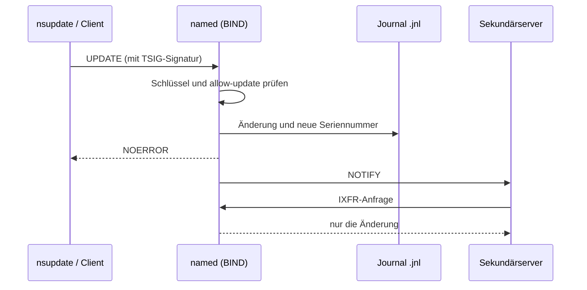

# 08.1 Dynamische DNS-Updates und Active-Directory-integrierte Zonen

| | |
|---|---|
| **Modul** | 08 Dynamische DNS-Updates (DDNS) und Active-Directory-integrierte Zonen |
| **Stufe** | Aufbau |
| **Geschätzte Zeit** | 8 bis 10 Stunden (Schätzung; Lehrplan: 10 UE zu 45 Minuten = 7,5 Stunden, plus Zeit für Heraufstufung und Domänenbeitritt) |
| **Werkzeuge** | Windows Server mit DNS-Rolle und AD DS, Debian/Ubuntu mit BIND 9.18, `nsupdate`, `tsig-keygen`, `rndc`, `named-journalprint`, PowerShell 5.1 |
| **Vorwissen** | Module 01 bis 07 abgeschlossen (Snapshot `m07-ende`) |

> [!WARNING]
> **Stand der Prüfung: Entwurf, nur der BIND-Teil wurde ausgeführt.** Alle Befehle, Konfigurationen und Ausgaben zu `tsig-keygen`, `nsupdate`, `allow-update`, `update-policy`, Journal, `rndc freeze`/`thaw` stammen aus einem **echten Lauf von BIND 9.18.39 auf Ubuntu 24.04** (Testumgebung, ohne systemd und ohne AppArmor-Durchsetzung; Beispiele in `beispiele/`). **Der gesamte Windows-Teil wurde nicht ausgeführt:** die Heraufstufung zum Domänencontroller, die Umwandlung in AD-integrierte Zonen, sichere Updates, der Domänenbeitritt, Aging und Scavenging. Die vier `.ps1`-Skripte sind auf Syntax geprüft (PowerShell 7.4.6) und mit Attrappen gegen die Parameternamen aus Microsoft Learn probegelaufen. Verhalten und Ausgaben von Windows sowie die Bezeichnungen der deutschen Oberfläche sind sinngemäß bzw. *nicht bestätigt*. Mehrere Stellen, die der Lehrplan anders darstellt, sind als **Hinweis für das Fachlektorat** markiert.

## Lernziele

Nach dieser Übung kannst du

- erklären, wie dynamische Updates nach RFC 2136 ablaufen und wie sich Windows-Clients und ein DHCP-Server daran beteiligen,
- begründen, warum Active Directory ohne DNS nicht funktioniert, und die Rolle der `SRV`-Einträge unter `_msdcs` benennen,
- eine dateibasierte Zone in eine AD-integrierte Zone umwandeln und sichere dynamische Updates einstellen,
- Aging und Scavenging (Nichtaktualisierungs- und Aktualisierungsintervall) einrichten und statische von dynamischen Einträgen unterscheiden,
- in BIND dynamische Updates mit TSIG-Schlüssel, `allow-update` bzw. `update-policy` und `nsupdate` einrichten, das Journal lesen und eine dynamische Zone mit `rndc freeze`/`thaw` sicher von Hand bearbeiten.

## Voraussetzungen

- Labor mit allen drei VMs, Zustand: Snapshot `m07-ende`.
- Auf SRV-WIN-DNS ist `corp.example.com` eine **dateibasierte** primäre Zone mit Übertragung an `192.168.50.11` (Module 05/06), auf SRV-LIN-BIND ist `branch.example.org` primär mit den Einträgen aus Modul 05.
- Die Dateien dieses Ordners liegen bereit: die `.ps1`-Skripte auf SRV-WIN-DNS bzw. CLI-TEST-01, die übrigen Dateien auf SRV-LIN-BIND.
- **Achtung:** Die Heraufstufung zum Domänencontroller (Teil 2) verändert SRV-WIN-DNS grundlegend und lässt sich nicht einfach rückgängig machen. Lege vorher den Snapshot an und benutze nur das isolierte Labor.

## Grundbegriffe

| Begriff | Bedeutung |
|---|---|
| **Dynamisches Update** | Ein Client oder Dienst ändert Einträge direkt im DNS (Opcode `UPDATE`, RFC 2136). |
| **AD-integrierte Zone** | Zone, die nicht in einer Datei, sondern im Active-Directory-Verzeichnis liegt und mit AD repliziert wird. |
| **Sichere dynamische Updates** | Nur authentifizierte Clients dürfen ändern (unter Windows Kerberos/GSS-TSIG), nur der Ersteller eines Eintrags darf ihn überschreiben. |
| **`_msdcs`** | Teilbaum der Domäne mit den Einträgen, über die Clients Domänencontroller finden. |
| **Aging / Scavenging** | Zeitstempel an dynamischen Einträgen und das automatische Löschen veralteter Einträge. |
| **TSIG-Schlüssel** | Gemeinsames Geheimnis (HMAC), mit dem BIND Update-Anfragen authentifiziert (RFC 8945). |
| **Journal (`.jnl`)** | Binärdatei neben der Zonendatei, in der BIND dynamische Änderungen festhält. |

## Testumgebung

Wie in den Modulen 01 bis 07. Neu: `SRV-WIN-DNS` wird Domänencontroller der Gesamtstruktur `corp.example.com`; `CLI-TEST-01` tritt der Domäne bei.

| Zone | Wo | Neu in Modul 08 |
|---|---|---|
| `corp.example.com` | SRV-WIN-DNS | AD-integriert, nur sichere Updates; BIND bleibt Sekundärserver |
| `50.168.192.in-addr.arpa` | SRV-WIN-DNS | AD-integriert, nur sichere Updates; BIND bleibt Sekundärserver |
| `branch.example.org` | SRV-LIN-BIND | dynamisch, Updates nur mit Schlüssel `ddns-key` |



## Aufgabe

### Teil 1: Dynamische Updates verstehen

*(Lerneinheit 8.1)*

Ein dynamisches Update ist eine DNS-Nachricht mit dem Opcode `UPDATE` (RFC 2136). Sie nennt die Zone und enthält Bedingungen (Voraussetzungen) und Änderungen: Einträge hinzufügen oder löschen. Der Primärserver der Zone führt die Änderung atomar aus, erhöht die Seriennummer und sendet NOTIFY an die Sekundärserver (siehe Modul 06). Ein Sekundärserver nimmt keine Updates an; je nach Konfiguration leitet er sie an den Primärserver weiter (bei BIND `allow-update-forwarding`, hier nicht benutzt).

Wer registriert was?

| Wer | Was | Wie |
|---|---|---|
| Windows-Client | eigener A-/AAAA-Eintrag, auf Wunsch PTR | beim Start, bei Adressänderung, mit `ipconfig /registerdns` bzw. `Register-DnsClient` |
| DHCP-Server | A und PTR im Namen von Clients | Konfiguration des DHCP-Servers (eigener Lehrplan; hier nur als Überblick) |
| Domänencontroller | seine `SRV`-Einträge unter `_msdcs` und den Standorten | der Dienst *Netlogon* registriert sie dynamisch |
| Administrator / Skript | beliebige Einträge | `nsupdate` (BIND) oder `Add-DnsServerResourceRecord` |

Der Client ermittelt den zuständigen Primärserver über die SOA-Abfrage seiner Zone und schickt das Update dorthin (so üblich; im Labor nicht mitgeschnitten).

**Aufgabe:** Beschreibe in zwei Sätzen, warum eine Sekundärzone nie dynamisch aktualisiert werden kann, auch wenn die Zone auf dem Primärserver dynamische Updates erlaubt.

### Teil 2: Active Directory und AD-integrierte Zonen auf SRV-WIN-DNS

*(Lerneinheit 8.2, Praxisaufgabe 1; nicht ausgeführt, siehe Warnhinweis)*

**Warum AD ohne DNS nicht funktioniert.** Ein Client findet einen Domänencontroller nicht über Broadcasts, sondern über DNS: Er fragt `SRV`-Einträge wie `_ldap._tcp.dc._msdcs.corp.example.com` ab. Sie nennen die Namen und Ports der Domänencontroller, die er per `A`-Eintrag in eine Adresse auflöst. Fehlen die Einträge, scheitern Anmeldung, Domänenbeitritt und Gruppenrichtlinien.

**1. Vorbereitung (SRV-WIN-DNS)**

Snapshot `m07-ende` anlegen, falls noch nicht geschehen. Dann:

```powershell
.\08.1-windows-vor-heraufstufung.ps1 -WhatIf
.\08.1-windows-vor-heraufstufung.ps1
```

Das Skript prüft, dass `corp.example.com` dateibasiert ist, erlaubt vorläufig dynamische Updates (`NonsecureAndSecure`) und zeigt die DNS-Server der Netzwerkkarten an.

> **Hinweis für das Fachlektorat:** Der Lehrplan stuft den Server mit `Install-ADDSForest -DomainName "corp.example.com" -InstallDns:$false` herauf. Damit legt der Assistent keine Zone an, und Netlogon muss seine Einträge in die **vorhandene** Zone eintragen. Ob das mit einer dateibasierten Zone ohne vorherige Freigabe dynamischer Updates gelingt, ist hier *nicht bestätigt*; deshalb erlaubt das Vorbereitungsskript Updates vorläufig. Zusätzlich: Laut Microsoft Learn richtet `Install-ADDSForest` bei bereits installierter DNS-Rolle automatisch DNS-Clienteinstellungen, Weiterleitungen und Stammhinweise ein, wenn man `-SkipAutoConfigureDns` nicht angibt. Prüfe nach der Heraufstufung `Get-DnsServerForwarder` und die DNS-Servereinstellung der Netzwerkkarte (laut Microsoft Learn wird für das AD-integrierte DNS der bevorzugte DNS-Server auf `127.0.0.1` gesetzt).

**2. Heraufstufung**

- **GUI:** Server-Manager → *Rollen und Features hinzufügen* → *Active Directory-Domänendienste* → Warnsymbol → *Server zu einem Domänencontroller heraufstufen* → *Neue Gesamtstruktur hinzufügen* → Stammdomänenname `corp.example.com`. Bei den Domänencontrolleroptionen die Auswahl des DNS-Servers entsprechend `-InstallDns:$false` setzen. Die Bezeichnungen und die genaue Entsprechung sind *nicht bestätigt*.
- **PowerShell:**

```powershell
Install-WindowsFeature AD-Domain-Services -IncludeManagementTools
Test-ADDSForestInstallation -DomainName corp.example.com -InstallDns:$false
Install-ADDSForest -DomainName corp.example.com -InstallDns:$false
```

Das Kennwort für den Verzeichnisdienst-Wiederherstellungsmodus (DSRM) fragt `Install-ADDSForest` selbst ab, wenn `-SafeModeAdministratorPassword` fehlt. **Gib es selbst ein und notiere es nur in deinem Passwortmanager; es gehört nie in ein Skript, eine Datei dieses Ordners oder ein Repository.** Der Server startet nach der Heraufstufung neu.

**3. Zonen umwandeln und Updates absichern**

- **GUI:** DNS-Manager → Zone → Rechtsklick → *Eigenschaften* → *Allgemein* → Schaltfläche *Ändern…* beim Typ → *Zone in Active Directory speichern*; bei *Dynamische Updates* → *Nur sichere*. Die Bezeichnungen sind *nicht bestätigt*.
- **PowerShell:**

```powershell
ConvertTo-DnsServerPrimaryZone -Name corp.example.com -ReplicationScope Domain -Force
Set-DnsServerPrimaryZone -Name corp.example.com -DynamicUpdate Secure
```

  Für beide Zonen (Forward und IPv4-Reverse) samt erneuter Freigabe der Übertragung an BIND, mit Vorabprüfung:

```powershell
.\08.1-windows-ad-zonen-umwandeln.ps1 -WhatIf
.\08.1-windows-ad-zonen-umwandeln.ps1
```

> **Hinweis für das Fachlektorat:** Der Lehrplan nennt für die Einstellung „Nur sichere“ den Wert `SecureOnly`. In Microsoft Learn sind für `-DynamicUpdate` die Werte `None`, `Secure` und `NonsecureAndSecure` dokumentiert; die Skripte verwenden `Secure`.

`-ReplicationScope Domain` entspricht dem Replikationsbereich „an alle DNS-Server in der Domäne“ (Partition `DomainDnsZones`); `Forest` entspricht `ForestDnsZones`. In einer Umgebung mit nur einem Domänencontroller ist der Unterschied nicht zu beobachten. Die Spaltennamen `DynamicUpdate` und `ReplicationScope` in der Ergebnisanzeige des Skripts sind *nicht bestätigt*; fehlt eine Spalte, zeigt `Get-DnsServerZone -Name corp.example.com | Format-List *` alle Eigenschaften.

**4. `_msdcs`-Einträge prüfen**

```powershell
Get-DnsServerResourceRecord -ZoneName corp.example.com -RRType SRV | Format-Table HostName, RecordType -AutoSize
Resolve-DnsName -Type SRV _ldap._tcp.dc._msdcs.corp.example.com -Server 192.168.50.10
```

Erwartet: SRV-Einträge, die auf `winserver.corp.example.com` zeigen. Wo genau sie liegen, hängt davon ab, wie der Assistent die Zone angelegt hat; bei einer vom Assistenten erstellten DNS-Installation liegt `_msdcs` in einer eigenen Zone, hier wahrscheinlich als Teilbaum in `corp.example.com` (*nicht bestätigt*). Nach meinem Kenntnisstand schreibt Netlogon die Einträge zusätzlich in die Datei `netlogon.dns` unter `%SystemRoot%\System32\config`, falls man sie von Hand eintragen muss.

**5. Übertragung an BIND prüfen**

Der Lehrplan verlangt, nach der Umwandlung zu prüfen, dass die Zonenübertragung an `192.168.50.11` noch aktiv ist (das Umwandlungsskript setzt sie erneut):

```powershell
Get-DnsServerZone -Name corp.example.com | Format-List *
```

(Die Eigenschaftsnamen für Übertragung und Benachrichtigung sind *nicht bestätigt*.) Auf SRV-LIN-BIND:

```bash
sudo rndc retransfer corp.example.com
dig @192.168.50.11 corp.example.com SOA +short
dig @192.168.50.10 corp.example.com SOA +short
```

Beide Seriennummern müssen gleich sein.

**6. Client in die Domäne aufnehmen (CLI-TEST-01)**

```powershell
Set-DnsClientServerAddress -InterfaceAlias "Ethernet" -ServerAddresses 192.168.50.10
Add-Computer -DomainName corp.example.com -Credential (Get-Credential) -Restart
```

(`Get-Credential` fragt nach den Zugangsdaten eines Domänenadministrators; du gibst sie selbst ein. Der Name der Netzwerkkarte ist ein Beispiel.) Nach dem Neustart:

```powershell
.\08.1-windows-client-registrierung.ps1
```

oder klassisch:

```text
ipconfig /registerdns
nslookup cli-test-01.corp.example.com 192.168.50.10
```

Erwartet: A-Eintrag `cli-test-01.corp.example.com` → `192.168.50.100`. Prüfe im DNS-Manager, dass der Eintrag einen Zeitstempel trägt.

### Teil 3: Aging und Scavenging

*(Lerneinheit 8.3, Praxisaufgabe 2; nicht ausgeführt)*

Dynamisch registrierte Einträge bleiben stehen, auch wenn der Rechner verschwindet. Aging versieht sie mit einem Zeitstempel; Scavenging löscht abgelaufene.

| Intervall | Aufgabe |
|---|---|
| **Nichtaktualisierungsintervall** (*No-Refresh*) | Zeit nach dem letzten Zeitstempel, in der Aktualisierungen des Zeitstempels **nicht** angenommen werden. Das spart Schreibvorgänge und Replikation, weil ein Client, der alle paar Stunden registriert, nicht jedes Mal einen Datensatz ändert. |
| **Aktualisierungsintervall** (*Refresh*) | Danach darf der Eintrag aktualisiert werden. Wird er in diesem Fenster nicht aktualisiert, gilt er als veraltet und darf beim nächsten Scavenging gelöscht werden. |

Mit 7 Tagen und 7 Tagen kann ein Eintrag frühestens nach 14 Tagen ohne Aktualisierung aufgeräumt werden. Statische Einträge (von Hand angelegt, ohne Zeitstempel) werden nie aufgeräumt.

```powershell
Set-DnsServerZoneAging -Name corp.example.com -Aging $true -NoRefreshInterval 7.00:00:00 -RefreshInterval 7.00:00:00
Set-DnsServerScavenging -ScavengingState $true -ScavengingInterval 7.00:00:00
```

Beides mit Vorabprüfung und Anzeige der Zeitstempel über das Skript:

```powershell
.\08.1-windows-aging-einrichten.ps1 -WhatIf
.\08.1-windows-aging-einrichten.ps1
```

- **GUI:** Zone → *Eigenschaften* → *Allgemein* → *Alterung…* (Kontrollkästchen *Veraltete Ressourceneinträge aufräumen* und beide Intervalle); Server → *Eigenschaften* → *Erweitert* → *Veraltete Ressourceneinträge automatisch aufräumen*. Die Bezeichnungen sind *nicht bestätigt*.
- **Statisch oder dynamisch:** Im DNS-Manager zeigt die Spalte *Zeitstempel* bei statischen Einträgen „statisch“, bei dynamischen Datum und Uhrzeit. In PowerShell ist die Eigenschaft `Timestamp` des Eintrags bei statischen Einträgen leer (*nicht bestätigt*).
- Laut Microsoft Learn ist Aging standardmäßig aus; ein Eintrag, den du per `Add-DnsServerResourceRecord` mit `-AgeRecord` anlegst, bekommt ebenfalls einen Zeitstempel.

> **Vorsicht:** Aktiviere Scavenging nur, wenn du die Intervalle verstanden hast. Das Löschen läuft automatisch; ein zu kurzes Intervall kann gültige Einträge entfernen (Microsoft Learn: Wert nicht kleiner wählen als der längste Aktualisierungszeitraum eines Eintrags der Zone).

### Teil 4: Dynamische Updates mit TSIG in BIND

*(Lerneinheit 8.4, Praxisaufgabe 3; im Testlauf ausgeführt)*

**1. Schlüssel erzeugen**

```bash
sudo tsig-keygen -a hmac-sha256 ddns-key | sudo tee /etc/bind/ddns.key > /dev/null
sudo chown root:bind /etc/bind/ddns.key
sudo chmod 640 /etc/bind/ddns.key
ls -l /etc/bind/ddns.key
sudo sed 's/secret ".*"/secret "<GESCHWAERZT>"/' /etc/bind/ddns.key
```

Erwartet (so gemessen): `-rw-r----- 1 root bind … /etc/bind/ddns.key`, und der Inhalt hat die Form `key "ddns-key" { algorithm hmac-sha256; secret "…"; };`. **Zeige das Geheimnis niemals in Chats, Berichten oder Repositories.** Der `sed`-Befehl zeigt die Datei mit geschwärztem Geheimnis.

**2. Zonendatei verlegen und Updates erlauben**

`named` (Benutzer `bind`) darf unter `/etc/bind` nichts anlegen (so in Modul 06 gemessen); die Journaldatei muss aber neben der Zonendatei entstehen. Deshalb liegt die Datei einer dynamischen Zone unter `/var/lib/bind`:

```bash
sudo cp -p /etc/bind/db.branch.example.org /var/lib/bind/db.branch.example.org
sudo chown bind:bind /var/lib/bind/db.branch.example.org
ls -ld /var/lib/bind
```

Im Testlauf gehörte `/var/lib/bind` `root:bind` mit Modus `775`. Passe `/etc/bind/named.conf.local` an (Vorlage: `08.1-named.conf.local-ausschnitt`): `include "/etc/bind/ddns.key";` an den Anfang, in der Zone den Pfad `file "/var/lib/bind/db.branch.example.org";` und die Zeile `allow-update { key "ddns-key"; };`.

```bash
sudo named-checkconf
sudo rndc reconfig
sudo rndc zonestatus branch.example.org
```

Erwartet (so gemessen): `files: /var/lib/bind/db.branch.example.org`, `dynamic: yes`, `frozen: no`.

Die alte Datei in `/etc/bind` bleibt als Sicherung liegen; BIND liest sie nicht mehr.

**3. Dynamisches Update mit `nsupdate`**

```bash
dig @192.168.50.11 branch.example.org SOA +short
nsupdate -k /etc/bind/ddns.key 08.1-nsupdate-dynhost.txt
dig @192.168.50.11 dynhost.branch.example.org A +noall +answer
dig @192.168.50.11 branch.example.org SOA +short
```

Die Datei `08.1-nsupdate-dynhost.txt` enthält `server`, `zone`, `update add dynhost.branch.example.org 300 A 192.168.50.77` und `send`. Interaktiv geht es auch: `nsupdate -k /etc/bind/ddns.key`, dann die Zeilen eintippen, Abschluss mit `send` und Strg+D.

Erwartet (so gemessen, `beispiele/01-nsupdate-hinzufuegen.md`): `dynhost.branch.example.org. 300 IN A 192.168.50.77`; die Seriennummer stieg **von selbst** um 1 (2026111104 → 2026111105); der Sekundärserver erhielt den Eintrag per NOTIFY und IXFR. Im Log:

```text
client … 192.168.50.11#50380/key ddns-key: signer "ddns-key" approved
client … updating zone 'branch.example.org/IN': adding an RR at 'dynhost.branch.example.org' A 192.168.50.77
zone branch.example.org/IN: sending notifies (serial 2026111105)
```

Löschen: `update delete dynhost.branch.example.org A` und `send`.

**4. Ohne Schlüssel wird abgelehnt**

```bash
nsupdate <<'EOF'
server 192.168.50.11
zone branch.example.org
update add evil.branch.example.org 300 A 192.168.50.66
send
EOF
```

Erwartet (so gemessen): `update failed: REFUSED`, der Eintrag existiert nicht (`NXDOMAIN`); im Log steht `update 'branch.example.org/IN' denied`.

**5. Zonendatei und Journal ansehen**

```bash
ls -l /var/lib/bind
grep -c dynhost /var/lib/bind/db.branch.example.org
sudo named-journalprint /var/lib/bind/db.branch.example.org.jnl
```

Erwartet (so gemessen, `beispiele/03-journal.md`): `db.branch.example.org.jnl` ist entstanden, die Zonendatei enthält `dynhost` noch **nicht** (Anzahl 0), das Journal zeigt das Löschen und Hinzufügen des SOA und den neuen A-Eintrag. Die dynamischen Änderungen stehen also zunächst nur im Journal; die Datei wird erst bei bestimmten Anlässen neu geschrieben (hier beim Einfrieren).

**6. Von Hand bearbeiten: erst einfrieren**

Falsch (so gemessen, `beispiele/04-bearbeiten-ohne-freeze.md`): Hängt man eine Zeile an die laufende Datei an und versucht `sudo rndc reload branch.example.org`, antwortet BIND `rndc: 'reload' failed: dynamic zone`. Die neue Zeile bleibt unbeachtet (`NXDOMAIN` für den Namen). Schlimmer: Beim nächsten `rndc freeze` schreibt BIND die Datei aus dem Speicher neu, und die von Hand angehängte Zeile ist **weg**. Außerdem gehen Kommentare und die ursprüngliche Formatierung der Datei verloren (die neu geschriebene Datei hat BINDs eigenes Format, `$ORIGIN`-Zeilen, englische Kommentare im SOA).

Richtig (so gemessen, `beispiele/05-freeze-bearbeiten-thaw.md`):

```bash
sudo rndc freeze branch.example.org
sudo nano /var/lib/bind/db.branch.example.org
sudo named-checkzone branch.example.org /var/lib/bind/db.branch.example.org
sudo rndc thaw branch.example.org
```

Im Editor die Seriennummer **erhöhen** und die Änderung vornehmen (im Test: Seriennummer 2026111105 → 2026111106 und die Zeile `hand IN A 192.168.50.78`). `rndc freeze` schreibt vorher alle ausstehenden dynamischen Änderungen aus dem Journal in die Datei und hält dynamische Updates an; `rndc thaw` lädt die Datei neu und gibt Updates wieder frei. Im Test: `hand.branch.example.org` → `192.168.50.78`, der dynamische Eintrag `dynhost` blieb erhalten. Im Log stand `journal file is out of date: removing journal file`, und der Sekundärserver bekam eine vollständige Übertragung (`IXFR version not in journal, falling back to AXFR`), weil das Journal verworfen wurde. Das Journal entsteht beim nächsten Update neu.

**7. `update-policy` als feinere Alternative**

`allow-update { key "ddns-key"; };` erlaubt dem Schlüssel **jede** Änderung in der Zone. Mit `update-policy` lässt sich einschränken:

```text
update-policy { grant ddns-key name dyn2.branch.example.org. A TXT; };
```

(`allow-update` und `update-policy` dürfen nicht gleichzeitig in einer Zone stehen.) Im Test (`beispiele/06-update-policy.md`) war mit dieser Regel das Update für `dyn2.branch.example.org` (Typ A) erfolgreich, für `dynhost2.branch.example.org` kam `REFUSED`. Nach dem Versuch stelle `allow-update` wieder her.

**8. Prüfskript**

```bash
sudo bash 08.1-ddns-pruefen.sh
```

Das Skript prüft Schlüsselrechte, dynamischen Zonenstatus, Pfad unter `/var/lib/bind`, legt `ddns-test.branch.example.org` an und löscht ihn wieder und bestätigt, dass ein Update ohne Schlüssel abgelehnt wird.

## Hintergrund

### Sichere dynamische Updates

Bei einer nicht sicheren Zone darf jeder Absender Einträge ändern; ein Fremdgerät im Netz kann Namen übernehmen („DNS-Hijacking im LAN“). Bei einer AD-integrierten Zone mit „Nur sichere“ authentifiziert sich der Client mit Kerberos (die Aushandlung heißt GSS-TSIG, RFC 3645), und der Server speichert in der Zugriffsliste des Eintrags, wer ihn angelegt hat. Nur dieser Besitzer (und Administratoren) dürfen ihn überschreiben. Dateibasierte Windows-Zonen kennen diese Variante nicht.

### Aging und Replikation

Jeder Zeitstempel einer AD-integrierten Zone ist ein Attribut im Verzeichnis. Würde jede Registrierung den Zeitstempel sofort ändern, müsste AD ständig replizieren. Das Nichtaktualisierungsintervall verhindert das.

### BIND: Journal statt Zonendatei

BIND schreibt dynamische Änderungen schnell ins Journal, statt bei jeder Änderung die ganze Zonendatei neu zu schreiben. Die Datei wird erst bei bestimmten Anlässen aktualisiert (gemessen: `rndc freeze`). Deshalb ist die Datei zwischendurch veraltet und darf nur eingefroren bearbeitet werden. Mit dem Journal bedient BIND auch IXFR an die Sekundärserver.

## Hinweise

- Die Schlüsseldatei `ddns.key` bleibt auf dem Server (`640`, Gruppe `bind`), nie in Repositories, Chats oder Berichten.
- Erhöhe nach jeder von Hand bearbeiteten Zonendatei die Seriennummer, sonst übernehmen die Sekundärserver die Änderung nicht.
- Nach der Umwandlung in eine AD-integrierte Zone bleibt BIND Sekundärserver von `corp.example.com`; er nimmt dort keine dynamischen Updates an.
- Teste Aging im Labor nur mit kurzen Intervallen, wenn du das Löschen beobachten willst, und stelle sie danach wieder auf 7 Tage.
- Snapshot `m08-ende` nach Abschluss.

## Prüfbefehle

```bash
sudo rndc zonestatus branch.example.org
sudo named-journalprint /var/lib/bind/db.branch.example.org.jnl
dig @192.168.50.11 dynhost.branch.example.org A +noall +answer
sudo bash 08.1-ddns-pruefen.sh
```

```powershell
Get-DnsServerZone | Format-Table ZoneName, ZoneType, IsDsIntegrated, DynamicUpdate -AutoSize
Get-DnsServerZoneAging -Name corp.example.com
Get-DnsServerScavenging
Resolve-DnsName -Type SRV _ldap._tcp.dc._msdcs.corp.example.com -Server 192.168.50.10
```

**Kontrollfragen**

1. Welche konkrete Aufgabe haben das „Nichtaktualisierungsintervall“ (No-Refresh Interval) und das „Aktualisierungsintervall“ (Refresh Interval) beim DNS-Scavenging unter Windows Server?
2. Warum schlägt die Anmeldung eines Windows-Clients an einer Active-Directory-Domäne fehl, wenn in dessen Netzwerkkonfiguration ein DNS-Server eingetragen ist, der die `_msdcs`- bzw. `SRV`-Einträge der AD-Domäne nicht auflösen kann?
3. Warum darf eine in BIND 9 für dynamische Updates freigegebene Zonendatei niemals direkt im Texteditor bearbeitet werden, ohne zuvor `rndc freeze <zone>` auszuführen?

## Erweiterungen

- Mit `nsupdate -d -k /etc/bind/ddns.key …` die Nachrichten im Detail ansehen und die Voraussetzungen (`prereq nxdomain`, `prereq yxrrset`) ausprobieren.
- Den TSIG-Schlüssel auf einen anderen Algorithmus (`hmac-sha512`) umstellen und das Update wiederholen.
- Mit `update-policy` die Regel `grant ddns-key zonesub TXT;` ausprobieren und beobachten, was sie erlaubt (Dokumentation: ARM, *update-policy*).
- Das Aging mit Intervallen von wenigen Minuten bzw. Stunden testen (nur im Labor) und mit `Start-DnsServerScavenging` einen Durchlauf auslösen.
- Beim Domänenbeitritt von `CLI-TEST-01` mit `Get-DnsServerResourceRecord` den Zeitstempel und die Zugriffsliste des Eintrags vergleichen (Eigenschaftsnamen *nicht bestätigt*).

## Musterlösung

<details>
<summary>Musterlösung anzeigen</summary>

### Teil 1

Ein Sekundärserver besitzt keine schreibbare Kopie; seine Daten kommen ausschließlich per Zonenübertragung vom Primärserver. Würde er Änderungen annehmen, hätten Primär- und Sekundärserver verschiedene Inhalte und die Seriennummern passten nicht mehr. Updates müssen beim Primärserver ankommen (oder von einem Sekundärserver dorthin weitergeleitet werden).

### Teil 2

Kontrollwerte: `Get-DnsServerZone` zeigt für beide Zonen `IsDsIntegrated = True` und `DynamicUpdate = Secure`; `Resolve-DnsName -Type SRV _ldap._tcp.dc._msdcs.corp.example.com` liefert `winserver.corp.example.com`; die Seriennummern auf beiden Servern sind gleich; der Client-Eintrag trägt einen Zeitstempel. (Windows-Ausgaben nicht bestätigt.)

### Teil 3

Mit 7 + 7 Tagen kann ein Eintrag frühestens nach 14 Tagen aufgeräumt werden. Statische Einträge haben keinen Zeitstempel und bleiben.

### Teil 4

Kontrollwerte aus dem Testlauf: Modus `640`/Gruppe `bind`; `dynamic: yes`; Seriennummer +1 nach dem Update; Update ohne Schlüssel `REFUSED`; Zonendatei enthält `dynhost` erst nach `rndc freeze`; `rndc reload` einer dynamischen Zone: `dynamic zone`; nach `freeze`/Bearbeiten/`thaw` sind beide Einträge (`hand` und `dynhost`) vorhanden.

### Antworten auf die Kontrollfragen

1. Das Nichtaktualisierungsintervall legt die Zeit nach dem letzten Zeitstempel fest, in der dessen Aktualisierung nicht angenommen wird (weniger Schreibvorgänge und Replikation). Im anschließenden Aktualisierungsintervall darf der Eintrag aufgefrischt werden; geschieht das nicht, gilt er nach Ablauf beider Intervalle als veraltet und darf beim nächsten Scavenging gelöscht werden.
2. Der Client findet Domänencontroller über `SRV`-Einträge wie `_ldap._tcp.dc._msdcs.<Domäne>` (und Kerberos-Einträge). Kann sein DNS-Server sie nicht auflösen (zum Beispiel ein öffentlicher Resolver oder eine Zone ohne diese Einträge), findet er keinen Domänencontroller. Der Beitritt oder die Anmeldung scheitert mit der Meldung, dass kein Domänencontroller kontaktiert werden konnte. Der Client muss also einen DNS-Server verwenden, der die Domäne hostet.
3. Weil die Zonendatei einer dynamischen Zone nicht den aktuellen Stand enthält: Änderungen stehen im Journal und im Speicher. Eine Handänderung an der laufenden Datei wird nicht geladen (`rndc reload` verweigert: `dynamic zone`) oder beim nächsten Schreiben von BIND überschrieben (im Test ging die angehängte Zeile verloren). Mit `rndc freeze` schreibt BIND zuerst alle ausstehenden Änderungen in die Datei und hält Updates an; nach der Bearbeitung (mit höherer Seriennummer) lädt `rndc thaw` die Datei neu und gibt Updates wieder frei. Ohne erhöhte Seriennummer übernehmen die Sekundärserver die Änderung nicht.

</details>

## Aufräumen und Rückkehr zum Ausgangszustand

- Testeinträge `dynhost`, `hand`, `dyn2` aus `branch.example.org` entfernen (`update delete …` oder nach `rndc freeze` in der Datei) und die Seriennummer erhöhen.
- `allow-update { key "ddns-key"; };`, `ddns.key` und der Pfad `/var/lib/bind` **bleiben** für die folgenden Module bestehen; die alte Datei `/etc/bind/db.branch.example.org` ist veraltet und kann als Sicherung bleiben oder entfernt werden.
- Die Domäne `corp.example.com` und die AD-integrierten Zonen bleiben bestehen. Die vorläufige Einstellung `NonsecureAndSecure` ist nach der Umwandlung durch `Secure` ersetzt.
- Snapshot `m08-ende` auf allen drei VMs.

## Quellen

- RFC 2136 (Dynamic Updates in the Domain Name System): <https://datatracker.ietf.org/doc/html/rfc2136>
- RFC 8945 (TSIG), RFC 3645 (GSS-TSIG): <https://datatracker.ietf.org/doc/html/rfc8945>, <https://datatracker.ietf.org/doc/html/rfc3645>
- Microsoft Learn: *Install-ADDSForest* (`-InstallDns`, `-SafeModeAdministratorPassword`, `-SkipAutoConfigureDns`): <https://learn.microsoft.com/powershell/module/addsdeployment/install-addsforest>
- Microsoft Learn: *Test-ADDSForestInstallation*: <https://learn.microsoft.com/powershell/module/addsdeployment/test-addsforestinstallation>
- Microsoft Learn: *ConvertTo-DnsServerPrimaryZone* (`-ReplicationScope`): <https://learn.microsoft.com/powershell/module/dnsserver/convertto-dnsserverprimaryzone>
- Microsoft Learn: *Set-DnsServerPrimaryZone* (`-DynamicUpdate`): <https://learn.microsoft.com/powershell/module/dnsserver/set-dnsserverprimaryzone>
- Microsoft Learn: *Set-DnsServerZoneAging*, *Set-DnsServerScavenging*: <https://learn.microsoft.com/powershell/module/dnsserver/set-dnsserverzoneaging>, <https://learn.microsoft.com/powershell/module/dnsserver/set-dnsserverscavenging>
- ISC: *BIND 9 Administrator Reference Manual*, `allow-update`, `update-policy`, `rndc freeze`/`thaw`, `nsupdate`, `tsig-keygen`: <https://bind9.readthedocs.io/>
- Eigene Messungen mit BIND 9.18.39 auf Ubuntu 24.04
