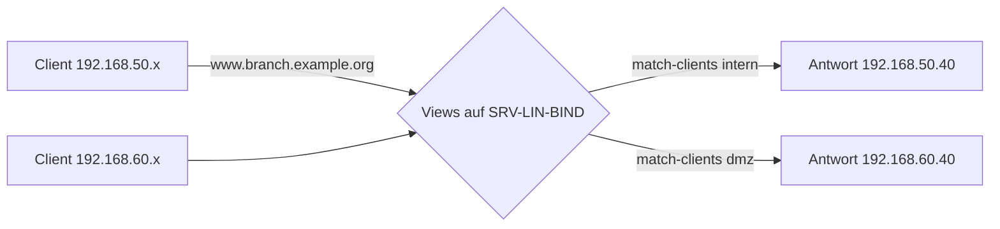

# 09.1 Split-Brain-DNS mit BIND Views und Windows DNS Policies

| | |
|---|---|
| **Modul** | 09 Split-Brain-DNS (Split-Horizon), BIND Views und Windows DNS Policies |
| **Stufe** | Vertiefung |
| **Geschätzte Zeit** | 7 bis 9 Stunden (Schätzung; Lehrplan: 10 UE zu 45 Minuten = 7,5 Stunden) |
| **Werkzeuge** | Debian/Ubuntu mit BIND 9.18, `dig -b`, `rndc`, Windows Server mit DNS-Rolle (ab Windows Server 2016), PowerShell 5.1 |
| **Vorwissen** | Module 01 bis 08 abgeschlossen (Snapshot `m08-ende`) |

> [!WARNING]
> **Stand der Prüfung: Entwurf, BIND-Teil mit Testlauf.** Die View-Konfiguration, die Reihenfolge der Views, `rndc` mit Views und die Mitschnitte in `beispiele/` stammen aus einem **echten Lauf von BIND 9.18.39 auf Ubuntu 24.04**. Das zweite Subnetz wurde im Testlabor durch zusätzliche Adressen auf einer Schnittstelle simuliert (`dig -b` wählt die Quelladresse). **Der Windows-Teil (Adressen, Lauschadressen, DNS-Richtlinien) wurde nicht ausgeführt.** Das Skript `09.1-windows-dns-policy.ps1` ist auf Syntax geprüft (PowerShell 7.4.6), mit Attrappen probegelaufen, und die Parameter von `Add-DnsServerQueryResolutionPolicy` stimmen mit Microsoft Learn überein; die Cmdlets zum Entfernen (`Remove-DnsServerClientSubnet`, `-ZoneScope` bei `Remove-DnsServerResourceRecord`) und der Parameter `Set-DnsServerSetting -ListenAddresses` sind *nicht bestätigt*. Windows-Ausgaben und deutsche Oberflächentexte sind sinngemäß.

## Lernziele

Nach dieser Übung kannst du

- Split-Brain-DNS (Split-Horizon) erklären und Vor- und Nachteile gegeneinander abwägen,
- in BIND 9 mit `view` und `match-clients` unterschiedliche Antworten für verschiedene Quellnetze liefern und die Regel „alle Zonen in Views“ umsetzen,
- die Auswertungsreihenfolge (erster passender View) und die Folgen für `rndc` und Zonenübertragungen beschreiben,
- unter Windows Server mit Client-Subnetz, Zonenscope und Richtlinie dieselbe Aufgabe lösen.

## Voraussetzungen

- Labor mit allen drei VMs, Zustand: Snapshot `m08-ende`.
- BIND läuft mit `branch.example.org` (dynamisch, `/var/lib/bind`), den Sekundärzonen aus Modul 06, `partner.example.net` und `lab.internal`.
- `corp.example.com` ist auf SRV-WIN-DNS AD-integriert (Modul 08).
- Sicherungen anlegen, **bevor** du Konfigurationsdateien änderst (Teil 2).

## Grundbegriffe

| Begriff | Bedeutung |
|---|---|
| **Split-Brain / Split-Horizon** | Derselbe Name liefert je nach Quelle des Clients unterschiedliche Antworten. |
| **`view`** | BIND-Block, der einer Gruppe von Clients (`match-clients`) eine eigene Menge von Zonen zeigt. |
| **Zonenscope** | Windows: eine zusätzliche Datenmenge innerhalb einer Zone, in der Einträge abweichen dürfen. |
| **Client-Subnetz** | Windows: benanntes Netz, das in einer Richtlinie als Kriterium dient. |
| **Richtlinie (DNS Policy)** | Windows: verknüpft Kriterium (z. B. Client-Subnetz) mit einer Aktion (z. B. Antwort aus einem Zonenscope). |

## Testumgebung

Wie in den Modulen 01 bis 08. Neu: ein zweites Subnetz `192.168.60.0/24`, das ohne Router simuliert wird, indem jede VM eine zweite Adresse bekommt.

| Rechner | Adresse im Netz 1 | Adresse im Netz 2 |
|---|---|---|
| SRV-WIN-DNS | 192.168.50.10 | 192.168.60.10 |
| SRV-LIN-BIND | 192.168.50.11 | 192.168.60.11 |
| CLI-TEST-01 | 192.168.50.100 | 192.168.60.100 |



## Aufgabe

### Teil 1: Zweites Subnetz vorbereiten

*(Lerneinheit 9.1, Praxisaufgabe 1)*

**Konzept (9.1):** Ein Mailserver oder Webserver soll intern unter seiner privaten Adresse (RFC 1918) und für Gäste oder die DMZ unter einer anderen Adresse erreichbar sein, ohne dass die Clients zwei Namen kennen müssen. Zwei Architekturen: **getrennte Server** (einer intern, einer extern; einfach zu überblicken, doppelter Pflegeaufwand) oder **Views/Policies auf einem Server** (eine Software, mehrere Sichten; Fehlkonfiguration kann interne Daten nach außen preisgeben).

**1. Adressen hinzufügen**

- **Windows (SRV-WIN-DNS, CLI-TEST-01):**

```powershell
.\09.1-windows-zweites-subnetz.ps1 -InterfaceAlias Ethernet -IPAddress 192.168.60.10 -WhatIf
.\09.1-windows-zweites-subnetz.ps1 -InterfaceAlias Ethernet -IPAddress 192.168.60.10
```

  Auf CLI-TEST-01 entsprechend `192.168.60.100`. Der Schnittstellenname `Ethernet` ist ein Beispiel (`Get-NetAdapter`).
- **GUI:** Adaptereigenschaften → *Internetprotokoll Version 4* → *Erweitert…* → *IP-Adressen* → *Hinzufügen*. Die Bezeichnungen sind *nicht bestätigt*.
- **Linux (SRV-LIN-BIND), vorübergehend:**

```bash
ip -br addr
sudo ip addr add 192.168.60.11/24 dev <schnittstelle>
```

  Dauerhaft in der Netzplan-Datei unter `/etc/netplan/` eine zweite Adresse bei `addresses:` ergänzen und `sudo netplan apply` ausführen (im Testlabor nicht ausgeführt). Die Reihenfolge ist wichtig: `192.168.50.11/24` bleibt die erste Adresse.

**2. Dienst für das zweite Subnetz öffnen**

Ohne diesen Schritt werden Abfragen aus dem zweiten Subnetz nicht beantwortet.

- **Windows (Lauschadresse):** DNS-Manager → Server → *Eigenschaften* → Reiter *Schnittstellen* → die Adresse `192.168.60.10` ergänzen; oder in PowerShell `Set-DnsServerSetting -ListenAddresses 192.168.50.10,192.168.60.10` (Parametername *nicht bestätigt*).
- **BIND:** In `/etc/bind/named.conf.options` (Vorlage: `09.1-named.conf.options-ausschnitt`) `192.168.60.11;` in `listen-on` ergänzen, die ACL `dmz-net { 192.168.60.0/24; };` anlegen und `allow-query { lab-nets; dmz-net; };` setzen:

```bash
sudo named-checkconf
sudo rndc reload
dig -b 192.168.60.100 @192.168.60.11 www.branch.example.org A +short
```

Diese Erweiterungen bleiben auch nach den Bereinigungen dieses Moduls bestehen. `allow-recursion { lab-nets; };` verhindert bereits jetzt, dass die DMZ rekursive Abfragen stellen darf; Modul 10 behandelt das ausführlich.

**3. Ausgangslage messen**

Ohne Views bekommen beide Netze dieselbe Antwort (`beispiele/01-ohne-views.md`): `www.branch.example.org` → `web.branch.example.org.` → `192.168.50.40`. Auf CLI-TEST-01:

```powershell
Resolve-DnsName www.branch.example.org -Server 192.168.50.11 -Type A -DnsOnly
Resolve-DnsName www.branch.example.org -Server 192.168.60.11 -Type A -DnsOnly
```

Beide Abfragen liefern zunächst `192.168.50.40`. Welche Quelladresse Windows verwendet, entscheidet es nach der Routing-Tabelle; für einen sauberen Test sollte die zweite Abfrage aus dem Netz `.60` stammen (auf Windows nicht zuverlässig steuerbar; siehe Hinweis in Teil 2).

### Teil 2: Views in BIND

*(Lerneinheit 9.2, Praxisaufgabe 2; im Testlauf ausgeführt)*

**1. Sicherungen**

```bash
sudo mkdir -p /root/bak-modul09
sudo cp -p /etc/bind/named.conf.local /etc/bind/named.conf.default-zones /etc/bind/named.conf.options /root/bak-modul09/
```

**2. Die Regel: alle Zonen in Views**

Sobald eine `view`-Klausel existiert, muss **jede** Zone in einer View stehen. In `named.conf` (Debian/Ubuntu) werden `named.conf.options`, `named.conf.local` und `named.conf.default-zones` eingebunden. Die Standardzonen stehen in der dritten Datei außerhalb jeder View. Deshalb wird deren Inhalt durch einen Kommentar ersetzt (Vorlage: `09.1-named.conf.default-zones-leer`) und die Zonen stehen im View `internal`.

**3. Views einrichten**

Kopiere `09.1-named.conf.local-views` nach `/etc/bind/named.conf.local` und `09.1-db.branch.example.org.dmz` nach `/etc/bind/db.branch.example.org.dmz`. Beide Views im Überblick:

```text
view "internal" {
    match-clients { 192.168.50.0/24; 127.0.0.0/8; fd00:50::/64; ::1/128; };
    recursion yes;
    …alle Zonen aus den Modulen 3 bis 8 …
};

view "dmz" {
    match-clients { 192.168.60.0/24; };
    allow-recursion { none; };
    zone "branch.example.org" {
        type primary;
        file "/etc/bind/db.branch.example.org.dmz";
    };
};
```

Der Schlüssel `ddns-key` bleibt mit `include` **außerhalb** der Views (Schlüssel sind global). Die dynamische Zone `branch.example.org` bleibt im View `internal` (mit `allow-update` und Pfad `/var/lib/bind`). Die DMZ-Sicht ist bewusst klein und nicht dynamisch; `www` ist ein CNAME auf `web`, deshalb ändert sich in der DMZ-Datei der Eintrag `web`.

```bash
sudo named-checkzone branch.example.org /etc/bind/db.branch.example.org.dmz
sudo named-checkconf
sudo rndc reload
```

> **Hinweis:** `recursion no;` zusammen mit dem globalen `allow-recursion` meldet `named-checkconf` als Widerspruch (so gemessen: `both "recursion no;" and "allow-recursion" active for view dmz`). Die Vorlage setzt daher im DMZ-View `allow-recursion { none; };`.

**4. Testen**

```bash
dig -b 192.168.50.100 +short @192.168.50.11 www.branch.example.org A
dig -b 192.168.60.100 +short @192.168.60.11 www.branch.example.org A
bash 09.1-split-pruefen.sh views
```

`dig -b` setzt die Quelladresse. Voraussetzung: Sie liegt auf dem prüfenden Rechner. Von CLI-TEST-01 aus:

```powershell
Resolve-DnsName www.branch.example.org -Server 192.168.50.11 -Type A -DnsOnly
Resolve-DnsName www.branch.example.org -Server 192.168.60.11 -Type A -DnsOnly
```

Welche Quelladresse Windows für die zweite Abfrage nimmt, hängt von der Routing-Tabelle ab: Ohne Router liegen beide Adressen im selben Segment, und Windows wählt die Quelladresse nach eigener Regel. Prüfe sie mit `Get-NetIPAddress` und notiere, was beim Test tatsächlich ankommt (im Log von BIND mit `rndc querylog on`, siehe Modul 11, steht die Quelladresse). Verlässlich ist der Test mit `dig -b` von einem Linux-Rechner.

Erwartet (so gemessen, `beispiele/02-mit-views.md`):

| Abfrage | Antwort |
|---|---|
| `www.branch.example.org` aus `.50.100` an `.50.11` | `web.branch.example.org.` → `192.168.50.40` |
| `www.branch.example.org` aus `.60.100` an `.60.11` | `web.branch.example.org.` → `192.168.60.40` |
| `linserver.branch.example.org AAAA` aus der DMZ | leer (die DMZ-Datei enthält keinen AAAA-Eintrag) |
| `corp.example.com SOA` aus der DMZ | `REFUSED` (Zone gibt es im DMZ-View nicht, keine Rekursion) |
| `www.example.org A` aus der DMZ | `REFUSED` (Rekursion verboten) |
| `corp.example.com SOA` aus `.50.100` an die Adresse `.60.11` | normale Antwort (maßgeblich ist die **Quell**-, nicht die Zieladresse) |

**5. Reihenfolge: der erste passende View gewinnt**

Passt eine Quelladresse zu mehreren Views, nimmt BIND den **ersten** in der Konfigurationsdatei. Test: Setze beim View `dmz` `match-clients { 192.168.0.0/16; };`. Steht `dmz` hinter `internal`, bekommt `192.168.50.100` die interne Antwort (`192.168.50.40`); steht `dmz` davor, bekommt dasselbe System die DMZ-Antwort (`192.168.60.40`) (so gemessen, `beispiele/04-reihenfolge-der-views.md`). Spezifische Views gehören deshalb nach oben, allgemeine nach unten.

**6. Folgen im Betrieb**

- `rndc` braucht jetzt die Sicht: `sudo rndc freeze branch.example.org` scheitert mit `zone 'branch.example.org' was found in multiple views`. Richtig: `sudo rndc freeze branch.example.org IN internal` und `sudo rndc thaw branch.example.org IN internal` (so gemessen, `beispiele/03-rndc-mit-views-und-transfer.md`).
- Die Zone zählt als zwei getrennte Zonen: Seriennummer und Datei der DMZ-Sicht pflegst du getrennt von Hand.
- Die Zonenübertragung an `192.168.50.10` läuft weiter, weil dessen Quelladresse zum View `internal` gehört (Log: `view internal: transfer of 'branch.example.org/IN': AXFR started`). Ein Sekundärserver in der DMZ bekäme dagegen die DMZ-Sicht.
- `nsupdate` mit dem Schlüssel funktioniert unverändert gegen den View `internal`.

**7. Bereinigung (wichtig für die Module 10 bis 12)**

```bash
sudo cp -p /root/bak-modul09/named.conf.local /root/bak-modul09/named.conf.default-zones /etc/bind/
sudo rm -f /etc/bind/db.branch.example.org.dmz
sudo named-checkconf
sudo rndc reload
bash 09.1-split-pruefen.sh ohne
```

Die Änderungen an `named.conf.options` aus Teil 1 bleiben. Danach liefern beide Netze wieder `192.168.50.40` (`beispiele/05-nach-rueckkehr.md`). Alternativ darfst du den View `internal` als Arbeits-View behalten, wenn alle Zonen darin geführt werden; dann gelten für alle weiteren Befehle die Hinweise aus Punkt 6.

### Teil 3: DNS-Richtlinien unter Windows

*(Lerneinheit 9.3, Praxisaufgabe 3; nicht ausgeführt, siehe Warnhinweis)*

Eine Windows-Split-Brain-Konfiguration besteht aus drei Bausteinen: einem **Client-Subnetz** (oder einer Server-Schnittstelle) als Kriterium, einem **Zonenscope** mit den abweichenden Einträgen und einer **Richtlinie**, die beides verknüpft.

**1. Einrichten**

```powershell
Add-DnsServerClientSubnet -Name "DMZ-Subnet" -IPv4Subnet "192.168.60.0/24"
Add-DnsServerZoneScope -ZoneName "corp.example.com" -Name "DMZ-Scope"
Add-DnsServerResourceRecord -ZoneName "corp.example.com" -A -Name "files" -IPv4Address "192.168.50.20"
Add-DnsServerResourceRecord -ZoneName "corp.example.com" -ZoneScope "DMZ-Scope" -A -Name "files" -IPv4Address "192.168.60.20"
Add-DnsServerQueryResolutionPolicy -Name "DMZ-Policy" -Action ALLOW -ClientSubnet "eq,DMZ-Subnet" -ZoneScope "DMZ-Scope,1" -ZoneName "corp.example.com"
```

Alles in einem Zug, mit Vorabprüfung:

```powershell
.\09.1-windows-dns-policy.ps1 -WhatIf
.\09.1-windows-dns-policy.ps1
```

> **Hinweis für das Fachlektorat:** Der Lehrplan legt nur den Eintrag im Scope `DMZ-Scope` an. Soll die Abfrage über `192.168.50.10` ein Ergebnis liefern, braucht `files` auch einen Eintrag im **Standard-Scope** (hier `192.168.50.20`); das Skript legt ihn an. Zusätzlich steht in Microsoft Learn: Die Richtlinie braucht für den Standard-Scope keine eigene Regel, Aging/Scavenging und dynamische Updates funktionieren nur im Standard-Scope, und Richtlinien werden **nicht** über Active Directory repliziert, sondern liegen nur auf dem lokalen Server. Der Wert `1` in `"DMZ-Scope,1"` ist das Gewicht des Scopes.

**2. Prüfen (von DMZ-Adresse)**

```powershell
Resolve-DnsName files.corp.example.com -Server 192.168.50.10 -Type A -DnsOnly
Resolve-DnsName files.corp.example.com -Server 192.168.60.10 -Type A -DnsOnly
```

Erwartet: `192.168.50.20` bzw. `192.168.60.20`. Die Richtlinie entscheidet nach der **Quelladresse** des Clients (Kriterium `ClientSubnet`). Die Zieladresse (`.50.10` oder `.60.10`) spielt für diese Richtlinie keine Rolle. Damit der zweite Test wirklich aus dem Netz `.60` kommt, ist (wie in Teil 2) die Quelladresse zu beachten. Alternativ kannst du die Richtlinie über die Server-Schnittstelle bilden (`-ServerInterfaceIP "eq,192.168.60.10"`, Beispiel in der Microsoft-Dokumentation zu Split-Brain; im Lehrplan nicht verlangt).

**3. Bereinigung**

```powershell
.\09.1-windows-dns-policy.ps1 -Entfernen -WhatIf
.\09.1-windows-dns-policy.ps1 -Entfernen
```

Das entfernt Richtlinie, Scope-Eintrag, Scope und Client-Subnetz. Mit `-AuchStandardEintrag` verschwindet auch `files` im Standard-Scope. Danach liefert die Standardauflösung für alle Clients dasselbe Ergebnis.

## Hintergrund

### Vor- und Nachteile von Split-Brain

Vorteile: ein Name für alle, interne Adressen werden nicht nach außen getragen, kein Hairpin-Verkehr über die Firewall. Nachteile: zwei Datenbestände müssen konsistent gepflegt werden, Fehlersuche wird schwieriger („bei mir geht es“), und eine falsche `match-clients`-Regel kann interne Daten preisgeben.

### Views sind nicht nur Zonensichten

Ein View hat eigene Optionen (Rekursion, Weiterleitungen). Nach der BIND-Dokumentation führt jeder View außerdem einen eigenen Cache (im Testlauf nicht geprüft).

## Hinweise

- Teste Views immer mit `dig -b <Quelladresse>`, nie nur mit der Zieladresse.
- Nach Änderungen an Views immer `named-checkconf`, erst dann `rndc reload`.
- Die DMZ-Sicht darf nur enthalten, was für Gäste bestimmt ist. Prüfe mit einer Abfrage nach einer internen Zone, dass sie `REFUSED` liefert.
- Snapshot `m09-ende` nach der Bereinigung.

## Prüfbefehle

```bash
sudo named-checkconf
bash 09.1-split-pruefen.sh views
dig -b 192.168.60.100 @192.168.60.11 corp.example.com SOA +noall +comments
sudo rndc zonestatus branch.example.org IN dmz
```

```powershell
Get-DnsServerClientSubnet
Get-DnsServerZoneScope -ZoneName corp.example.com
Get-DnsServerQueryResolutionPolicy -ZoneName corp.example.com
Resolve-DnsName files.corp.example.com -Server 192.168.60.10 -Type A -DnsOnly
```

**Kontrollfragen**

1. Welche zwingende Konfigurationsregel gilt in BIND 9, sobald Sie in der `named.conf` auch nur einen einzigen `view`-Block definieren?
2. Wie entscheidet BIND 9, welcher `view` für eine eingehende Client-Anfrage herangezogen wird, wenn die Quell-IP-Adresse des Clients theoretisch auf die `match-clients`-Liste von zwei verschiedenen Views passt?
3. Aus welchen drei logischen Bausteinen setzt sich eine Split-Brain-Konfiguration auf Basis von Windows Server DNS Policies zusammen?

## Erweiterungen

- Im DMZ-View `recursion yes;` mit einem eigenen `forwarders`-Eintrag probieren und beobachten, wie sich der Cache je View unterscheidet (`rndc dumpdb -cache` nennt die Views).
- Einen dritten View `"gast"` für `192.168.70.0/24` hinzufügen und die Reihenfolge prüfen.
- Statt `match-clients` mit `match-destinations` arbeiten (Auswahl nach Zieladresse) und das Ergebnis mit Teil 2, Punkt 4 vergleichen (Dokumentation: ARM).
- Die Richtlinie unter Windows über die Server-Schnittstelle (`-ServerInterfaceIP`) statt über das Client-Subnetz bilden und die Unterschiede notieren.
- Mit `rndc querylog on` verfolgen, welche Quelladresse Windows tatsächlich benutzt (siehe Modul 11).

## Musterlösung

<details>
<summary>Musterlösung anzeigen</summary>

### Teil 1

Ohne Views liefern beide Adressen `192.168.50.40`; `09.1-split-pruefen.sh ohne` meldet „alles in Ordnung“.

### Teil 2

Mit Views: intern `192.168.50.40`, DMZ `192.168.60.40`; die DMZ bekommt `REFUSED` für `corp.example.com` und für Rekursion. `rndc freeze` ohne Angabe des Views scheitert mit `found in multiple views`.

### Teil 3

Kontrollwerte: `192.168.50.20` (Standard-Scope) bzw. `192.168.60.20` (DMZ-Scope); `Get-DnsServerQueryResolutionPolicy` zeigt `DMZ-Policy`. Nach der Bereinigung liefert `files` nur noch den Standardwert bzw. ist entfernt. (Windows-Ausgaben nicht bestätigt.)

### Antworten auf die Kontrollfragen

1. Alle Zonen müssen innerhalb von Views liegen. Eine Zone außerhalb einer View ist ein Konfigurationsfehler (`named-checkconf` bzw. der Start melden ihn). Deshalb müssen auch Standardzonen wie `localhost` und `.` in einen View.
2. Die Views werden in der Reihenfolge der Konfigurationsdatei geprüft. Der **erste** View, dessen `match-clients` (und gegebenenfalls `match-destinations`) die Anfrage trifft, wird verwendet; die übrigen werden nicht mehr betrachtet (so gemessen: Vertauschen der Reihenfolge ändert die Antwort für dieselbe Quelladresse).
3. Client-Subnetz (Kriterium; alternativ Server-Schnittstelle), Zonenscope (abweichende Einträge) und Richtlinie (Verknüpfung, Aktion ALLOW mit Scope und Gewicht).

</details>

## Aufräumen und Rückkehr zum Ausgangszustand

- BIND: Sicherungen zurückspielen (Teil 2, Punkt 7), `db.branch.example.org.dmz` löschen. `named.conf.options` behält die Änderungen aus Teil 1.
- Windows: `09.1-windows-dns-policy.ps1 -Entfernen`. Die zusätzlichen Adressen im Netz 192.168.60.0/24 bleiben bestehen.
- Snapshot `m09-ende` auf allen drei VMs.

## Quellen

- Microsoft Learn: *Use DNS Policy for Split-Brain DNS Deployment* und *… in Active Directory*: <https://learn.microsoft.com/windows-server/networking/dns/deploy/split-brain-dns-deployment>, <https://learn.microsoft.com/windows-server/networking/dns/deploy/dns-sb-with-ad>
- Microsoft Learn: *Add-DnsServerQueryResolutionPolicy*: <https://learn.microsoft.com/powershell/module/dnsserver/add-dnsserverqueryresolutionpolicy>
- Microsoft Learn: *Remove-DnsServerZoneScope*: <https://learn.microsoft.com/powershell/module/dnsserver/remove-dnsserverzonescope>
- RFC 1918 (private Adressräume): <https://datatracker.ietf.org/doc/html/rfc1918>
- ISC: *BIND 9 Administrator Reference Manual*, `view`, `match-clients`, `rndc` : <https://bind9.readthedocs.io/>
- Eigene Messungen mit BIND 9.18.39 auf Ubuntu 24.04
