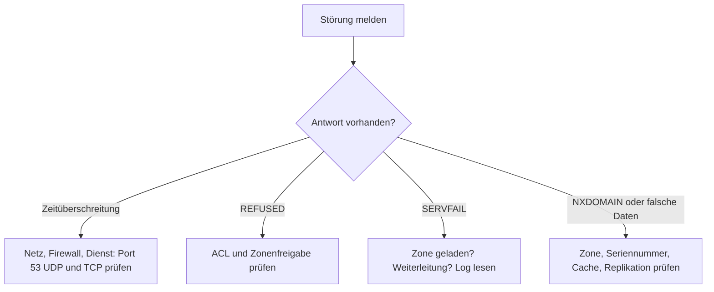

# 11.1 Systematische Fehlersuche, Diagnose und Monitoring (Windows und Linux)

| | |
|---|---|
| **Modul** | 11 Systematische Fehlersuche, Diagnose und Monitoring (Windows & Linux) |
| **Stufe** | Pflicht |
| **Geschätzte Zeit** | 7 bis 9 Stunden (Schätzung; Lehrplan: 10 UE zu 45 Minuten = 7,5 Stunden) |
| **Werkzeuge** | `nslookup`, `dig`, PowerShell `Resolve-DnsName`, `rndc`, `tcpdump`, Windows-Ereignisanzeige, Debian/Ubuntu mit BIND 9.18, Windows Server mit DNS-Rolle |
| **Vorwissen** | Module 01 bis 10 abgeschlossen (Snapshot `m10-ende`) |

> [!WARNING]
> **Stand der Prüfung: Entwurf, BIND-Teil mit Testlauf.** Alle `dig`-, `rndc`-, Log- und `tcpdump`-Mitschnitte in `beispiele/` stammen aus einem **echten Lauf von BIND 9.18.39 auf Ubuntu 24.04**. Im Testlabor spielte eine zweite BIND-Instanz die Rolle von `SRV-WIN-DNS` (Adresse 192.168.50.10); **die Windows-Ausgaben stammen daher nicht von Windows.** Die Szenarien B und C und die Sperre von TCP 53 (Szenario A, mit `iptables` statt Windows-Firewall) wurden real nachgestellt. **Nicht ausgeführt** wurden: alle Windows-Befehle, `journalctl` (im Testlabor gibt es kein `systemd`) und AppArmor. Die Parameter von `Set-DnsServerDiagnostics` stimmen mit Microsoft Learn überein; `Resolve-DnsName`-Parameter und das Ereignisprotokoll `DNS Server` stammen aus dem Lehrplan, der analytische Kanal ist *nicht bestätigt*. Das Verhalten bei **Weiterleitungsschleifen wurde nicht gemessen**. Windows-Ausgaben und deutsche Oberflächentexte sind sinngemäß.

## Lernziele

Nach dieser Übung kannst du

- `nslookup`, `Resolve-DnsName` und `dig` gezielt einsetzen und die Abschnitte einer DNS-Antwort lesen,
- Protokollierung unter Windows (Ereignisprotokoll, Debug-Protokoll) und BIND (`logging`-Block, `rndc querylog`) einschalten und auswerten,
- DNS-Verkehr mit `tcpdump` mitschneiden,
- typische Störungen (TCP 53 gesperrt, Seriennummer nicht erhöht, `REFUSED`) nach einem festen Schema eingrenzen und beheben.

## Voraussetzungen

- Labor mit allen drei VMs, Zustand: Snapshot `m10-ende`.
- `tcpdump` auf `SRV-LIN-BIND` (`sudo apt install tcpdump`).
- Sicherungen anlegen, **bevor** du Dateien änderst (jeweils im Teil genannt).

## Grundbegriffe

| Begriff | Bedeutung |
|---|---|
| **Header-Flags** | `qr` Antwort, `aa` autoritativ, `rd` Rekursion gewünscht, `ra` Rekursion verfügbar, `tc` abgeschnitten. |
| **Status** | `NOERROR`, `NXDOMAIN` (Name existiert nicht), `SERVFAIL` (Server konnte nicht antworten), `REFUSED` (Server verweigert). |
| **`+norecurse`** | `dig` setzt `rd` nicht: Der Server soll nur aus eigenen Daten und seinem Cache antworten. |
| **Query-Log** | Protokoll jeder eingehenden Anfrage. Erzeugt viel Daten, deshalb nur zeitweise. |
| **Seriennummer (SOA)** | Sekundäre Server übertragen nur, wenn sie kleiner als die des Primären ist. |

## Testumgebung

Wie in den Modulen 01 bis 10. Im Testlabor liefen beide Server auf einem Rechner; dein Labor hat drei VMs, die Befehle ändern sich nur durch die Adressen.



## Aufgabe

### Teil 1: Abfragewerkzeuge und Antwortanalyse (11.1)

**1. Eine Antwort Zeile für Zeile lesen**

```bash
dig @192.168.50.10 files.corp.example.com A +norecurse
dig @192.168.50.10 -x 192.168.50.10
```

Der Mitschnitt in `beispiele/01-dig-norecurse-header.txt` (Server: im Testlabor ein Ersatz für `SRV-WIN-DNS`) zeigt:

- **HEADER:** `status: NOERROR`, `flags: qr aa ra`, `ANSWER: 1, AUTHORITY: 2, ADDITIONAL: 3`. `aa` bedeutet, der Server ist für die Zone zuständig.
- **QUESTION:** Name, Klasse `IN`, Typ `A`.
- **ANSWER:** `files.corp.example.com. 3600 IN A 192.168.50.20`.
- **AUTHORITY:** die Nameserver der Zone (`NS`).
- **ADDITIONAL:** deren Adressen (Klebe-Einträge, damit der Client nicht nachfragen muss).

Die Reverse-Abfrage (`beispiele/02-dig-reverse.txt`) fragt nach `10.50.168.192.in-addr.arpa` (Typ `PTR`): `dig -x` baut den Namen selbst.

**2. Unter Windows dasselbe mit `Resolve-DnsName`**

```powershell
Resolve-DnsName files.corp.example.com -Type A -Server 192.168.50.10 -NoRecursion -DnsOnly
Resolve-DnsName 10.50.168.192.in-addr.arpa -Type PTR -Server 192.168.50.10 -DnsOnly
```

`-DnsOnly` verwendet ausschließlich DNS, also weder die `hosts`-Datei noch LLMNR oder NetBIOS. Das Skript `11.1-windows-abfragen.ps1` führt vier Abfragen und die Auswertung des Ereignisprotokolls aus (nur lesend).

**3. `+norecurse` gegen einen Resolver**

```bash
sudo rndc flush
dig @192.168.50.11 testhost.lab.internal A +norecurse
dig @192.168.50.11 testhost.lab.internal A
dig @192.168.50.11 testhost.lab.internal A +norecurse
```

Gemessen (`beispiele/03-norecurse-vs-rekursiv.txt`): Die erste Abfrage ist leer (`ANSWER: 0`, `AUTHORITY: 13`, also die Root-Server als Verweis), die zweite liefert `192.168.50.120`, die dritte antwortet jetzt aus dem Cache. `+norecurse` fragt den Server also nur nach dem, was er schon weiß.

**4. `nslookup` interaktiv**

```text
nslookup
> server 192.168.50.10
> set type=MX
> branch.example.org
> set type=A
> set debug
> files.corp.example.com
> exit
```

`set debug` zeigt zusätzlich Frage, Antwort, Autorität und `ttl` (`beispiele/10-nslookup-interaktiv.txt`; der Mitschnitt stammt vom Linux-`nslookup`, die Windows-Ausgabe weicht im Layout ab).

**5. `dig +trace`**

`dig +trace branch.example.org` verfolgt die Auflösung von den Root-Servern aus. Das Testlabor hat **kein Internet**, daher ist der Befehl dort nicht gelaufen. In deinem Labor funktioniert `+trace` nur, wenn die Root-Server erreichbar sind; sonst bricht er nach der ersten Stufe ab.

### Teil 2: Logging und Diagnose unter Windows (11.2)

*Alle Befehle auf `SRV-WIN-DNS`, PowerShell als Administrator. Dieser Teil wurde nicht ausgeführt.*

**1. Ereignisprotokoll**

Ereignisanzeige: *Anwendungs- und Dienstprotokolle → Microsoft → Windows → DNS-Server* (Anzeigename je Sprache; im Lehrplan `Applications and Services Logs -> DNS Server`). Mit PowerShell:

```powershell
Get-WinEvent -LogName 'DNS Server' -MaxEvents 20 | Format-Table TimeCreated, Id, LevelDisplayName -AutoSize
```

Das **analytische** Protokoll (`Microsoft-Windows-DNSServer/Analytical`) ist standardmäßig aus und liefert Abfragen mit geringerer Last als das Debug-Protokoll; Einschalten und Kanalname sind *nicht bestätigt* (Ereignisanzeige: Ansicht → Analyse- und Debugprotokolle anzeigen).

**2. Debug-Protokollierung einschalten**

```powershell
.\11.1-windows-debuglog.ps1 -Starten -WhatIf
.\11.1-windows-debuglog.ps1 -Starten
```

Das Skript ruft `Set-DnsServerDiagnostics` mit Datei `C:\DNS-Logs\dns-debug.log`, Rollover und den Optionen Abfragen/Antworten, UDP/TCP, Senden/Empfangen auf. Laut Dokumentation sind jeweils mindestens eine Option aus den Paaren *Senden/Empfangen*, *TCP/UDP*, *Benachrichtigungen/Aktualisierungen/Abfragen* und *Frage/Antwort* nötig, plus `FullPackets`. Oberfläche: Eigenschaften des DNS-Servers → Reiter *Debugprotokollierung*.

**3. Abfragen auslösen und auswerten**

Löse von `CLI-TEST-01` einige Abfragen aus (`Resolve-DnsName files.corp.example.com -Server 192.168.50.10`) und öffne die Datei. Die Datei ist Text mit einer Zeile pro Paket (Richtung, Protokoll, Typ, Name); das genaue Format ist nicht bestätigt.

**4. Ausschalten**

```powershell
.\11.1-windows-debuglog.ps1 -Beenden
```

Die Protokollierung kostet Leistung und Plattenplatz. Schalte sie nach dem Test aus und lösche die Datei.

### Teil 3: Logging unter BIND (11.3)

**1. Sicherung und Log-Verzeichnis**

```bash
sudo cp -a /etc/bind/named.conf /etc/bind/named.conf.m10
sudo mkdir -p /var/log/named
sudo chown bind:bind /var/log/named
```

**2. `logging`-Block einbinden**

Kopiere `11.1-named.conf.logging` nach `/etc/bind/named.conf.logging` und ergänze am Ende von `/etc/bind/named.conf`:

```text
include "/etc/bind/named.conf.logging";
```

Die Datei definiert vier Kanäle (`channel`) mit Datei, Größe und Rotation und ordnet ihnen Kategorien (`category`) zu: `queries`, `xfer-in`, `xfer-out`, `security`, `rate-limit` und `default` (zusätzlich zu `default_syslog`).

```bash
sudo named-checkconf
sudo rndc reconfig
ls -l /var/log/named
```

Unter Ubuntu kann AppArmor das Schreiben nach `/var/log/named/` verbieten (im Testlabor nicht geprüft); dann in `/etc/apparmor.d/local/usr.sbin.named` die Zeile `/var/log/named/** rw,` ergänzen und AppArmor neu laden.

> Im Testlabor lief die BIND-Instanz zuerst mit der Startoption `-g`. **`-g` erzwingt, dass alle Meldungen auf die Konsole gehen**, und überstimmt damit den `logging`-Block. Nach dem Start ohne `-g` landeten die Zeilen in den Dateien. Ein Dienst, der über `systemd` gestartet wird, läuft mit `-f` bzw. ohne `-g` und ist davon nicht betroffen.

**3. Query-Log zur Laufzeit ein- und ausschalten**

```bash
sudo rndc querylog on
dig @192.168.50.11 www.branch.example.org A +short
sudo rndc querylog off
sudo cat /var/log/named/queries.log
```

Ergebnis (`beispiele/04-querylog.txt`): Zeilen wie `client 192.168.50.100#35669 (testhost.lab.internal): query: testhost.lab.internal IN AAAA +E(0)K (192.168.50.11)`. `+` bedeutet „Rekursion gewünscht“, `E(0)` EDNS Version 0, `K` Cookie (laut BIND-Dokumentation; die Zeichen wurden so im Testlauf beobachtet). Nach `rndc querylog off` erscheinen keine neuen Zeilen. Mit `rndc status` siehst du `query logging is ON` bzw. `OFF`.

**4. Auswertung mit `journalctl`**

Läuft `named` unter `systemd`, landen die Meldungen der Kategorie `default` im Journal:

```bash
sudo journalctl -u named --since "10 minutes ago" --no-pager
```

(Der Dienst heißt auf Ubuntu `named` bzw. `bind9`. Im Testlabor nicht ausgeführt.)

### Teil 4: Paketmitschnitt (11.4)

**1. Mitschnitt starten**

In einer zweiten Sitzung:

```bash
sudo tcpdump -i any port 53 -nn -vv
```

Auf `CLI-TEST-01` löst du Abfragen aus (`Resolve-DnsName www.branch.example.org -Server 192.168.50.11`). `-nn` verhindert die Auflösung von Namen und Ports, `-vv` zeigt viele Details.

**2. Mitschnitt lesen**

Ergebnis (`beispiele/08-tcpdump-udp.txt`, `beispiele/09-tcpdump-nxdomain.txt`):

```text
192.168.50.100.59187 > 192.168.50.11.53: 27809+ [1au] A? www.branch.example.org. (63)
192.168.50.11.53 > 192.168.50.100.59187: 27809* 2/0/1 CNAME web.branch.example.org., A 192.168.50.40 (113)
```

- Die Zahl `27809` ist die Transaktions-ID; Frage und Antwort tragen dieselbe.
- `+` = Rekursion gewünscht, `*` = autoritative Antwort.
- `2/0/1` = 2 Antwort-, 0 Autoritäts-, 1 Zusatzeintrag.
- Bei einem nicht vorhandenen Namen steht `NXDomain*`.
- Im Mitschnitt von `lo` meldet `tcpdump` teils `bad udp cksum`; das ist ein Artefakt der Prüfsummenberechnung auf der Loopback-Schnittstelle und kein Fehler.

### Teil 5: Troubleshooting-Labor (11.4)

Arbeite in jedem Szenario nach dem Schema: **1. Symptom messen, 2. Hypothese, 3. Beweis im Log oder Mitschnitt, 4. Fehler beheben, 5. Kontrollabfrage.**

**Szenario A: TCP 53 gesperrt (Zonentransfer scheitert)**

*Vorbereitung:* `SRV-LIN-BIND` ist Sekundär für `corp.example.com`.

1. Auf `SRV-WIN-DNS` TCP 53 eingehend sperren (PowerShell, nicht ausgeführt; Blockregeln haben Vorrang vor Erlaubnisregeln):

```powershell
New-NetFirewallRule -DisplayName "TEST-Blockiere-TCP53" -Direction Inbound -Protocol TCP -LocalPort 53 -Action Block
```

2. Auf `SRV-LIN-BIND`:

```bash
dig +time=3 +tries=1 @192.168.50.10 corp.example.com SOA +short
dig @192.168.50.10 corp.example.com AXFR
sudo rndc retransfer corp.example.com
sudo tail -n 5 /var/log/named/transfers.log
```

Gemessen im Testlabor (`beispiele/07-szenario-a-tcp53-gesperrt.txt`, Sperre mit `iptables ... REJECT --reject-with tcp-reset`): Die SOA-Abfrage über UDP gelingt, `dig ... AXFR` meldet `connection refused`, im Log steht `failed to connect: connection refused` und `Transfer status: connection refused`; `tcpdump` zeigt ein SYN, das sofort mit RST beantwortet wird. **Die Windows-Firewall verwirft Pakete in der Regel still**, dann siehst du stattdessen eine Zeitüberschreitung. Der Hinweis liegt in beiden Fällen darin, dass UDP funktioniert und nur TCP scheitert.

3. Regel entfernen und prüfen:

```powershell
Remove-NetFirewallRule -DisplayName "TEST-Blockiere-TCP53"
```

```bash
sudo rndc retransfer corp.example.com
sudo tail -n 3 /var/log/named/transfers.log
```

Erwartet: `Transfer status: success`.

**Szenario B: Seriennummer nicht erhöht**

*Vorbereitung:* `branch.example.org` ist dynamisch; Änderungen nur nach `rndc freeze`. Sicherung: `sudo cp -a /var/lib/bind/db.branch.example.org /var/lib/bind/db.branch.example.org.m11`.

1. Seriennummern vergleichen:

```bash
bash 11.1-serial-vergleichen.sh branch.example.org 192.168.50.11 192.168.50.10
```

2. Eintrag ändern, **ohne** die Seriennummer zu erhöhen:

```bash
sudo rndc freeze branch.example.org
sudo nano /var/lib/bind/db.branch.example.org      # web: 192.168.50.40 -> 192.168.50.41, Seriennummer lassen
sudo rndc thaw branch.example.org
sudo rndc reload branch.example.org
```

Gemessen (`beispiele/05-szenario-b-serial-nicht-erhoeht.txt`): Der Primär liefert sofort `192.168.50.41`, der Sekundär bleibt bei `192.168.50.40`; sein Log meldet `notify from 192.168.50.11: zone is up to date`. **`rndc reload` auf die dynamische Zone wird abgelehnt** (`'reload' failed: dynamic zone`); `rndc thaw` lädt die Zone selbst neu, ein zweites `reload` ist unnötig.

3. Fehler beheben: Seriennummer erhöhen (zwischen `freeze` und `thaw`), danach `bash 11.1-serial-vergleichen.sh ...`. Im Testlauf übernahm der Sekundär die Änderung wenige Sekunden nach dem `thaw`, weil BIND beim `thaw` eine Benachrichtigung (`NOTIFY`) sendet.

Auf `SRV-WIN-DNS` prüfst du den Stand mit `Get-DnsServerZone -Name branch.example.org` und `Resolve-DnsName web.branch.example.org -Server 192.168.50.10 -DnsOnly`; die Windows-Ausgabe ist nicht bestätigt.

4. Zurück zum Ausgangszustand: Eintrag wieder auf `192.168.50.40`, Seriennummer erneut erhöhen, `thaw`.

**Szenario C: `REFUSED` wegen fehlender ACL**

1. Sichern: `sudo cp -a /etc/bind/named.conf.options /etc/bind/named.conf.options.m11`.
2. In `acl "lab-nets"` die Zeile `192.168.50.0/24;` entfernen, `sudo named-checkconf`, `sudo rndc reload`.
3. Abfragen von `CLI-TEST-01`:

```powershell
Resolve-DnsName www.branch.example.org -Server 192.168.50.11
```

(Unter Windows meldet `Resolve-DnsName` einen Fehler wie „DNS-Server hat die Anfrage abgelehnt“ bzw. `DNS_ERROR_RCODE_REFUSED`; Wortlaut nicht bestätigt.) Mit `dig` siehst du `status: REFUSED` (`beispiele/06-szenario-c-refused.txt`).

4. Ursache im Log: Mit `rndc querylog on` steht die Anfrage im `queries.log`, in `security.log` steht `query 'www.branch.example.org/A/IN' denied`. Beides unterscheidet `REFUSED` (Zugriffsregel) von `SERVFAIL` (Serverproblem) und `NXDOMAIN` (Name fehlt).
5. Wiederherstellen und kontrollieren:

```bash
sudo cp -a /etc/bind/named.conf.options.m11 /etc/bind/named.conf.options
sudo named-checkconf && sudo rndc reload
dig @192.168.50.11 www.branch.example.org A +short
```

**Szenario D (nur Theorie): Endlosschleife bei Weiterleitungen**

Zeigt Server X auf Y und Y auf X weiter, kreisen Anfragen, bis ein Zeitlimit greift; der Client sieht Zeitüberschreitung oder `SERVFAIL`. Erkennen: mit `tcpdump` wiederholte, gleiche Anfragen zwischen den Servern; beheben: Weiterleitungen aufheben oder die Richtung festlegen. **Dieses Verhalten wurde im Testlabor nicht gemessen.**

## Hintergrund

### Schema für die Fehlersuche

1. **Wer fragt wen?** Client, Server, Name, Typ notieren.
2. **Antwortet der Server überhaupt?** UDP und TCP, `dig +time=3 +tries=1`.
3. **Welcher Status?** `NOERROR`, `NXDOMAIN`, `SERVFAIL`, `REFUSED` führen zu verschiedenen Ursachen.
4. **Autoritativ oder aus dem Cache?** `aa` im Header, `+norecurse`.
5. **Sind die Server synchron?** Seriennummern vergleichen.
6. **Beweis sichern:** Log oder Mitschnitt, dann erst ändern.

### Statuswerte im Vergleich

| Status | Typische Ursache | Wo nachsehen |
|---|---|---|
| `REFUSED` | ACL, Rekursion nicht erlaubt, Zone nicht freigegeben | `security.log`, `allow-query` |
| `SERVFAIL` | Zone nicht geladen, Weiterleitung ausgefallen, DNSSEC-Prüfung | Log, `rndc zonestatus` |
| `NXDOMAIN` | Name fehlt, falsche Zone, Replikation hinkt | Zone, Seriennummer |
| Zeitüberschreitung | Dienst/Firewall/Netz | `ss -ulpn`, `tcpdump` |

## Hinweise

- Query-Log und Debug-Protokoll nur zeitweise einschalten.
- Vor jeder Änderung sichern; die Änderung zurücknehmen und mit einer Kontrollabfrage belegen.
- Nach Szenario A die Firewall-Regel nicht vergessen.
- Snapshot `m11-ende` nach der Bereinigung.

## Prüfbefehle

```bash
sudo named-checkconf
sudo bash 11.1-bind-diagnose.sh branch.example.org
bash 11.1-serial-vergleichen.sh branch.example.org 192.168.50.11 192.168.50.10
sudo rndc status | grep "query logging"
```

```powershell
.\11.1-windows-abfragen.ps1
.\11.1-windows-debuglog.ps1
Get-NetFirewallRule -DisplayName "TEST-Blockiere-TCP53" -ErrorAction SilentlyContinue
```

**Kontrollfragen**

1. Ein DNS-Server beantwortet normale `A`- und `AAAA`-Anfragen von einem sekundären Server problemlos, aber die Zonenübertragung (`AXFR`) zwischen denselben beiden Servern schlägt mit einem Verbindungsfehler (Connection Reset / Timeout) fehl. Welche Netzwerkursache liegt hier am wahrscheinlichsten vor?
2. Welcher Parameter von `Resolve-DnsName` stellt sicher, dass bei der Fehlersuche weder die lokale `hosts`-Datei noch LLMNR oder NetBIOS verwendet werden, sondern ausschließlich eine reine DNS-Abfrage erfolgt?
3. Worin liegt der Unterschied im Antwortverhalten eines DNS-Servers, wenn Sie ihn mit `dig @server name +norecurse` abfragen, im Vergleich zu einer Standardabfrage mit `dig @server name`?
4. Wie können Sie in BIND 9 im laufenden Betrieb ohne Bearbeitung von Konfigurationsdateien die Protokollierung sämtlicher eingehender DNS-Abfragen vorübergehend ein- und wieder ausschalten?

## Erweiterungen

- Eine Abfrage über TCP erzwingen (`dig +tcp`) und im Mitschnitt den Verbindungsaufbau (SYN, SYN-ACK, ACK) und die Länge-Präfix-Nachricht ansehen.
- Mit `tcpdump -w dns.pcap` in eine Datei schreiben und mit Wireshark öffnen.
- Mit `rndc dumpdb -cache` den Cache auslesen (Datei `named_dump.db` im Arbeitsverzeichnis) und TTLs vergleichen.
- Mit `dig +dnssec` oder `+bufsize=512` abgeschnittene Antworten (`tc`) provozieren und `+tcp` als Rückfall beobachten.
- Das Windows-Debugprotokoll mit dem `tcpdump`-Mitschnitt derselben Abfragen vergleichen.

## Musterlösung

<details>
<summary>Musterlösung anzeigen</summary>

### Teil 1

`dig ... +norecurse` auf einen autoritativen Server liefert eine Antwort mit `aa`; auf einen Resolver ohne zwischengespeicherte Antwort ist `ANSWER` leer und `AUTHORITY` enthält die Root-Server. `dig -x` fragt den `PTR`-Namen unter `in-addr.arpa`.

### Teil 3 und 4

`rndc querylog on` schreibt die Anfragen in `queries.log`, `rndc querylog off` beendet das. `tcpdump` zeigt Frage und Antwort mit gleicher Transaktions-ID.

### Teil 5

A: UDP 53 geht, TCP 53 nicht; Transfer scheitert (`connection refused` bzw. Zeitüberschreitung), nach Entfernen der Regel `Transfer status: success`. B: Der Sekundär ignoriert die Änderung, weil die Seriennummer gleich blieb („zone is up to date“); nach dem Erhöhen übernimmt er sie. C: `REFUSED` mit `denied` im `security.log`, nach Wiederherstellen der ACL wieder Antwort.

### Antworten auf die Kontrollfragen

1. TCP 53 ist zwischen den Servern blockiert (Firewall oder Netzfilter). Normale Abfragen laufen über UDP 53, `AXFR` braucht immer TCP 53. Abhilfe: TCP 53 freigeben; Test mit `dig +tcp` und `AXFR`.
2. `-DnsOnly`.
3. Mit `+norecurse` (kein `rd`-Flag) beantwortet der Server nur aus eigenen Zonen und seinem Cache; ist die Antwort nicht bekannt, liefert er eine leere Antwort oder einen Verweis (Root-Server), statt selbst nachzufragen. Die Standardabfrage setzt `rd`; ein Resolver löst dann rekursiv auf und liefert die endgültige Antwort.
4. Mit `rndc querylog on` und `rndc querylog off` (Status mit `rndc status`).

</details>

## Aufräumen und Rückkehr zum Ausgangszustand

- Szenario A: Firewall-Regel `TEST-Blockiere-TCP53` entfernen und `rndc retransfer corp.example.com` prüfen.
- Szenario B: `web` zurück auf `192.168.50.40`, Seriennummer erhöhen, Sekundär vergleichen.
- Szenario C: `named.conf.options` aus der Sicherung zurück, `rndc reload`.
- Query-Log aus (`rndc querylog off`), Windows-Debugprotokoll aus (`-Beenden`), Datei löschen.
- Der `logging`-Block darf bleiben; ohne ihn `include` aus `named.conf` entfernen.
- Snapshot `m11-ende` auf allen drei VMs.

## Quellen

- Microsoft Learn: *Set-DnsServerDiagnostics*: <https://learn.microsoft.com/powershell/module/dnsserver/set-dnsserverdiagnostics>
- Microsoft Learn: *Resolve-DnsName*: <https://learn.microsoft.com/powershell/module/dnsclient/resolve-dnsname>
- Microsoft Learn: *New-NetFirewallRule*: <https://learn.microsoft.com/powershell/module/netsecurity/new-netfirewallrule>
- ISC: *BIND 9 Administrator Reference Manual*, `logging`, `rndc`: <https://bind9.readthedocs.io/>
- Manpages `dig(1)`, `tcpdump(8)`, `nslookup(1)`
- Eigene Messungen mit BIND 9.18.39 auf Ubuntu 24.04
