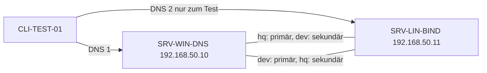

# 12.1 Abschlussprojekt: Hybride DNS-Infrastruktur AlpenTech (Windows und BIND 9)

| | |
|---|---|
| **Modul** | 12 Integriertes Abschlussprojekt: Hybride DNS-Infrastruktur (Windows & BIND 9) |
| **Stufe** | Vertiefung |
| **Geschätzte Zeit** | 5 bis 7 Stunden (Schätzung; Lehrplan: 8 UE zu 45 Minuten = 6 Stunden) |
| **Werkzeuge** | Windows Server mit DNS-Rolle (PowerShell 5.1), Debian/Ubuntu mit BIND 9.18, `dig`, `rndc`, `bash` |
| **Vorwissen** | Module 01 bis 11 abgeschlossen (Snapshot `m11-ende`) |

> [!WARNING]
> **Stand der Prüfung: Entwurf, BIND-Teil mit Testlauf.** Alle Mitschnitte in `beispiele/` stammen aus einem **echten Lauf von BIND 9.18.39 auf Ubuntu 24.04**. Im Testlabor spielte eine zweite BIND-Instanz die Rolle von `SRV-WIN-DNS` (Adresse 192.168.50.10); der **Ausfall** wurde durch Beenden dieser Instanz bzw. von `named` nachgestellt. **Die Windows-Schritte wurden nicht ausgeführt.** Die Skripte `12.1-windows-alpentech-einrichten.ps1` und `12.1-windows-client-ausfalltest.ps1` sind auf Syntax geprüft (PowerShell 7.4.6) und mit Attrappen probegelaufen; die Parameter der verwendeten Cmdlets stimmen mit Microsoft Learn überein, soweit in den Modulen 04 bis 08 geprüft. *Nicht bestätigt* sind: der Name `@` für Einträge am Zonenursprung, `dnscmd /ZoneResetSecondaries ... /NoXfr` und die Standardwerte der SOA-Felder auf deinem Windows-Server. **Eine Transferbeschränkung für eine sekundäre Windows-Zone lässt sich laut Microsoft Learn nicht mit `Set-DnsServerSecondaryZone` setzen** (der Parameter fehlt); das Skript weist darauf hin. Windows-Ausgaben und deutsche Oberflächentexte sind sinngemäß.

## Lernziele

Nach dieser Übung kannst du

- aus einem Projektbriefing eine kurze Anforderungsspezifikation mit Zonen, Zonentypen, Transferbeschränkungen und Testfällen schreiben,
- gegenseitig sekundäre Zonen zwischen Windows-DNS und BIND einrichten und Transfers auf die Partneradresse beschränken,
- Forward- und Reverse-Zonen (IPv4 und IPv6) mit allen Eintragstypen anlegen,
- die Konfiguration mit einem Abnahmeprotokoll prüfen, den Ausfall je eines Servers simulieren und eine kompakte Betriebsdokumentation schreiben.

## Voraussetzungen

- Labor mit allen drei VMs, Zustand: Snapshot `m11-ende`.
- Aus Modul 05 und 06: die Reverse-Zonen `50.168.192.in-addr.arpa` und `0.0.0.0.0.0.0.0.0.5.0.0.0.0.d.f.ip6.arpa` auf `SRV-WIN-DNS`; `50.168.192.in-addr.arpa` ist auf `SRV-LIN-BIND` sekundär, **die IPv6-Reverse-Zone noch nicht** (Teil 3).
- Aus Modul 10: `allow-transfer { none; };` in `named.conf.options`. Jede Zone braucht deshalb ihre eigene Freigabe.
- Sicherungen anlegen, **bevor** du Dateien änderst (Teil 3).

## Das Briefing: AlpenTech GmbH

Die fiktive **AlpenTech GmbH** hat einen Hauptsitz (Windows Active Directory und DNS, Zone `hq.alpentech.internal`) und einen Entwicklungsstandort (Linux, BIND 9, Zone `dev.alpentech.internal`). Beide Standorte sollen die Namen des jeweils anderen auflösen, und der Ausfall eines DNS-Servers darf Clients nicht beeinträchtigen. Im Labor liegen beide Standorte im Netz 192.168.50.0/24 bzw. fd00:50::/64.



## Testumgebung

Wie in den Modulen 01 bis 11. Die Zonen werden mit diesen Hosts gefüllt (nicht belegt in den früheren Modulen):

| Zone | Name | IPv4 | IPv6 |
|---|---|---|---|
| hq | `ns1`, `fs01`, `mail`, `erp` | .10, .51, .52, .53 | `fd00:50::` mit gleichem Hostteil |
| dev | `ns1`, `git`, `ci`, `build` | .11, .61, .62, .63 | `fd00:50::` mit gleichem Hostteil |

Dazu kommen `intranet` (Alias auf `fs01`) bzw. `wiki` (Alias auf `git`), `MX`, `TXT`, `SRV` und `PTR`.

## Aufgabe

### Teil 1: Anforderungsspezifikation (12.1)

Kopiere `12.1-vorlage-anforderungsspezifikation.md` und fülle sie aus, **bevor** du einrichtest. Sie muss enthalten:

- Zonen mit Zonentyp, Primär- und Partnerserver (Tabelle in Abschnitt 3 der Vorlage),
- die Einträge (mindestens je Zone drei `A`, drei `AAAA`, ein `CNAME`, ein `MX`, ein `TXT`, ein `SRV`; zu jeder Adresse ein `PTR`),
- die Transferbeschränkungen (nur an die Partneradresse),
- die Testfälle T1 bis T7.

**Entwurfsentscheidungen, die du begründen kannst:**

- Es gibt **eine** IPv4- und **eine** IPv6-Reverse-Zone. Beide gehören `SRV-WIN-DNS` (Primär); `SRV-LIN-BIND` hält Kopien. Die PTR-Einträge für `git`, `ci` und `build` werden deshalb **auf Windows** angelegt.
- Die Adressen `.10` und `.11` behalten ihre PTR-Einträge aus Modul 05 (ein PTR pro Adresse).
- Die SOA-Werte bleiben die Standardwerte der jeweiligen Plattform; du trägst die tatsächlichen Werte in die Betriebsdokumentation ein.

### Teil 2: Windows-Seite einrichten (12.2)

*Auf `SRV-WIN-DNS`, PowerShell als Administrator. Nicht ausgeführt.*

```powershell
.\12.1-windows-alpentech-einrichten.ps1 -WhatIf
.\12.1-windows-alpentech-einrichten.ps1
```

Das Skript

1. legt die primäre Zone `hq.alpentech.internal` an (Datei, keine dynamischen Updates),
2. füllt sie (`A`, `AAAA`, `CNAME`, `MX`, `TXT`, `SRV`, `NS` für `ns1.dev.alpentech.internal`),
3. ergänzt PTR-Einträge in den beiden Reverse-Zonen (IPv6: 16 Nibbles Hostanteil, umgekehrt; siehe `12.1-ptr-ergaenzung.ip6.arpa`),
4. beschränkt Transfer und NOTIFY der Zone `hq` auf `192.168.50.11`,
5. legt die sekundäre Zone `dev.alpentech.internal` an und stößt den Transfer an.

Die Transferfreigabe der Reverse-Zonen setzte schon `06.1-windows-primaer-freigeben.ps1`. Prüfe sie:

```powershell
Get-DnsServerZone | Where-Object ZoneName -match 'alpentech|arpa' | Format-Table ZoneName, ZoneType, SecureSecondaries, SecondaryServers
```

**Transfer der sekundären Zone `dev` auf Windows beschränken:** `Set-DnsServerSecondaryZone` bietet dafür keinen Parameter. Über die Oberfläche: DNS-Manager → `dev.alpentech.internal` → Eigenschaften → Zonenübertragungen → *Zonenübertragungen zulassen* abwählen. Alternativ (*nicht bestätigt*): `dnscmd /ZoneResetSecondaries dev.alpentech.internal /NoXfr`.

### Teil 3: BIND-Seite einrichten (12.2)

**1. Sicherung**

```bash
sudo cp -a /etc/bind/named.conf.local /etc/bind/named.conf.local.m12
```

**2. Zonendatei für `dev`**

Kopiere `12.1-db.dev.alpentech.internal` nach `/etc/bind/db.dev.alpentech.internal` und prüfe:

```bash
sudo named-checkzone dev.alpentech.internal /etc/bind/db.dev.alpentech.internal
```

Die Meldung `MX 'mail.hq.alpentech.internal' (out of zone) has no addresses records` ist eine **Warnung**: `named-checkzone` kennt die fremde Zone nicht, der `MX` zeigt bewusst auf `mail.hq` (Ergebnis `OK`, `beispiele/06-pruefung-konfiguration.md`).

**3. Zonen eintragen**

Hänge den Inhalt von `12.1-named.conf.local-ergaenzung` an `/etc/bind/named.conf.local` an: `dev` als Primär (Transfer und NOTIFY nur an `192.168.50.10`), `hq` als Sekundär (`primaries { 192.168.50.10; };`) und die **IPv6-Reverse-Zone** als Sekundär. Letztere ist nötig, damit `SRV-LIN-BIND` auch bei Ausfall von Windows `PTR`-Abfragen für IPv6 beantwortet.

```bash
sudo named-checkconf
sudo rndc reconfig
sudo rndc retransfer hq.alpentech.internal
sudo rndc retransfer 0.0.0.0.0.0.0.0.0.5.0.0.0.0.d.f.ip6.arpa
sudo rndc zonestatus hq.alpentech.internal | grep -E "type|serial|next refresh|expires"
```

> **Falle aus der Erprobung:** Im Testlabor zeigte der Sekundär nach `rndc retransfer` zunächst die alte Seriennummer der IPv6-Reverse-Zone, weil die Primärzone die neu ergänzten PTR-Einträge noch nicht geladen hatte (Zonendatei von Hand geändert, Zone nicht neu geladen). Unter Windows erledigt das der DNS-Manager bzw. PowerShell selbst; prüfe bei einem alten Stand immer erst die Seriennummer **auf dem Primär** (`bash 11.1-serial-vergleichen.sh <zone> 192.168.50.10 192.168.50.11`).

### Teil 4: Abnahme (12.3)

**1. Abnahmetest**

```bash
bash 12.1-abnahme-pruefen.sh
```

Das Skript fragt beide Server nach allen 24 Vorwärts- und 12 Rückwärtseinträgen, nennt die Seriennummern und prüft, dass `AXFR` von der Quelladresse des Skripts aus gesperrt ist. Aus dem Testlabor (`SRC=192.168.50.100`, `beispiele/01-abnahme-beide-server.md`): *Bestanden: 76, Fehler: 0*.

Starte das Skript **nicht** von `192.168.50.10` oder `192.168.50.11` aus: Der Partner darf übertragen, das Skript meldet das dann als Fehler.

**2. Transferbeschränkung gezielt prüfen**

```bash
dig -b 192.168.50.100 @192.168.50.10 hq.alpentech.internal AXFR
dig -b 192.168.50.11  @192.168.50.10 hq.alpentech.internal AXFR
```

Erwartet: erste Abfrage `Transfer failed`, zweite überträgt die Zone. Außerdem übertragen die **Sekundärkopien** an niemanden (`beispiele/05-transfer-nur-an-partner.md`).

**3. Befüllen des Abnahmeprotokolls**

Kopiere `12.1-vorlage-abnahmeprotokoll.md` und trage Ergebnis und Beleg je Testfall ein.

### Teil 5: Hochverfügbarkeitstest (12.3)

**1. Zweiten DNS-Server auf `CLI-TEST-01` eintragen (nur für den Test)**

```powershell
.\12.1-windows-client-ausfalltest.ps1 -Beginn -WhatIf
.\12.1-windows-client-ausfalltest.ps1 -Beginn
.\12.1-windows-client-ausfalltest.ps1 -Pruefen
```

`-Pruefen` leert den Client-Cache und löst alle Einträge beider Zonen mit dem Standard-Resolver des Clients auf (erwartet: *Fehler: 0*). **`CLI-TEST-01` ist seit Modul 8 Domänenmitglied, `SRV-LIN-BIND` kennt die AD-`SRV`-Einträge nicht** (Modul 8, Kontrollfrage 2): lasse den zweiten Server nicht dauerhaft eingetragen.

**2. Ausfall von `SRV-WIN-DNS`**

Auf `SRV-WIN-DNS`:

```powershell
Stop-Service DNS
```

Auf `CLI-TEST-01` (Cache leeren, dann erneut prüfen):

```powershell
ipconfig /flushdns
.\12.1-windows-client-ausfalltest.ps1 -Pruefen
```

Im Testlabor (`beispiele/02-ausfall-windows.md`): Der beendete Server meldet `connection refused`, `SRV-LIN-BIND` beantwortet **alle 38 Prüfungen** allein, auch `PTR` für IPv4 und IPv6, weil auch die Reverse-Zonen sekundär vorliegen. Beachte: Ein Windows-Client wechselt nach einer Zeitüberschreitung zum zweiten Server; die Dauer dieser Umschaltung wurde nicht gemessen.

```powershell
Start-Service DNS
```

**3. Ausfall von `SRV-LIN-BIND`**

Auf `SRV-LIN-BIND`: `sudo systemctl stop named` (Dienstname je nach Distribution `named` oder `bind9`). Dann `bash 12.1-abnahme-pruefen.sh 192.168.50.10`: Windows beantwortet alle Einträge allein (`beispiele/03-ausfall-bind.md`, *Bestanden: 38*). Danach `sudo systemctl start named`.

**4. Bereinigung**

```powershell
.\12.1-windows-client-ausfalltest.ps1 -Ende
```

Das stellt nur `192.168.50.10` als DNS-Server auf `CLI-TEST-01` ein. Prüfe anschließend die Domänenanmeldung (Abmelden und Anmelden).

### Teil 6: Betriebsdokumentation (12.3)

Kopiere `12.1-vorlage-betriebsdokumentation.md` und trage deine tatsächlichen Werte ein: Zonen, Zonentypen, Primär-/Sekundär-Beziehungen, SOA-Parameter, Härtungsmaßnahmen, Betriebsabläufe, erste Schritte bei Störungen.

SOA-Werte liest du so:

```bash
dig +short @192.168.50.11 hq.alpentech.internal SOA
dig +short @192.168.50.11 dev.alpentech.internal SOA
```

```powershell
Get-DnsServerResourceRecord -ZoneName hq.alpentech.internal -RRType SOA
```

## Hintergrund

### Was „Expire“ bewirkt

Der Sekundärserver fragt den Primärserver in Abständen nach der Seriennummer (Refresh; bei Fehlschlag Retry). Gelingt das länger als **Expire**, gilt die Kopie als zu alt: Der Sekundär beendet die Auslieferung der Zone und antwortet mit `SERVFAIL`. Das schützt vor dem Ausliefern veralteter Daten.

**Im Testlauf gemessen** (`beispiele/04-expire-verhalten.md`, Testzone mit SOA 1 20 10 40 5): Solange der Primär erreichbar war, kam `NOERROR`. Nach Beenden des Primärs blieb es bis zum Ablauf von Expire bei `NOERROR`, danach kam `SERVFAIL`; das Log meldete `zone expiretest.alpentech.internal/IN: expired` und `query failed (zone not loaded)`.

**BIND setzt zu kurze Zeiten auf Mindestwerte hoch.** Mit den Standardwerten wurde `expires` im Test auf rund 13 Minuten statt 40 Sekunden berechnet. Für den Kurztest wurden in der Sekundärzone `min-refresh-time 5;` und `min-retry-time 5;` gesetzt. In deinem Betrieb sind das keine empfehlenswerten Werte.

### Wer antwortet im Notfall?

Ein Client nimmt den zweiten DNS-Server nur, wenn dieser **dieselben Namen** kennt. Darum muss jede interne Zone auf beiden Servern liegen (primär, sekundär oder über Weiterleitung). Das gilt auch für die Reverse-Zonen.

## Hinweise

- Alle Transfers brauchen TCP 53 (Modul 11, Szenario A).
- Nach jeder Änderung an `dev` die Seriennummer erhöhen (Modul 11, Szenario B).
- Der Abnahmetest ist nur so gut wie seine Erwartungswerte: Hast du eigene Namen gewählt, passe die Werte im Skript an.
- Snapshot `m12-ende` nach der Bereinigung.

## Prüfbefehle

```bash
sudo named-checkconf
bash 12.1-abnahme-pruefen.sh
bash 11.1-serial-vergleichen.sh dev.alpentech.internal 192.168.50.11 192.168.50.10
sudo rndc zonestatus hq.alpentech.internal | grep -E "type|serial|expires"
```

```powershell
Get-DnsServerZone | Where-Object ZoneName -match 'alpentech|arpa' | Format-Table ZoneName, ZoneType
.\12.1-windows-client-ausfalltest.ps1 -Pruefen
```

**Kontrollfragen**

1. Warum ist es für die Ausfallsicherheit eines Standorts entscheidend, dass Clients beide DNS-Server (`SRV-WIN-DNS` und `SRV-LIN-BIND`) in ihrer Netzwerkkonfiguration eingetragen haben (bei domänenverbundenen Clients nur, wenn beide Server auch die AD-Einträge auflösen können), und beide Server sämtliche internen Zonen (entweder primär, sekundär oder über redundante Weiterleitungen) auflösen können?
2. Welche Prüfschritte führen Sie vor der Übergabe einer neu eingerichteten DNS-Infrastruktur in den Produktivbetrieb durch, um sicherzustellen, dass sowohl die Zonensyntax als auch die Replikation und die Zugriffskontrolle fehlerfrei arbeiten?
3. Wie verhalten sich sekundäre Zonen auf `SRV-LIN-BIND`, wenn der primäre Server `SRV-WIN-DNS` länger ausfällt als die im SOA-Record definierte `Expire`-Zeitspanne?

## Erweiterungen

- Ein dritter Server als weiterer Sekundär (zusätzliche `allow-transfer`-Zeile, `also-notify`).
- `exempt-clients` oder Ausnahmeliste für Rate Limiting hinzufügen (Modul 10).
- Mit `rndc dumpdb -zones` den Zustand der Zonen auslesen.
- Das Abnahmeskript um die Prüfung der Seriennummern-Gleichheit als Fehlerbedingung erweitern.
- Dynamische Updates für `dev` mit TSIG-Schlüssel (Modul 8) und deren Wirkung auf Transfers.
- Ein `NS`-Eintrag und die zugehörige Adresse für einen dritten Standort.

## Musterlösung

<details>
<summary>Musterlösung anzeigen</summary>

### Teil 1

Die ausgefüllte Spezifikation entspricht den Tabellen in der Vorlage: hq primär auf Windows, dev primär auf BIND, gegenseitig sekundär, Transfer nur an die Partneradresse, Reverse-Zonen primär auf Windows mit Kopie auf BIND.

### Teil 2 bis 4

Referenzdateien: `12.1-db.hq.alpentech.internal`, `12.1-db.dev.alpentech.internal`, `12.1-ptr-ergaenzung.*`, `12.1-named.conf.local-ergaenzung`. `bash 12.1-abnahme-pruefen.sh` meldet *alles in Ordnung*; `AXFR` von fremden Adressen scheitert, vom Partner gelingt es nur beim Primär.

### Teil 5

Bei beendetem `SRV-WIN-DNS` löst `SRV-LIN-BIND` alle Einträge beider Zonen und die Reverse-Einträge auf, und umgekehrt. Nach `-Ende` steht nur `192.168.50.10` auf `CLI-TEST-01`.

### Antworten auf die Kontrollfragen

1. Der Client fragt nur dann einen zweiten Server, wenn der erste nicht antwortet. Hat er nur einen Server eingetragen, gibt es keinen Ausweg. Der zweite Server kann nur helfen, wenn er dieselben Namen kennt (Zone primär, sekundär oder per Weiterleitung). Bei domänenverbundenen Clients kommt hinzu, dass sie die AD-`SRV`-Einträge brauchen; kennt der zweite Server diese nicht, kann er die Anmeldung stören.
2. Zonensyntax: `named-checkconf` und `named-checkzone` (Windows: Zone lädt ohne Fehler im Ereignisprotokoll). Replikation: Seriennummern auf allen Servern vergleichen, Transfer mit `rndc retransfer` bzw. `Start-DnsServerZoneTransfer` auslösen und im Log prüfen. Zugriffskontrolle: `AXFR` von einer fremden Adresse (muss scheitern) und vom Partner (muss gelingen), rekursive Abfrage von außen (muss `REFUSED` liefern). Außerdem der Ausfalltest je Server und die Abnahme gegen die Spezifikation.
3. Sobald Expire überschritten ist, ohne dass der Sekundär den Primär erreicht, gilt die Zone als abgelaufen: `SRV-LIN-BIND` liefert sie nicht mehr aus und antwortet mit `SERVFAIL` (im Testlauf gemessen; Log: `expired`). Sobald der Primär wieder erreichbar ist, holt der Sekundär die Zone neu und antwortet wieder.

</details>

## Aufräumen und Rückkehr zum Ausgangszustand

- `CLI-TEST-01`: `.\12.1-windows-client-ausfalltest.ps1 -Ende`, Domänenanmeldung prüfen.
- Dienste auf beiden Servern wieder gestartet.
- Die AlpenTech-Zonen dürfen bleiben. Zum Entfernen: BIND: Zonenblöcke aus `named.conf.local` löschen (oder `named.conf.local.m12` zurückspielen), `rndc reconfig`; Windows: `Remove-DnsServerZone -Name hq.alpentech.internal -Force` (und `dev`), PTR-Einträge in den Reverse-Zonen entfernen.
- Snapshot `m12-ende` auf allen drei VMs.

## Quellen

- Microsoft Learn: *Add-DnsServerPrimaryZone*, *Add-DnsServerSecondaryZone*, *Set-DnsServerPrimaryZone*, *Set-DnsServerSecondaryZone*, *Add-DnsServerResourceRecord*: <https://learn.microsoft.com/powershell/module/dnsserver/>
- ISC: *BIND 9 Administrator Reference Manual*, `zone`, `allow-transfer`, `min-refresh-time`, `min-retry-time`: <https://bind9.readthedocs.io/>
- RFC 1035 (SOA-Felder Refresh, Retry, Expire), RFC 1912
- Eigene Messungen mit BIND 9.18.39 auf Ubuntu 24.04
